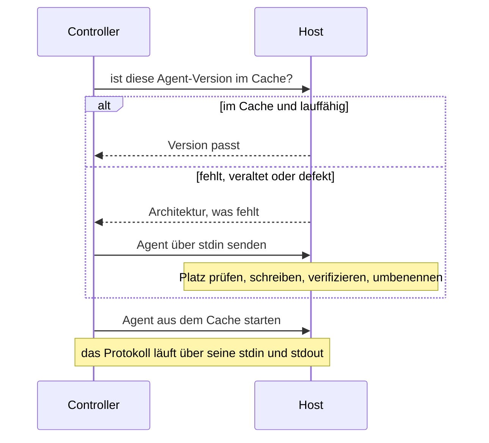

Volant legt auf jedem verwalteten Host ein kleines statisches Programm ab, den Agent, und spricht den Rest des Laufs über `ssh` mit ihm. [Verbindungen und become](/de/docs/hosts/connections/) behandelt, was Sie konfigurieren. Diese Seite behandelt, was darunter geschieht: den Upload, die Berechtigungsprüfungen, die geteilte Verbindung und die Dateideskriptoren, die sie kostet.

## Einen Host erreichen



Auf einem Host, der schon einmal lief, gehen Prüfung und Start in eine `ssh`-Sitzung: Der Befehl prüft das Verzeichnis, vergleicht den gecachten Agent mit dem Build, den dieser Controller für den Maschinentyp des Hosts hat, und startet ihn, unter `sudo -n` für eine Verbindung, die mit `sudo` Rechte erweitert. Schlägt davon etwas fehl, endet die Sitzung, bevor der Agent antwortet, und die Schritte oben laufen der Reihe nach.

## Der Agent-Cache

Der Agent ist eine einzelne statische ausführbare Datei. Sein Release-Archiv für x86_64-Linux ist etwa 1,2 MB groß. Volant lädt ihn einmal pro Host hoch und verwendet ihn bei jedem späteren Lauf wieder.

Er liegt unter `<remote_tmp>/volant-agent-<version>-<uid>/volant-agent`, mit dem Standard-`remote_tmp` also unter `~/.ansible/tmp/` in einem Home-Verzeichnis. Die Version im Pfad ist die des Controllers selbst, und so vermeidet ein aktualisierter Controller, einen älteren Agent auszuführen. Die uid ist die numerische ID des Kontos, das den Agent ausführt, sodass das Anmeldekonto und ein `become`-Konto, die sich ein `remote_tmp` teilen, je ein eigenes Verzeichnis bekommen.

Ein Task ohne Rechteausweitung führt den Agent als das Konto aus, mit dem Sie sich anmelden, und speichert ihn im Home dieses Kontos. Ein Task mit Rechteausweitung führt ihn als `become_user` aus und speichert ihn im Home dieses Benutzers, geschrieben über `sudo`. Ein anderer `become_user` als `root` braucht das, weil Home-Verzeichnisse oft den Modus 0700 haben und ein Agent unter Ihrem Anmeldekonto außer Reichweite wäre. Ein Host hält einen Cache pro Konto, als das der Lauf handelt, und jeder gehört diesem Konto.

Der Agent reist durch `ssh -C`, sodass OpenSSH ihn auf der Leitung komprimiert und auf dem Host nichts entpackt werden muss.


### Berechtigungsprüfungen

Volant führt den zwischengespeicherten Agent nur aus einem Verzeichnis aus, das kein anderes Konto ändern kann. Es prüft das bei der Probe, nach einem Upload und noch einmal kurz vor dem Start:

- Das Verzeichnis und das Programm sind keine symbolischen Links. Das Konto, das den Agent ausführt, besitzt beide, und keines hat ein Schreibbit für Gruppe oder andere.
- `remote_tmp` gehört diesem Konto, root oder, unter `sudo` oder `su`, dem Konto, das sich angemeldet hat. Andere Konten können nicht hineinschreiben, oder es hat das Sticky-Bit, wie `/tmp`.
- Ein `remote_tmp`, das dem Konto gehört, darf für seine Gruppe offen sein, wenn diese Gruppe die primäre Gruppe des Kontos ist, wie es eine umask von 002 mit einer Gruppe pro Benutzer ergibt. Das gilt nicht, wenn ein ACL-Eintrag darauf sichtbar ist (ein `+` hinter dem Modus in `ls -l`), weil dieser Eintrag einem anderen Konto Schreibzugriff geben kann. Volant liest nur die Modusbits, ACLs, die nicht darin stehen (NFSv4, ZFS, macOS), sieht es also nicht.

Jeder andere Zustand stoppt den Host mit einem `UNREACHABLE`-Fehler, der den Pfad, seine Berechtigungen und seinen Eigentümer nennt. Ein Upload wird mit `umask 077` angelegt. Gehört das Verzeichnis Ihnen und ist zu offen, leert der Upload es von Volants Dateien und legt es neu an. Gehört es einem anderen Konto, lässt Volant es in Ruhe und meldet es. Entfernt werden nur die Verzeichnisse anderer Versionen, die dasselbe Konto besitzt und die kein anderes Konto beschreiben kann.

Ein `remote_tmp`, das nicht existiert, legt das angemeldete Konto mit Modus 0700 an, wie ansible-core, auch wenn ein Task mit Rechteausweitung es zuerst braucht. Ein anderer `become_user` als root kann es dann nicht betreten: Geben Sie einem solchen Konto ein eigenes `remote_tmp`, oder legen Sie ein gemeinsames mit Sticky-Bit an. Das Standard-`~/.ansible/tmp` braucht nichts, weil `~` das Home jedes Kontos bezeichnet.

Die Prüfungen verwenden `ls -ldn` und brauchen daher keine `stat`-Option. Volant prüft die Verzeichnisse über `remote_tmp` nicht. Ein Konto, das eines davon ersetzen kann, kann den Pfad in der kurzen Zeit zwischen der letzten Prüfung und dem Start des Agents immer noch austauschen.

### Upload und Reparatur

Vor jeder Verbindung fragt Volant den zwischengespeicherten Agent nach seiner Version. Eine abweichende Version, eine fehlende Datei oder eine Datei, die nicht startet, führen alle zu einem neuen Upload. Ein defekter Cache, etwa eine Kopie, die ein unterbrochener Lauf abgeschnitten hat, wird repariert statt gemeldet.

Der Upload prüft zuerst mit `df` den freien Platz und verlangt Raum für den doppelten Agent plus ein Megabyte. Er schreibt unter einen temporären Namen, der die Prozess-ID der entfernten Shell enthält, prüft die Byte-Anzahl und benennt dann an Ort und Stelle um. Eine abgebrochene Übertragung landet nie unter dem endgültigen Namen, und zwei Läufe, die gleichzeitig auf denselben Host hochladen, können ihre Bytes nicht mischen.

Wenn Python-Module gelaufen sind, liegt `<remote_tmp>/volant-blobs-<version>-<uid>` neben dem Agent-Verzeichnis und enthält die Modul-Payloads. Um beide Caches zu leeren, entfernen Sie die beiden Verzeichnisse. Sonst bleibt nichts zurück:

```sh
ssh web1 'rm -rf ~/.ansible/tmp/volant-agent-* ~/.ansible/tmp/volant-blobs-*'
```

Ein Upload entfernt bereits die Cache-Verzeichnisse anderer Versionen, sodass ein Host einen Agent hält und keine Historie von ihnen.

## Eine Verbindung pro Host

Alle `ssh`-Aufrufe, die Volant für einen Inventory-Host macht, teilen sich eine einzige OpenSSH-Verbindung: die Versionsprüfung, der Agent-Upload, die Verbindung zum Agent und die Verbindung mit erweiterten Rechten. Volant hängt `-o ControlMaster=auto -o ControlPath=<dir>/<name> -o ControlPersist=30s` an seine Kommandozeile an, sodass nur der erste Aufruf den Schlüsselaustausch und die Authentifizierung bezahlt. Die geteilte Verbindung bleibt nach ihrer letzten Sitzung 30 Sekunden offen, und ein Lauf, der in diesem Fenster startet, verwendet sie wieder.

Außerdem fügt es `ServerAliveInterval=5` und `ServerAliveCountMax=3` hinzu, sodass ein Master, dessen Host nicht mehr antwortet, nach etwa 15 Sekunden endet, statt jede neue Sitzung festzuhalten. Ein Keepalive in Ihren eigenen `ssh`-Argumenten (alles, was `serveralive` enthält) ersetzt sie.

Die Sockets liegen in `$XDG_RUNTIME_DIR/volant-cm`. Ohne ein brauchbares Runtime-Verzeichnis liegen sie in `/tmp/volant-cm-<uid>`, angelegt mit Modus 0700. Wer dort einen Socket anlegen kann, könnte Ihrem nächsten `ssh` eine eigene Verbindung unterschieben, deshalb wird ein Verzeichnis abgelehnt, das nicht Ihnen gehört oder nicht den Modus 0700 hat. Der Lauf gibt dann `[WARNING]: ssh connections are not shared` mit dem Grund aus und macht mit einer Verbindung pro Lauf weiter.

Der Socket-Name ist ein Hash aus dem Inventory-Namen, jeder `ssh`-Option, mit der sich der Host verbindet, und dem, was `ssh -G` aus Ihren Konfigurationsdateien auflöst. Eine Verbindung, die für einen Benutzer, Schlüssel, Port oder `ProxyJump` geöffnet wurde, bedient also nie einen Host, der einen anderen verlangt, und ein `HostName`, der in `~/.ssh/config` zwischen zwei Läufen geändert wurde, bekommt eine neue Verbindung. Zwei Inventory-Aliase einer Maschine bekommen zwei Verbindungen, weil eine Verbindung, die fünfzig Aliase teilen, an das `MaxSessions`-Limit des Servers stoßen würde. Eine Verbindung, die ein Passwort geöffnet hat, wird nie einem anderen Lauf angeboten.

Volant überlässt das Teilen Ihnen, wenn Sie es schon konfigurieren. Es fügt nichts hinzu, wenn:

- `ansible_ssh_common_args` oder `ansible_ssh_extra_args` `ControlMaster`, `ControlPath` oder `ControlPersist` erwähnen oder `-S` oder `-M` übergeben;
- Ihre ssh-Konfiguration schon eine davon für diesen Host setzt, wie `ssh -G` sie meldet;
- die `ssh`-Argumente mit `-v` Debug-Ausgabe verlangen;
- `[volant] ssh_control_master = false` oder `VOLANT_SSH_CONTROL_MASTER=0` gilt, siehe [Konfiguration](/de/docs/reference/configuration/#volant-ssh-control-master).

Eine Verbindung mit erweiterten Rechten, die nicht in einer Sitzung starten kann (siehe oben), führt eine zusätzliche `ssh`-Sitzung für die `sudo`-Probe aus, zwei, wenn ein Passwort nötig ist. Ist das Teilen an, verwenden diese Sitzungen dieselbe Verbindung.

OpenSSH erledigt die Arbeit, daher gelten `~/.ssh/config`, `Match`, `Include`, `ProxyJump` und Ihr ssh-agent genau so, wie sie für `ansible-playbook` gelten.

## Dateideskriptoren

Jede Verbindung ist ein eigener `ssh`-Prozess und kostet den Controller drei Dateideskriptoren. Mit Rechteausweitung kann ein Lauf zwei Verbindungen pro Host halten: die eigene des Hosts und eine mit erweiterten Rechten.

Beim Start hebt Volant sein eigenes weiches Limit für offene Dateien bis zum harten Limit an, begrenzt auf 1.048.576. Die meisten Linux-Systeme liefern ein hartes Limit weit über dem, was ein Lauf braucht, sodass nichts zu tun ist. Der Agent eines lokalen Hosts startet mit dem weichen Limit, mit dem Volant gestartet ist, sodass seine Module bekommen, was sie unter `ansible-playbook` bekämen, und `ansible_python_module_rlimit_nofile` setzt das Limit eines Moduls selbst, `command` und `shell` eingeschlossen.

:::caution
Ein hartes Limit von 1024 stoppt einen Lauf bei etwa 330 Verbindungen oder etwa 169 Hosts mit Rechteausweitung. `ssh` startet dann nicht mehr, und die Hosts, die es gerade trifft, werden als nicht erreichbar gemeldet, obwohl mit ihnen alles in Ordnung ist. In bash senkt `ulimit -n 1024` das harte Limit zusammen mit dem weichen.
:::

Prüfen Sie vor einem so breiten Lauf beide Limits:

```sh
ulimit -Sn; ulimit -Hn
```
