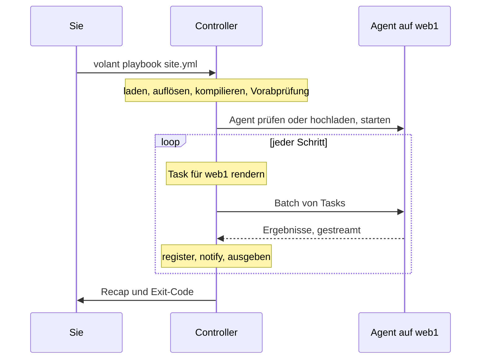

import { LinkCard } from '@astrojs/starlight/components';
import Flow from '../../../../../components/Flow.astro';

Volant besteht aus zwei Programmen und einem Protokoll. Der Controller läuft auf Ihrem Rechner und übernimmt das ganze Denken. Der Agent läuft auf jedem Host und tut, was man ihm sagt.

<Flow
  lanes={[
    {
      label: 'Controller',
      note: 'auf Ihrem Rechner, bevor sich etwas verbindet',
      steps: [
        { text: 'Dateien laden' },
        { text: 'Variablen auflösen' },
        { text: 'Schritte kompilieren' },
        { text: 'Vorabprüfung' },
        { text: 'Executor', kind: 'key' },
      ],
    },
    {
      label: 'Verwalteter Host',
      note: 'ein Agent, erreicht über eine einzige ssh-Verbindung',
      steps: [
        { text: 'volant-agent', kind: 'key' },
        { text: 'native Module oder der warme Python-Server' },
        { text: 'Ergebnisse, zurückgestreamt' },
      ],
    },
  ]}
/>

## Der Controller

Der Controller, `crates/volant`, liest `ansible.cfg`, das Inventory, die Playbooks und die Rollen. Er löst Variablen auf, rendert jedes Template und kompiliert jedes Play in eine flache Liste von Schritten, bevor er sich irgendwohin verbindet. Die [Vorabprüfung](/de/docs/internals/preflight/) stoppt dann bei allem, was dieses Release noch nicht unterstützt.

Der Executor startet pro Host einen Treiber, begrenzt durch `forks`. Die Strategie `linear` hält die Treiber im Gleichschritt. Unter `free` und `host_pinned` arbeitet jeder Treiber in seinem eigenen Tempo, und `debug` ist `linear` mit einem Debugger nach einem fehlgeschlagenen Task. Ein Treiber führt seinen Host durch die Schritte, rendert jeden Task mit den Variablen dieses Hosts, schickt ihn an den Agent und bewertet das Ergebnis: `register`, `changed_when`, `failed_when`, Handler. Ein Koordinator hält die Treiber an Synchronisationspunkten an und besitzt alles, was das Terminal erreicht.

Für Python-Module bittet der Controller einen Hilfsprozess mit ansible-core, die Modul-Payloads zu bauen, und hält das Ergebnis zwischen den Läufen in einem Cache. Derselbe Hilfsprozess führt die Filter, Tests und Lookups aus, für die es keine Rust-Version gibt, die Inventory-Plugins aus Collections und die Action-Plugins, die Volant überbrückt und die ihre Jobs parallel ausführen. Vor der ersten Verbindung liest er außerdem den ganzen Lauf, um zu entscheiden, ob der Agent Facts nativ sammeln darf. Siehe [Der warme Python-Pfad](/de/docs/internals/python/).

Alle `ssh`-Aufrufe für einen Inventory-Host teilen sich eine OpenSSH-Verbindung, siehe [Verbindungen und become](/de/docs/hosts/connections/#eine-verbindung-pro-host).

## Der Agent

Der Agent, `crates/volant-agent`, ist eine statische Binärdatei, die einmal pro Host hochgeladen und im Cache gehalten wird. Sein Release-Archiv ist etwa 1,2 MB groß. Er empfängt Batches von Tasks, führt sie aus und streamt die Ergebnisse zurück, sobald sie fertig sind. `command`, `shell` und `raw` führt er selbst aus. Er bringt außerdem native Versionen von `setup`, `stat`, `file`, `apt`, `systemd`, `lineinfile`, `copy`, `package_facts`, `service_facts`, `user` und `group` mit, die einen Task beantworten, wenn seine Argumente es erlauben, und ihn sonst zurückgeben. Alles andere führt der warme Python-Server aus, siehe [Native Module](/de/docs/internals/python/#native-module). Für Tasks mit `async` startet er außerdem Hintergrundjobs, und `async_status` liest sie zurück. Mit `ansible_connection: local` ist der Agent ein Kindprozess des Controllers, und es läuft kein `ssh`. Er weiß nichts über Playbooks, Variablen oder Rechteausweitung.

## Das Protokoll

`crates/volant-protocol` definiert die Frames und Nachrichten, die beide Programme teilen. Der Controller startet den Agent über `ssh` und spricht das Protokoll für den Rest des Laufs über Standardeingabe und Standardausgabe dieses Prozesses. Frames sind JSON. Nur ein Blob mit Modulen oder eine bereitgestellte Datei folgt seiner Ankündigung als rohe Bytes, seit Protokollversion 6 deflate-komprimiert, wenn das kürzer ist. Die aktuelle Version ist 8. Eine Nachricht zu ändern bedeutet, `PROTOCOL_VERSION` zu erhöhen, und die Version des Agents ist Teil seines Cache-Pfads, sodass ein Controller nie mit einem Agent aus einem anderen Release spricht.

Ein Frame ist höchstens 64 MiB groß, weil `slurp` eine Datei als einen String innerhalb eines Ergebnisses sendet. Auch ein Ergebnis ist durch seinen Inhalt begrenzt: höchstens 500.000 Werte, 64 Verschachtelungsebenen und 500.000 Zeilen `stdout` und `stderr` zusammen (oder eine Zeile je 32 Byte Ausgabe, wenn das mehr ist). Ein Ergebnis über einer Grenze lässt diesen Task nur für diesen Host fehlschlagen, mit einer Meldung, die die Grenze und die Anzahl nennt. Jede andere Nachricht ist höchstens 1 MiB groß.

## Ein Lauf von Anfang bis Ende

## Wie ein Play kompiliert wird

Sie schreiben ein Play als Baum: Abschnitte, Rollen, Blöcke, Tasks. Volant flacht ihn einmal ab, bevor es sich irgendwohin verbindet, zu einer einzigen nummerierten Liste von Schritten. Jeder Host geht dann dieselbe Liste durch, in der Reihenfolge, in der ansible-core sie ausführt:

<Flow
  lanes={[
    {
      steps: [
        { text: 'pre_tasks' },
        { text: 'Flush', kind: 'point' },
        { text: 'Rollen, jede nach ihren Abhängigkeiten' },
        { text: 'tasks' },
        { text: 'Flush', kind: 'point' },
        { text: 'post_tasks' },
        { text: 'Flush', kind: 'point' },
      ],
    },
  ]}
/>

Die drei Handler-Flush-Punkte sind immer vorhanden. Ob ein Play überhaupt Handler hat, steht erst fest, wenn seine Rollen von der Platte gelesen sind, deshalb legt der Compiler alle drei an. Ein Flush, der nichts auszuführen hat, gibt nichts aus.

Keywords, die auf einem Play, einem Rolleneintrag oder einem Block stehen, werden beim Kompilieren in jeden darunterliegenden Task übernommen, und der innerste Wert gewinnt. Ein `become: true` am Play und ein `become: false` an einem Task ergeben genau das, was Ansible ergibt, und der Lauf muss den Baum nicht mitschleppen.

Blöcke überstehen das Abflachen als Spannen über der Liste. Eine kleine Sprungtabelle über diesen Spannen sagt einem Host, wohin er nach einem erfolgreichen, fehlgeschlagenen oder übersprungenen Schritt geht. [Blöcke und Handler](/de/docs/playbooks/blocks/) beschreibt, was das für `rescue` und `always` bedeutet.

### Wo die Arbeit stattfindet

Das Templating findet auf dem Controller statt. Jeder Host rendert seine eigene Kopie eines Tasks mit seinen eigenen Variablen, und der gerenderte Task geht über eine Verbindung, die den ganzen Lauf über offen bleibt, an den Agent dieses Hosts. Der Agent führt ihn aus und streamt das Ergebnis zurück. Der Controller wendet dann `register`, `changed_when`, `failed_when` und `notify` an und gibt die Ergebniszeile aus.

Einige Module verlassen den Controller nie: `debug`, `set_fact`, `assert`, `fail`, `pause`, `include_vars` und `validate_argument_spec`. Siehe [Module](/de/docs/reference/modules/).

Ein Task, der als `action: module=ping` geschrieben ist, benennt keine Action. Er schlägt auf dem Controller fehl, wenn ein Host ihn erreicht, mit Exit 2, und ein `rescue` oder `ignore_errors` fängt den Fehler auf.

Eine Schleife rendert jedes Element, wenn sie es erreicht, sodass ein Element, das sich nicht rendern lässt, allein fehlschlägt. Siehe [Schleifen und Wiederholungen](/de/docs/playbooks/loops/#jedes-element-rendern).

Die Ergebniszeile folgt dem Format von ansible-core 2.19. `failed` und `skipped` werden vom Ergebnis weggelassen, auch auf `fatal:`-Zeilen und bei Schleifenelementen, weil das Präfix der Zeile es schon sagt. Die `warnings` eines Moduls werden als `[WARNING]:`-Zeilen ausgegeben und aus dem registrierten Wert herausgehalten. Ein fehlgeschlagener Task registriert `exception: "(traceback unavailable)"`, was die Zeile nie zeigt. Überspringt `when` jedes Element einer Schleife, folgt auf die `skipping:`-Zeile jedes Elements eine `skipping: [host]`-Zeile für den Task, und der Recap zählt den Task einmal.

## Designentscheidungen

Jede Entscheidung, die ändert, was Benutzer sehen, ist mit ihrer Begründung als Entscheidungsdokument festgehalten:

<LinkCard title="Entscheidungsdokumente" description="Warum GPL und welche Crates permissiv lizenziert sind, warum ansible-core 2.19, wie become und Batching funktionieren, warum der Python-Pfad ein Archiv pro Lauf verwendet, wie Action-Plugins laufen und warum gängige Module nativ laufen." href="/de/docs/decisions/" />

<LinkCard title="Code-Karte" description="Wo jeder Teil der Engine im Quellbaum liegt, für Mitwirkende." href="https://github.com/lorica-labs/volant/blob/main/ARCHITECTURE.md" />
