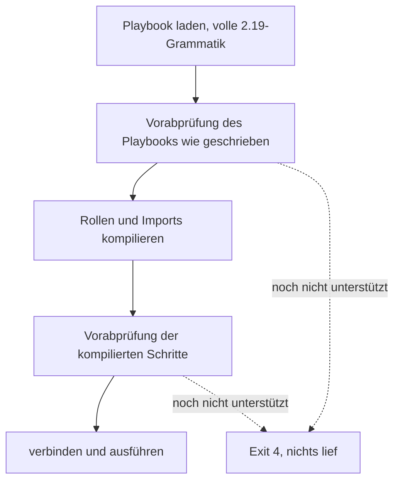

Volant liest die gesamte Grammatik von ansible-core 2.19, ein Playbook wird hier also so geparst wie unter Ansible. Eine zweite Prüfung, die Vorabprüfung, sucht dann alles, was der Loader akzeptiert hat und dieses Release noch nicht unterstützt. Findet sie etwas, benennt sie jeden Fund und stoppt den Lauf vor der ersten Verbindung, vor jedem Banner und vor jedem Recap.

Ohne sie würde ein Keyword, das an beiden Prüfungen vorbeigerutscht ist, stillschweigend ignoriert, und der Lauf würde Erfolg melden, nachdem er übersprungen hat, worum Sie gebeten haben.

Die Prüfung läuft zweimal: einmal auf dem Playbook, wie es geschrieben ist, und einmal auf den kompilierten Schritten. Der erste Durchgang liest das Play wie geschrieben, sodass ein Task, den `--tags` weggelassen hätte, den Lauf trotzdem stoppt, wenn er etwas nicht Unterstütztes verwendet. Der zweite Durchgang liest die kompilierten Schritte nach der Tag-Auswahl und ist der einzige Ort, an dem ein Keyword sichtbar ist, das in einer Rolle oder einer importierten Datei steht. Das irrt in Richtung häufigeres Stoppen, nie in Richtung selteneres. Jeder Abschnitt eines Blocks wird geprüft, auch `rescue` und `always`.

Was ein dynamisches Include einbringt, wird geprüft, wenn ein Host es erreicht. Eine Ablehnung dort lässt das Include für diesen Host fehlschlagen, und ein `rescue` oder `ignore_errors` fängt es auf. Siehe [Imports und Includes](/de/docs/playbooks/roles/#dynamische-includes).

## Was heute abgelehnt wird

[Läuft mein Playbook?](/de/docs/start/compatibility/#was-heute-abgelehnt-wird) hat die Tabelle dessen, was die Prüfung ablehnt, mit der Meldung jedes Falls und seinem Exit-Code.

## Exit-Codes

Ein Lauf, den die Vorabprüfung stoppt, endet mit Code 4, den Ansible für ein Playbook verwendet, das es nicht laden kann. Einige Fälle behalten den Code, den Ansible laut Messung verwendet:

| Fall | Exit-Code |
|---|---|
| Alles, was dieses Release noch nicht unterstützt | 4 |
| Eine Rolle, die `roles:` oder `import_role` nicht finden kann | 1 |
| Eine Methode der Rechteausweitung, die dieses Release noch nicht unterstützt | 2 |

Drei Fälle sind keine Vorabprüfungsfälle mehr. Sie schlagen fehl, wenn der Task erreicht wird, wie in ansible-core:

- Eine unbekannte `meta`-Action gibt ihr Banner aus, dann `invalid meta action requested: <action>`, und endet mit 1, was auch immer ihr `when` sagt.
- Ein `notify`, das keinen Handler benennt, beendet den Lauf mit Exit 1, wenn der Task `changed` meldet. Siehe [Handler](/de/docs/playbooks/blocks/#unterschiede-zu-ansible).
- Ein `include_role` einer Rolle, deren Task-Datei sich nicht laden lässt, führt die Plays und Tasks davor aus und endet dann nach dem Banner der Anweisung mit Exit 4. Ein `when: false` am Include verbirgt den Fehler.

[Exit-Codes](/de/docs/reference/exit-codes/) listet jeden Code auf, den Volant verwendet.

Auflistungen und `--syntax-check` rufen die Vorabprüfung nie auf, sodass Sie ein Playbook lesen können, bevor das Release erscheint, das es ausführt.

## Unterschiede zu Ansible

- `tags` und `timeout` werden geprüft, bevor ihr Wert angesehen wird, sodass `tags: 3` nicht den Typfehler von Ansible bekommt.
- Ein `with_<name>`, das kein Lookup-Plugin des ansible-core des Controllers ist, wird mit dem Satz von ansible-core abgelehnt, `'with_xyz' is not a valid attribute for a Task`. In einer Datei, die `include_tasks` oder `include_role` liest, während das Play läuft, schlägt das Include für den Host fehl, der es erreicht hat, und das Play stoppt nicht mit Exit 4.
- Bei einem Modul, das dieses Release noch nicht unterstützt, werden die Argumente nicht geparst, sodass der Fehler das Modul betrifft und nicht ein `key=value` in der nächsten Zeile.
- `gather_facts`, `ignore_errors` und `become`, die als etwas anderes als true oder false geschrieben sind, werden beim Laden des Playbooks abgelehnt, einen Schritt früher als Ansible sie ablehnt, mit der Meldung und dem Exit-Code von ansible-core. Ein Template wird nicht abgelehnt: `ignore_errors: "{{ ... }}"` wird gerendert, wenn der Task läuft, für jedes Schleifenelement, und die [Keywords als Templates](/de/docs/playbooks/how-a-play-runs/#keywords-als-templates) werden im selben Moment für jeden Host gerendert. `gather_facts` und `force_handlers` eines Plays werden gerendert, wenn das Play startet. Alle werden nach den Regeln von ansible-core gelesen, und ein Wert, den sie nicht annehmen können, lässt den Task fehlschlagen, oder bei den letzten beiden das Play stoppen, mit der Meldung von ansible-core.
