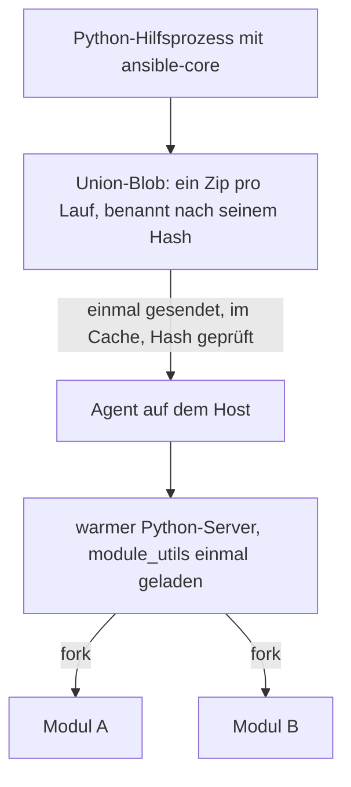

import { Aside } from '@astrojs/starlight/components';
import BarChart from '../../../../../components/BarChart.astro';

Die meisten Ansible-Module sind Python-Programme. Volant führt sie unverändert aus, startet aber nicht für jeden Task einen neuen Interpreter. Für die gängigsten Module läuft oft gar kein Python: Der Agent hat [native Versionen](#native-module), die antworten, wenn die Argumente eines Tasks es erlauben.

## Wie es funktioniert



1. Der Controller bittet einen Hilfsprozess, die Payload von ansible-core für jedes Modul zu bauen, das der Lauf braucht, außer der [Cache](#der-union-cache) hält das Ergebnis schon.
2. Volant führt sie zu einem Zip zusammen, dem Union-Blob, mit jeder `module_utils`-Datei, die sie importieren. Der Blob ist nach dem BLAKE3-Hash seines Inhalts benannt.
3. Der Blob wird einmal an jeden Host gesendet und dort zwischengespeichert. Der Agent prüft den Hash, bevor er ihn verwendet, und ein Host, der ihn schon hat, bekommt nichts.
4. Der Agent startet einen Python-Server, sobald der Controller die Payload gesendet hat, während die Tasks vor dem ersten, der Python braucht, noch laufen. Er hält einen Server pro Interpreter, Payload und dem Teil des Task-`environment`, den ein Interpreter beim Start liest (`PYTHON*`, `LD_*`, die Locale, `TZ`, `HOME` und das temporäre Verzeichnis); den Rest setzt das Kind, bevor das Modul läuft. Jeder Zielbenutzer hat einen eigenen Agent. Der Server lädt den gemeinsamen Code einmal aus dem Blob und forkt dann für jeden Task ein Kind. Das Kind führt das Modul aus und schreibt sein JSON-Ergebnis über eine Pipe zurück. Während das Kind läuft, importiert der Server dieses Modul in sich selbst, sodass das nächste Kind desselben Moduls es schon geladen vorfindet.

Die Union wird vor der ersten Verbindung gebaut, sie muss also jedes Modul enthalten, das ein Host erreichen könnte. Sie trägt die Module, die die Plays nennen, die jeder Task- und Handler-Datei der Rollen im Play (einschließlich ihrer Abhängigkeiten aus `meta/main.yml`) und die jeder Datei, die ein Include wörtlich nennt. Ein Modul, das nur in einer Datei für eine andere Plattform genannt wird, etwa `setup-RedHat.yml` neben `setup-Debian.yml`, ist ebenfalls enthalten, sodass ein `include_tasks: setup-{{ ansible_os_family }}.yml` sein Modul findet, welche Datei ein Host auch wählt. Ein Name dort, auf den kein Modul hört, bleibt draußen und schlägt nur dann namentlich fehl, wenn ein Host ihn erreicht.

Der Blob reist als rohe Bytes, mit deflate komprimiert, wenn das kürzer ist, und der Agent prüft den Hash der entpackten Bytes.

Modulergebnisse sind nicht vertrauenswürdig und werden nie als Controller-Templates gerendert. Siehe [Vertrauenswürdige und nicht vertrauenswürdige Werte](/de/docs/variables/templating/#werte-von-hosts-werden-nie-als-template-gerendert). Wie ansible-core es auf dem Controller tut, ergänzt Volant `stdout_lines` und `stderr_lines` in einem Ergebnis, das `stdout` oder `stderr` ohne sie hat, aufgeteilt nach den `splitlines()`-Regeln von Python.

## Was jede Seite braucht

Der Controller braucht Python 3 mit `ansible-core`. Ist `VOLANT_PYTHON` gesetzt, verwendet Volant das und nichts sonst. Andernfalls probiert es seine [verwaltete Runtime](/de/docs/reference/runtime/), dann die aktive virtuelle Umgebung, dann `python3` in Ihrem `PATH`. Hat keines davon ansible-core, installiert es die verwaltete Runtime.

Der Host braucht einen Python-3-Interpreter, aber nicht ansible-core: Der Blob trägt das Modul und jede Datei, die es importiert. Der Agent meldet beim Start die Interpreter, die er findet.

## Gemessene Kosten

Diese Zahlen stammen von einem Ubuntu-24.04-Host mit Python 3.12 über SSH. Jede Angabe ist ein Median.

<BarChart
  title="Kosten für die Ausführung eines Moduls"
  subtitle="Ubuntu-24.04-Host, Python 3.12, über SSH, Median. Kürzer ist schneller."
  unit="ms"
  rows={[
    { label: 'Ansible, Standardeinstellungen', value: 765 },
    { label: 'Ansible, Pipelining', value: 469 },
    { label: 'Payload als einfacher Prozess', value: 340 },
    { label: 'Fork, nichts vorgeladen', value: 266 },
    { label: 'Fork, module_utils geladen', value: 12.8, highlight: true, note: 'Was Volant tut' },
  ]}
/>

Die Kosten pro Modul folgen der Arbeit, die das Modul leistet. `apt` braucht 755 ms, überwiegend in `dpkg`, wo `ping` 12,8 ms braucht: Der warme Pfad beseitigt Overhead, keine Arbeit.

Die Module als ein Archiv zu senden spart 72,7 Prozent der Bytes, weil die Dateien, die sie teilen, nur einmal reisen. Für `ping`, `stat`, `file`, `lineinfile` und `apt` sind das 631.050 Bytes gegenüber 2.307.982 bei einem Zip pro Modul. Das Archiv zu laden kostet 264,5 ms, einmal pro Server.

[Entscheidungsdokument 0006](/de/docs/decisions/0006-warm-python-path/) hat die Begründung und eine Messung an einem vollständigen Playbook.

## Module aus Collections

Ein Modul aus einer installierten Collection, etwa `ansible.posix.sysctl` oder `community.general.ufw`, läuft auf dem warmen Python-Pfad wie ein eingebautes.

### Wie ein Name aufgelöst wird

Vor der ersten Verbindung fragt Volant das ansible-core des Controllers, was jeder Punktname ist. ansible-core sucht in den Collection-Pfaden, mit denen es konfiguriert ist, etwa `ANSIBLE_COLLECTIONS_PATH`, und dann im Verzeichnis `collections/` der verwalteten Runtime, wohin `volant runtime install --collections` sie legt. Volant installiert während eines Laufs nichts, und zur Antwort wird nichts geholt.

Ein Name außerhalb von `ansible.builtin` und `ansible.legacy` bekommt eine von fünf Antworten:

| Was ansible-core findet | Was Volant tut |
|---|---|
| ein Modul, das es bauen kann | nimmt es in die Union auf und führt es aus |
| ein Modul, das seine Collection über ein Action-Plugin ausführt, direkt oder über das Routing in `runtime.yml` | führt das Action-Plugin im Python-Hilfsprozess aus, als das von ansible-core selbst |
| ein Action-Plugin, das einen Windows-Host oder eine Netzwerkverbindung braucht | stoppt den Lauf: Das Modul braucht ein Action-Plugin aus seiner Collection, das dieses Release nicht ausführt |
| kein Modul mit diesem Namen | stoppt den Lauf mit dem Satz der Referenz |
| ein Modul, das es nicht ausführen kann: entfernt, nur PowerShell oder der Bau schlägt fehl | stoppt den Lauf, mit dem Grund |

In der Union behält ein eingebautes Modul seinen kurzen Namen, und ein Collection-Modul wird über seinen vollen Namen geführt. Zwei Collections, die je ein Modul namens `sysctl` mitbringen, bleiben getrennt, und `community.general.command` wird nie mit `command` verwechselt.

Die Argumente eines Collection-Moduls, die als String geschrieben sind (`ansible.posix.sysctl: name=net.ipv4.ip_forward value=1`), werden in `key=value`-Paare zerlegt, so wie `parse_kv` von ansible-core sie zerlegt.

### Ablehnungen

Die Ablehnungen kommen vor der ersten Verbindung, mit Exit-Code 4:

```text
task 'Forward': couldn't resolve module/action 'ns.coll.mod'. This often indicates a misspelling, missing collection, or incorrect module path. The collection 'ns.coll' is not installed on the controller: install it with volant runtime install --collections ns.coll
task 'Forward': module 'ns.coll.mod' cannot run: <reason>
```

Der Installationshinweis erscheint nur, wenn die Collection selbst fehlt. Ein Modul, das in einer installierten Collection fehlt, bekommt nur den ersten Satz. Auch `ansible.builtin.nosuch` bekommt nur ihn, weil keine Collection einen Namen im Namensraum liefern kann, den ansible-core besitzt. Ohne ansible-core auf dem Controller wird ein Name außerhalb von `ansible.builtin` mit demselben ersten Satz abgelehnt, ergänzt um den Grund, warum nichts nachgeschlagen werden konnte.

Ein Collection-Modul, das nur in der Datei einer Rolle für eine andere Plattform genannt wird, wird ebenfalls aufgelöst. Lässt es sich bauen, kommt es in die Union. Alles andere bleibt draußen, ohne den Lauf zu stoppen, und das Include, das es erreicht, schlägt für diesen Host fehl, bevor ein Task der Datei läuft:

```text
task 'Forward': module 'ansible.posix.sysctl' was not resolved to a module before the run, so no payload holds it: its collection is not installed on the controller, no module path holds it, or it is named only in a file nothing read before the first connection
```

## Module mit Action-Plugin

Einige Module von ansible-core funktionieren nur zusammen mit einem Action-Plugin, das zuerst auf dem Controller läuft. `package` wählt den Paketmanager des Hosts, `service` sein Init-System, und `template` rendert die Datei auf dem Controller, bevor etwas gesendet wird. Diese Module ohne ihr Plugin zu senden, würde etwas anderes tun, als das Playbook verlangt hat.

Volant hat eine eigene Version von acht dieser Plugins: `copy`, `dnf`, `fetch`, `package`, `reboot`, `service`, `template` und `unarchive` laufen auf dem Controller als kurze Folge von Teil-Tasks, jeder ein gewöhnliches Python-Modul oder ein reiner Befehl, gesendet über die bestehende Verbindung des Hosts. [Action-Plugins](/de/docs/internals/action-plugins/) beschreibt jedes einzelne. Die anderen Plugins, etwa die von `uri` und `script`, laufen als Python von ansible-core im Hilfsprozess.

`assert`, `fail` und `pause` haben ebenfalls Action-Plugins, aber keines davon ruft ein Modul auf, deshalb führt Volant sie auf dem Controller aus. `setup` läuft als gewöhnliches Modul, nativ oder in Python, sodass das Sammeln von Facts funktioniert.

## Der Union-Cache

Die Union zu bauen kostet einen Python-Start, einen Import von ansible-core und einen Bau jedes Moduls. ansible-core liest jede `module_utils`-Datei, die ein Modul importiert, und die Module eines Laufs teilen sich die meisten davon. Der Helfer liest deshalb jede Datei einmal für die ganze Union: 1,5 bis 1,8 Sekunden bei den vier Galaxy-Rollen der [Performance-Seite](/de/docs/project/performance/), gegenüber 3,7 bis 4,4 Sekunden, als jedes Modul sie erneut las. Der Controller legt das Ergebnis unter `$XDG_CACHE_HOME/volant/unions/` oder `~/.cache/volant/unions/` ab, in einem Verzeichnis, das Ihrem Konto vorbehalten ist.

Ein Eintrag wird über alles gefunden, was der Bau gelesen hat und was keine Datei ist: die Volant-Version, den Interpreter, die angeforderten Module und Collections, die Umgebung `ANSIBLE_*` und `PYTHON*`, die `ansible.cfg`, die ansible-core lesen würde, und das Arbeitsverzeichnis. Er listet außerdem jede Quelldatei auf, die der Hilfsprozess gelesen hat, mit Größe und Änderungszeit. Ein Lauf verwendet den Eintrag nur dann wieder, wenn jede dieser Dateien unverändert ist und das Zip noch seinen aufgezeichneten Hash hat. Ein Upgrade von ansible-core oder einer Collection an Ort und Stelle baut die Union daher neu.

Ein Cache, der sich nicht lesen lässt, beschädigt ist oder nicht geschrieben werden kann, lässt nie einen Lauf fehlschlagen: Die Union wird neu gebaut, und ein Verzeichnis, das sich nicht beschreiben lässt, gibt eine Warnung pro Lauf aus. Der Cache fasst bis zu 1 GiB. Darüber hinaus gehen zuerst die Einträge, die am längsten kein Lauf benutzt hat, und ein Eintrag, den 30 Tage lang kein Lauf benutzt hat, wird entfernt. Zum Leeren entfernen Sie das Verzeichnis.

## Native Module

Der Agent trägt Rust-Versionen dieser Module:

| Modul | Nativ beantwortet, wenn |
|---|---|
| `setup` | auf Debian und Ubuntu, für die Facts unter [Facts](/de/docs/variables/precedence/#native-facts) |
| `stat` | der Pfad einfach und absolut ist und die Prüfsumme SHA-1 ist |
| `file` | `state` den Wert `file`, `directory` oder `absent` hat oder nicht gesetzt ist, und `link`, wenn der Link schon da ist und auf `src` zeigt |
| `apt` | die Pakete mit exaktem Namen ohne Version angegeben sind: Ein frischer Cache und schon installierte oder abwesende Pakete werden nur gelesen; ein veralteter Cache wird aktualisiert, und fehlende Pakete werden mit denselben `apt-get`-Befehlen installiert, die das Modul ausführt, unter `policy_rc_d`, wenn die Aufgabe es setzt; ein als automatisch installiert markiertes Paket wird wie im Modul als manuell markiert |
| `systemd`, `systemd_service` | `name`, `state`, `enabled` und `daemon_reload` im System-Scope |
| `lineinfile` | der reguläre Ausdruck in Rust dasselbe bedeutet wie in Python und `backrefs` aus ist |
| `copy` | das Modul, das das Action-Plugin `copy` ausführt, für eine vom Controller bereitgestellte Datei |
| `package_facts` | der Manager apt ist und jedes Paket in einem stabilen Zustand ist |
| `service_facts` | der Host systemd ausführt |
| `user`, `group` | auf Debian und Ubuntu, für die gängigen Argumente |

Alles außerhalb davon geht an das Python-Modul von ansible-core. Ein Task-`environment`, SELinux, erweiterte Attribute, `remote_src`, ein regulärer Ausdruck, den nur Python versteht, oder ein halb installiertes Paket geben unter anderem alle zurück. `dnf` und jedes andere Modul laufen immer in Python.

Ein natives Modul bekommt die Argumente, die das Python-Modul bekommen hätte. Es entscheidet zuerst, rein lesend, ob es die Antwort geben kann, die die Referenz geben würde. Wenn nicht, gibt es den Task zurück, bevor es den Host anfasst, und das Python-Modul erledigt die eigentliche Arbeit. Sein Ergebnis, `invocation` eingeschlossen, ist das, was das Referenzmodul zurückgibt, Schlüssel für Schlüssel, und ein Test vergleicht beide für jeden Fall, den das Modul abdeckt. Das Ergebnis kommt als nicht vertrauenswürdige Daten zurück, über denselben Pfad wie das eines Python-Moduls.

Auf einem Host, dessen Konfiguration den Paket-Cache von apt abschaltet, wie die Debian- und Ubuntu-Images von Docker, baut apt ihn bei jedem Aufruf neu aus den Paketlisten: 1,3 Sekunden pro Aufruf unter Ubuntu 24.04. Das native `apt` lässt seine Aufrufe von `apt-get`, `apt-cache` und `apt-mark` dann einen Cache im eigenen Verzeichnis der Verbindung nutzen, das mit dem Ende der Verbindung entfernt wird. Was sie ausgeben und was sie auf dem Host hinterlassen, ändert sich nicht.

Setzen Sie `[volant] native_modules = false` oder `VOLANT_NATIVE_MODULES=0`, um jeden Task an Python zu schicken. `--profile` zeigt, welchen Pfad jeder Task genommen hat, und bei einer Rückgabe den Grund. Siehe [Kommandozeile](/de/docs/reference/cli/#lauf-und-ausgabe).

<Aside type="note">
Die [Modulreferenz](/de/docs/reference/modules/) listet immer auf, was das aktuelle Release ausführt, weil sie aus den eigenen Tabellen der Engine erzeugt wird.
</Aside>
