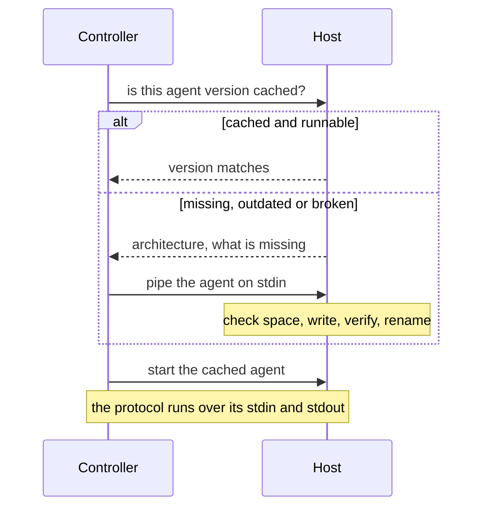

Volant puts a small static program, the agent, on every managed host and talks to it over `ssh` for the rest of the run. [Connections and become](/docs/hosts/connections/) covers what you configure. This page covers what happens underneath: the upload, the permission checks, the shared connection and the file descriptors it costs.

## Reaching a host



On a host that ran before, the check and the start go in one `ssh` session: the command checks the directory, compares the cached agent with the build this controller holds for the host's machine type, and starts it, under `sudo -n` for a connection that escalates with `sudo`. When any of that fails, the session ends before the agent answers, and the steps above run in order.

## The agent cache

The agent is a single static executable. Its release archive for x86_64 Linux is about 1.2 MB. Volant uploads it once per host and reuses it on every later run.

It lives at `<remote_tmp>/volant-agent-<version>-<uid>/volant-agent`, so with the default `remote_tmp` it sits under `~/.ansible/tmp/` in a home directory. The version in the path is the controller's own, which is how an upgraded controller avoids running an older agent. The uid is the numeric id of the account that runs the agent, so the login account and a `become` account that share one `remote_tmp` each get their own directory.

A task that does not escalate runs the agent as the account you log in as and caches it in that account's home. A task that escalates runs it as the `become_user` and caches it in that user's home, written through `sudo`. A `become_user` other than `root` needs this, because home directories are often mode 0700 and an agent cached under your login account would be out of reach. A host holds one cache per account the run acts as, each owned by that account.

The agent travels through `ssh -C`, so OpenSSH compresses it on the wire and nothing has to be unpacked on the host.


### Permission checks

Volant runs the cached agent only from a directory that no other account can change. It checks this on the probe, after an upload and again just before the start:

- The directory and the program are not symbolic links. The account that runs the agent owns both, and neither has a group or other write bit.
- `remote_tmp` belongs to that account, to root or, under `sudo` or `su`, to the account that logged in. Other accounts cannot write to it, or it has the sticky bit, as `/tmp` has.
- A `remote_tmp` that the account owns may be open to its group when that group is the account's own primary group, as a umask of 002 with a group per user makes it. It may not when an ACL entry shows on it (a `+` after the mode in `ls -l`), because that entry can grant write access to another account. Volant reads only the mode bits, so ACLs that are not in them (NFSv4, ZFS, macOS) are not seen.

Any other state stops the host with an `UNREACHABLE` error that names the path, its permissions and its owner. An upload is created with `umask 077`. If the directory is yours but too open, the upload empties it of Volant's files and makes it again. If another account owns it, Volant leaves it alone and reports it. Only the directories of other versions that the same account owns and that no other account can write are removed.

A `remote_tmp` that does not exist is created by the account that logged in, with mode 0700, as ansible-core does, even when an escalated task needs it first. A `become_user` other than root cannot enter it then: give such an account its own `remote_tmp`, or create a shared one with the sticky bit. The default `~/.ansible/tmp` needs nothing, since `~` names each account's own home.

The checks use `ls -ldn`, so they need no `stat` option. Volant does not check the directories above `remote_tmp`. An account that can replace one of them can still swap the path in the short time between the last check and the start of the agent.

### Upload and repair

Before every connection, Volant asks the cached agent for its version. A version mismatch, a missing file or a file that will not start all lead to a fresh upload. A broken cache, such as a copy truncated by an interrupted run, gets repaired instead of reported.

The upload checks free space with `df` first, and wants room for twice the agent plus a megabyte. It writes to a temporary name that includes the remote shell's process ID, checks the byte count, then renames into place. A transfer cut short never lands under the final name, and two runs uploading to the same host at once cannot mix their bytes.

When Python modules have run, `<remote_tmp>/volant-blobs-<version>-<uid>` sits beside the agent directory and holds the module payloads. To clear both caches, remove the two directories. Nothing else is left behind:

```sh
ssh web1 'rm -rf ~/.ansible/tmp/volant-agent-* ~/.ansible/tmp/volant-blobs-*'
```

An upload already removes the cache directories of other versions, so a host holds one agent rather than a history of them.

## One connection per host

All the `ssh` runs Volant makes for one inventory host share a single OpenSSH connection: the version check, the agent upload, the link to the agent and the escalated link. Volant adds `-o ControlMaster=auto -o ControlPath=<dir>/<name> -o ControlPersist=30s` to its command line, so only the first run pays for the key exchange and the authentication. The shared connection stays open for 30 seconds after its last session, and a run started in that window reuses it.

It also adds `ServerAliveInterval=5` and `ServerAliveCountMax=3`, so a master whose host stopped answering exits after about 15 seconds instead of holding every new session. A keepalive in your own `ssh` arguments (anything containing `serveralive`) replaces them.

The sockets live in `$XDG_RUNTIME_DIR/volant-cm`. Without a usable runtime directory they go to `/tmp/volant-cm-<uid>`, created at mode 0700. Whoever can create a socket there could hand your next `ssh` a connection of their own, so a directory that is not yours, or not at mode 0700, is refused. The run then prints `[WARNING]: ssh connections are not shared` with the reason and carries on with one connection per run.

The socket name is a hash of the inventory name, every `ssh` option the host connects with and what `ssh -G` resolves from your configuration files. So a connection opened for one user, key, port or `ProxyJump` never serves a host that asks for another, and a `HostName` changed in `~/.ssh/config` between two runs gets a new connection. Two inventory aliases of one machine get two connections, because one connection shared by fifty aliases would run into the server's `MaxSessions` limit. A connection that a password opened is never offered to another run.

Volant leaves sharing to you when you already configure it. It adds nothing when:

- `ansible_ssh_common_args` or `ansible_ssh_extra_args` mention `ControlMaster`, `ControlPath` or `ControlPersist`, or pass `-S` or `-M`;
- your ssh configuration already sets one of them for that host, as `ssh -G` reports it;
- the `ssh` arguments ask for debug output with `-v`;
- `[volant] ssh_control_master = false` or `VOLANT_SSH_CONTROL_MASTER=0`, see [Configuration](/docs/reference/configuration/#volant-ssh-control-master).

An escalated connection that cannot start in one session (see above) runs one extra `ssh` session for the `sudo` probe, two when a password is needed. With sharing on, those sessions use the same connection.

OpenSSH does the work, so `~/.ssh/config`, `Match`, `Include`, `ProxyJump` and your ssh-agent apply exactly as they do for `ansible-playbook`.

## File descriptors

Each connection is a separate `ssh` process and costs the controller three file descriptors. With escalation, a run can hold two connections per host: the host's own and one escalated.

At startup Volant raises its own soft limit on open files up to the hard limit, capped at 1,048,576. Most Linux systems ship a hard limit far above what a run needs, so nothing has to be done.

:::caution
A hard limit of 1024 still stops a run at about 330 connections, or about 169 escalating hosts. `ssh` then stops starting, and the hosts it happens to hit are reported unreachable although nothing is wrong with them. In bash, `ulimit -n 1024` lowers the hard limit along with the soft one.
:::

Check both limits before a run that wide:

```sh
ulimit -Sn; ulimit -Hn
```
