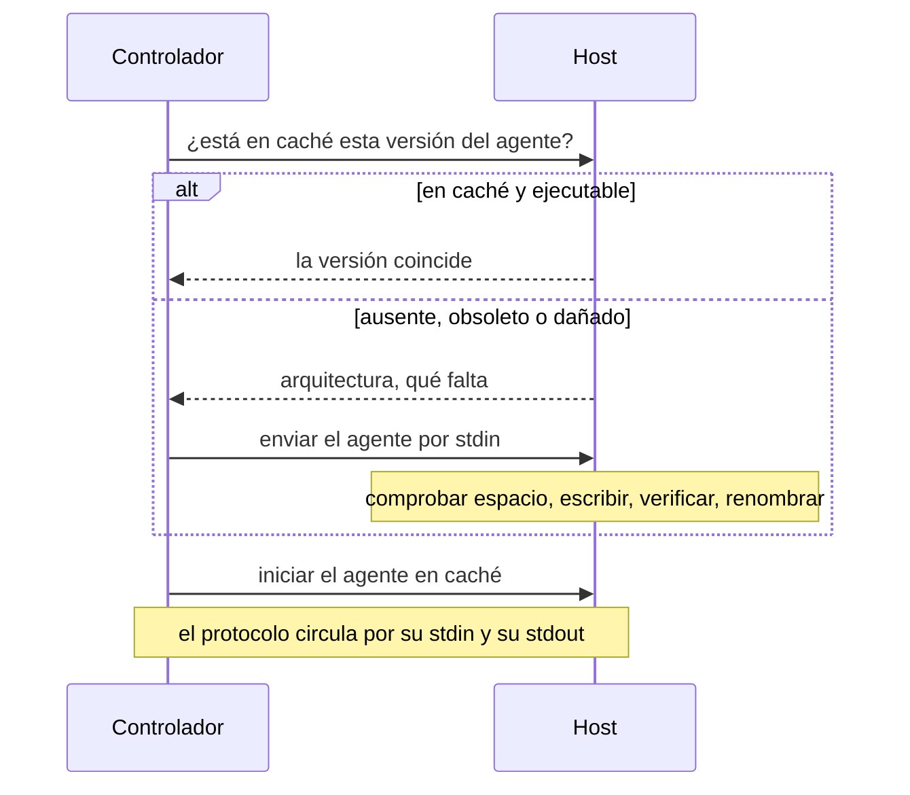

Volant deja un pequeño programa estático, el agente, en cada host administrado y habla con él por `ssh` durante el resto de la ejecución. [Conexiones y become](/es/docs/hosts/connections/) explica lo que configuras. Esta página explica lo que pasa por debajo: la subida, las comprobaciones de permisos, la conexión compartida y los descriptores de archivo que cuesta.

## Llegar a un host



En un host que ya se usó, la comprobación y el arranque van en una sola sesión `ssh`: el comando comprueba el directorio, compara el agente en caché con la compilación que este controlador tiene para el tipo de máquina del host y lo arranca, con `sudo -n` en una conexión que escala con `sudo`. Si algo de eso falla, la sesión termina antes de que el agente responda y los pasos de arriba se ejecutan en orden.

## La caché del agente

El agente es un único ejecutable estático. Su archivo de publicación para Linux x86_64 pesa unos 1.2 MB. Volant lo sube una vez por host y lo reutiliza en todas las ejecuciones siguientes.

Vive en `<remote_tmp>/volant-agent-<version>-<uid>/volant-agent`, de modo que con el `remote_tmp` por defecto queda bajo `~/.ansible/tmp/` en un directorio personal. La versión de la ruta es la del propio controlador, y así un controlador actualizado evita ejecutar un agente anterior. El uid es el id numérico de la cuenta que ejecuta el agente, de modo que la cuenta con la que inicias sesión y una cuenta de `become` que comparten un mismo `remote_tmp` tienen cada una su propio directorio.

Una tarea que no escala privilegios ejecuta el agente como la cuenta con la que inicias sesión y lo guarda en caché en el directorio personal de esa cuenta. Una tarea que escala privilegios lo ejecuta como `become_user` y lo guarda en caché en el directorio personal de ese usuario, escrito mediante `sudo`. Un `become_user` distinto de `root` lo necesita, porque los directorios personales suelen tener el modo 0700 y un agente guardado en la cuenta de inicio de sesión quedaría fuera de su alcance. Un host guarda una caché por cada cuenta con la que actúa la ejecución, y cada una pertenece a esa cuenta.

El agente viaja por `ssh -C`, así que OpenSSH lo comprime en la red y no hace falta descomprimir nada en el host.

### Comprobaciones de permisos

Volant ejecuta el agente en caché solo desde un directorio que ninguna otra cuenta puede modificar. Lo comprueba en la sonda, después de una subida y otra vez justo antes del inicio:

- El directorio y el programa no son enlaces simbólicos. La cuenta que ejecuta el agente es la dueña de ambos, y ninguno tiene bit de escritura para el grupo ni para otros.
- `remote_tmp` pertenece a esa cuenta, a root o, con `sudo` o `su`, a la cuenta que inició sesión. Otras cuentas no pueden escribir en él, o tiene el sticky bit, como `/tmp`.
- Un `remote_tmp` que pertenece a la cuenta puede estar abierto a su grupo cuando ese grupo es el grupo primario de la propia cuenta, como ocurre con una umask de 002 y un grupo por usuario. No puede estarlo cuando aparece una entrada de ACL (un `+` tras el modo en `ls -l`), porque esa entrada puede conceder acceso de escritura a otra cuenta. Volant lee solo los bits de modo, así que las ACL que no están en ellos (NFSv4, ZFS, macOS) no se ven.

Cualquier otro estado detiene el host con un error `UNREACHABLE` que nombra la ruta, sus permisos y su propietario. Una subida se crea con `umask 077`. Si el directorio es tuyo pero está demasiado abierto, la subida lo vacía de los archivos de Volant y lo crea de nuevo. Si pertenece a otra cuenta, Volant lo deja como está y lo notifica. Solo se eliminan los directorios de otras versiones que pertenecen a la misma cuenta y en los que ninguna otra cuenta puede escribir.

Un `remote_tmp` que no existe lo crea la cuenta que inició sesión, con el modo 0700, como hace ansible-core, aunque una tarea que escala privilegios lo necesite primero. Un `become_user` distinto de root no puede entrar entonces: dale a esa cuenta su propio `remote_tmp`, o crea uno compartido con el sticky bit. El `~/.ansible/tmp` por defecto no necesita nada, porque `~` designa el directorio personal de cada cuenta.

Las comprobaciones usan `ls -ldn`, así que no necesitan ninguna opción de `stat`. Volant no comprueba los directorios por encima de `remote_tmp`. Una cuenta que pueda reemplazar uno de ellos aún puede cambiar la ruta en el breve intervalo entre la última comprobación y el inicio del agente.

### Subida y reparación

Antes de cada conexión, Volant pregunta al agente en caché por su versión. Una versión distinta, un archivo ausente o un archivo que no arranca llevan a una subida nueva. Una caché dañada, como una copia truncada por una ejecución interrumpida, se repara en lugar de notificarse.

La subida comprueba primero el espacio libre con `df`, y exige sitio para dos veces el agente más un megabyte. Escribe en un nombre temporal que incluye el ID de proceso del shell remoto, comprueba el número de bytes y después lo renombra a su sitio. Una transferencia cortada a medias nunca queda con el nombre final, y dos ejecuciones que suben a la vez al mismo host no pueden mezclar sus bytes.

Cuando se han ejecutado módulos de Python, `<remote_tmp>/volant-blobs-<version>-<uid>` queda junto al directorio del agente y contiene los payloads de los módulos. Para vaciar ambas cachés, elimina los dos directorios. No queda nada más:

```sh
ssh web1 'rm -rf ~/.ansible/tmp/volant-agent-* ~/.ansible/tmp/volant-blobs-*'
```

Una subida ya elimina los directorios de caché de otras versiones, así que un host guarda un solo agente y no un historial de ellos.

## Una conexión por host

Todas las ejecuciones de `ssh` que hace Volant para un host del inventario comparten una única conexión OpenSSH: la comprobación de versión, la subida del agente, el enlace con el agente y el enlace con escalado de privilegios. Volant añade `-o ControlMaster=auto -o ControlPath=<dir>/<name> -o ControlPersist=30s` a su línea de comandos, de modo que solo la primera ejecución paga el intercambio de claves y la autenticación. La conexión compartida sigue abierta 30 segundos después de su última sesión, y una ejecución que empiece en esa ventana la reutiliza.

También añade `ServerAliveInterval=5` y `ServerAliveCountMax=3`, de modo que un master cuyo host dejó de responder termina al cabo de unos 15 segundos en lugar de retener cada sesión nueva. Un keepalive en tus propios argumentos de `ssh` (cualquiera que contenga `serveralive`) los reemplaza.

Los sockets viven en `$XDG_RUNTIME_DIR/volant-cm`. Sin un directorio de ejecución utilizable, van a `/tmp/volant-cm-<uid>`, creado con el modo 0700. Quien pueda crear un socket allí podría darle a tu siguiente `ssh` una conexión propia, así que se rechaza un directorio que no es tuyo o que no tiene el modo 0700. La ejecución imprime entonces `[WARNING]: ssh connections are not shared` con el motivo y continúa con una conexión por ejecución.

El nombre del socket es un hash del nombre del inventario, de todas las opciones de `ssh` con las que se conecta el host y de lo que `ssh -G` resuelve a partir de tus archivos de configuración. Así, una conexión abierta para un usuario, una clave, un puerto o un `ProxyJump` nunca sirve a un host que pida otro, y un `HostName` cambiado en `~/.ssh/config` entre dos ejecuciones obtiene una conexión nueva. Dos alias de inventario de una misma máquina obtienen dos conexiones, porque una conexión compartida por cincuenta alias chocaría con el límite `MaxSessions` del servidor. Una conexión que abrió una contraseña nunca se ofrece a otra ejecución.

Volant te deja el uso compartido a ti cuando ya lo configuras. No añade nada cuando:

- `ansible_ssh_common_args` o `ansible_ssh_extra_args` mencionan `ControlMaster`, `ControlPath` o `ControlPersist`, o pasan `-S` o `-M`;
- tu configuración de ssh ya define uno de ellos para ese host, tal como lo informa `ssh -G`;
- los argumentos de `ssh` piden salida de depuración con `-v`;
- `[volant] ssh_control_master = false` o `VOLANT_SSH_CONTROL_MASTER=0`, consulta [Configuración](/es/docs/reference/configuration/#volant-ssh-control-master).

Una conexión con escalado de privilegios que no puede arrancar en una sola sesión (ver arriba) ejecuta una sesión `ssh` más para la sonda de `sudo`, y dos cuando hace falta una contraseña. Con el uso compartido activado, esas sesiones usan la misma conexión.

OpenSSH hace el trabajo, así que `~/.ssh/config`, `Match`, `Include`, `ProxyJump` y tu ssh-agent se aplican exactamente igual que con `ansible-playbook`.

## Descriptores de archivo

Cada conexión es un proceso `ssh` distinto y le cuesta al controlador tres descriptores de archivo. Con escalado de privilegios, una ejecución puede mantener dos conexiones por host: la propia del host y una con escalado.

Al iniciarse, Volant sube su propio límite flexible de archivos abiertos hasta el límite estricto, con un tope de 1,048,576. La mayoría de los sistemas Linux traen un límite estricto muy superior a lo que necesita una ejecución, así que no hay que hacer nada.

:::caution
Un límite estricto de 1024 sigue deteniendo una ejecución en unas 330 conexiones, o en unos 169 hosts con escalado de privilegios. Entonces `ssh` deja de iniciarse y los hosts a los que les toca se notifican como inalcanzables aunque no les pase nada. En bash, `ulimit -n 1024` baja el límite estricto junto con el flexible.
:::

Comprueba ambos límites antes de una ejecución tan amplia:

```sh
ulimit -Sn; ulimit -Hn
```
