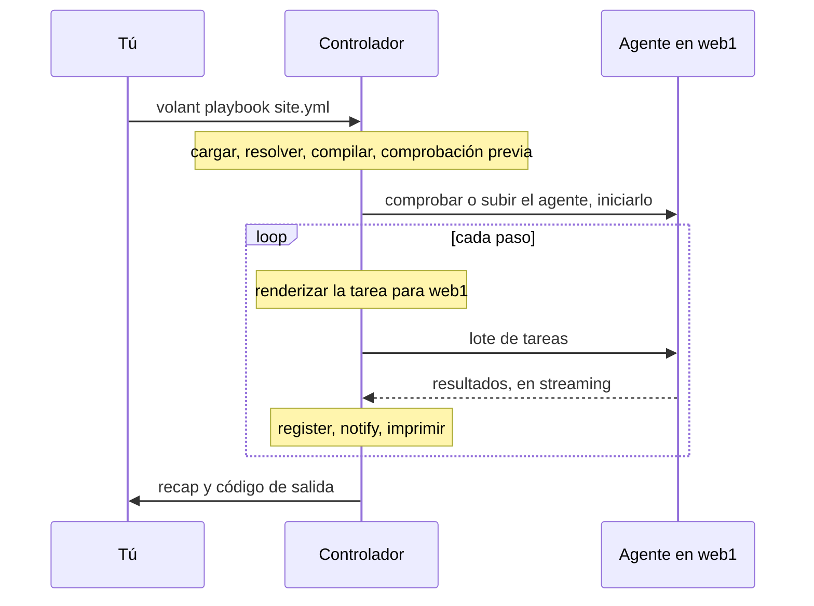

import { LinkCard } from '@astrojs/starlight/components';
import Flow from '../../../../../components/Flow.astro';

Volant son dos programas y un protocolo. El controlador se ejecuta en tu máquina y toma todas las decisiones. El agente se ejecuta en cada host y hace lo que se le ordena.

<Flow
  lanes={[
    {
      label: 'Controlador',
      note: 'en tu máquina, antes de que nada se conecte',
      steps: [
        { text: 'cargar archivos' },
        { text: 'resolver variables' },
        { text: 'compilar pasos' },
        { text: 'comprobación previa' },
        { text: 'ejecutor', kind: 'key' },
      ],
    },
    {
      label: 'Host administrado',
      note: 'un agente, alcanzado por una única conexión ssh',
      steps: [
        { text: 'volant-agent', kind: 'key' },
        { text: 'módulos nativos o el servidor de Python en caliente' },
        { text: 'resultados, enviados en streaming' },
      ],
    },
  ]}
/>

## El controlador

El controlador, `crates/volant`, lee `ansible.cfg`, el inventario, los playbooks y los roles. Resuelve las variables, renderiza cada plantilla y compila cada play en una lista plana de pasos antes de conectarse a ninguna parte. Después, la [comprobación previa](/es/docs/internals/preflight/) detiene la ejecución ante todo lo que esta versión todavía no admite.

El ejecutor inicia un driver por host, limitado por `forks`. La estrategia `linear` mantiene los drivers sincronizados. Con `free` y `host_pinned`, cada driver avanza a su propio ritmo, y `debug` es `linear` con un depurador tras una tarea fallida. Un driver recorre los pasos de su host, renderiza cada tarea con las variables de ese host, la envía al agente y juzga el resultado: `register`, `changed_when`, `failed_when`, handlers. Un coordinador retiene a los drivers en los puntos de sincronización y es el dueño de todo lo que llega a la terminal.

Para los módulos de Python, el controlador pide a un proceso helper que ejecuta ansible-core que construya los payloads de los módulos, y guarda el resultado en una caché entre ejecuciones. El mismo helper ejecuta los filtros, tests y lookups que no tienen versión en Rust, los plugins de inventario de las colecciones y los plugins de acción que Volant conecta mediante el bridge, que ejecutan sus trabajos en paralelo. Antes de la primera conexión, además, lee la ejecución entera para decidir si el agente puede recopilar facts de forma nativa. Consulta [La ruta de Python en caliente](/es/docs/internals/python/).

Todas las ejecuciones de `ssh` de un host del inventario comparten una única conexión OpenSSH, consulta [Conexiones y become](/es/docs/hosts/connections/#una-conexión-por-host).

## El agente

El agente, `crates/volant-agent`, es un binario estático que se sube una vez por host y se guarda en caché. Su archivo de publicación pesa unos 1.2 MB. Recibe lotes de tareas, las ejecuta y devuelve los resultados en streaming a medida que terminan. Ejecuta `command`, `shell` y `raw` por sí mismo. También incluye versiones nativas de `setup`, `stat`, `file`, `apt`, `systemd`, `lineinfile`, `copy`, `package_facts`, `service_facts`, `user` y `group`, que resuelven una tarea cuando sus argumentos lo permiten y se la devuelven al controlador en caso contrario. El servidor de Python en caliente ejecuta todo lo demás, consulta [Módulos nativos](/es/docs/internals/python/#módulos-nativos). También inicia trabajos en segundo plano para las tareas con `async`, y `async_status` los consulta. Con `ansible_connection: local`, el agente es un proceso hijo del controlador y no se ejecuta ningún `ssh`. No sabe nada de playbooks, variables ni escalado de privilegios.

## El protocolo

`crates/volant-protocol` define los frames y los mensajes que comparten ambos programas. El controlador inicia el agente por `ssh` y habla el protocolo por la entrada y la salida estándar de ese proceso durante el resto de la ejecución. Los frames son JSON, salvo que un blob de módulos o un archivo preparado sigue a su anuncio como bytes sin procesar, comprimidos con deflate cuando así ocupan menos, desde la versión 6 del protocolo. La versión actual es la 8. Cambiar un mensaje implica subir `PROTOCOL_VERSION`, y la versión del agente forma parte de su ruta de caché, así que un controlador nunca habla con un agente de otra versión.

Un frame mide como máximo 64 MiB, porque `slurp` y `fetch` envían un archivo como una sola cadena dentro de un resultado. Un resultado también está acotado por lo que contiene: como máximo 500,000 valores, 64 niveles de anidamiento y 500,000 líneas de `stdout` y `stderr` juntas (o una línea por cada 32 bytes de salida cuando eso es más). Un resultado que supera un límite hace fallar esa tarea solo para ese host, con un mensaje que indica el límite y el recuento. Cualquier otro mensaje mide como máximo 1 MiB.

## Una ejecución, de principio a fin

## Cómo se compila un play

Escribes un play como un árbol: secciones, roles, bloques, tareas. Volant lo aplana una sola vez, antes de conectarse a nada, en una única lista numerada de pasos. Después, todos los hosts recorren esa misma lista, en el orden en que la ejecuta ansible-core:

<Flow
  lanes={[
    {
      steps: [
        { text: 'pre_tasks' },
        { text: 'flush', kind: 'point' },
        { text: 'roles, cada uno tras sus dependencias' },
        { text: 'tasks' },
        { text: 'flush', kind: 'point' },
        { text: 'post_tasks' },
        { text: 'flush', kind: 'point' },
      ],
    },
  ]}
/>

Los tres puntos de flush de handlers siempre están ahí. Si un play tiene handlers o no solo se sabe cuando se leen sus roles del disco, así que el compilador dispone los tres. Un flush sin nada que ejecutar no imprime nada.

Las palabras clave escritas en un play, en una entrada de rol o en un bloque se incorporan a cada tarea que hay debajo mientras el play se compila, y gana el valor más interno. Un `become: true` en el play y un `become: false` en una tarea dan exactamente lo que da Ansible, y la ejecución no tiene que cargar con el árbol.

Los bloques sobreviven al aplanado como tramos sobre la lista. Una pequeña tabla de saltos sobre esos tramos le dice a un host adónde ir después de que un paso tenga éxito, falle o se omita. [Bloques y handlers](/es/docs/playbooks/blocks/) explica qué significa eso para `rescue` y `always`.

### Dónde se hace el trabajo

El renderizado de plantillas ocurre en el controlador. Cada host renderiza su propia copia de una tarea con sus propias variables, y la tarea renderizada va al agente de ese host por una conexión que permanece abierta durante toda la ejecución. El agente la ejecuta y devuelve el resultado en streaming. Después, el controlador aplica `register`, `changed_when`, `failed_when` y `notify`, e imprime la línea de resultado.

Algunos módulos nunca salen del controlador: `debug`, `set_fact`, `assert`, `fail`, `pause`, `include_vars` y `validate_argument_spec`. Consulta [Módulos](/es/docs/reference/modules/).

Una tarea escrita como `action: module=ping` no nombra ninguna acción. Falla en el controlador cuando un host llega a ella, con el código de salida 2, y un `rescue` o `ignore_errors` absorbe el fallo.

Un bucle renderiza cada elemento cuando llega a él, así que un elemento que no se puede renderizar falla solo. Consulta [Bucles y reintentos](/es/docs/playbooks/loops/#renderizado-de-cada-elemento).

La línea de resultado sigue el formato de ansible-core 2.19. `failed` y `skipped` se omiten del resultado, también en las líneas `fatal:` y en los elementos de un bucle, porque el prefijo de la línea ya lo indica. Los `warnings` de un módulo se imprimen como líneas `[WARNING]:` y no entran en el valor registrado. Una tarea fallida registra `exception: "(traceback unavailable)"`, que la línea nunca muestra. Cuando `when` omite todos los elementos de un bucle, a la línea `skipping:` de cada elemento le sigue una línea `skipping: [host]` para la tarea, y el recap cuenta la tarea una sola vez.

## Decisiones de diseño

Cada decisión que cambia lo que ven los usuarios queda registrada, con su razonamiento, como un registro de decisión:

<LinkCard title="Registros de decisión" description="Por qué GPL y qué crates son permisivos, por qué ansible-core 2.19, cómo funcionan become y el procesamiento por lotes, por qué la ruta de Python usa un archivo por ejecución, cómo se ejecutan los plugins de acción y por qué los módulos comunes se ejecutan de forma nativa." href="/es/docs/decisions/" />

<LinkCard title="Mapa del código" description="Dónde vive cada parte del motor en el árbol de fuentes, para quienes contribuyen." href="https://github.com/lorica-labs/volant/blob/main/ARCHITECTURE.md" />
