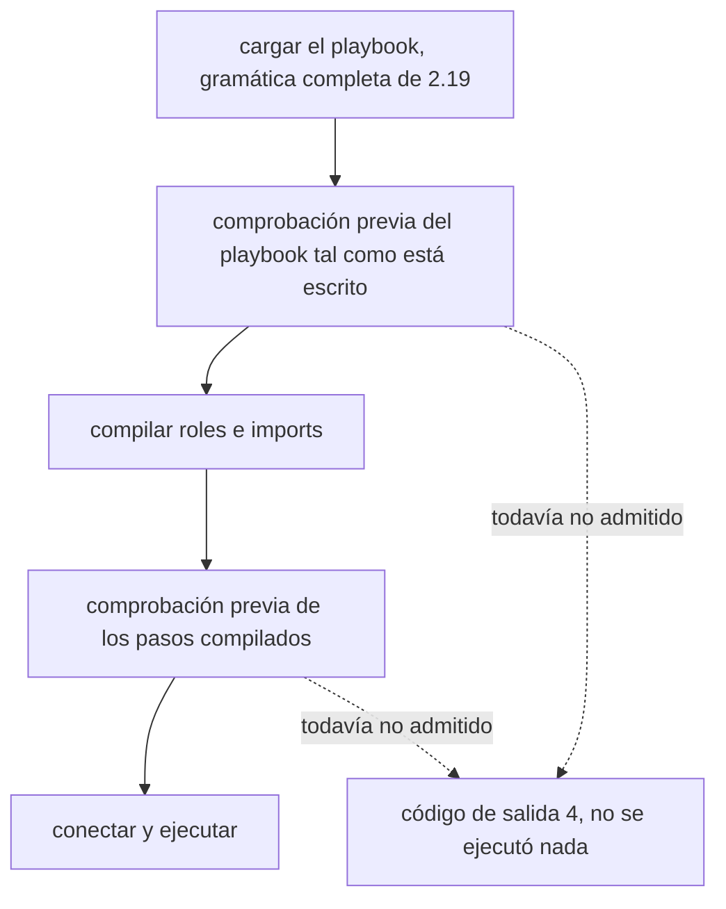

Volant lee toda la gramática de ansible-core 2.19, así que un playbook se interpreta aquí igual que bajo Ansible. Una segunda comprobación, la comprobación previa, busca después todo lo que el cargador aceptó y esta versión todavía no admite. Si encuentra algo, nombra cada caso y detiene la ejecución antes de la primera conexión, antes de cualquier banner y antes de cualquier recap.

Sin ella, una palabra clave que se colara entre las dos comprobaciones se ignoraría en silencio, y la ejecución informaría de éxito tras omitir lo que pediste.

La comprobación se ejecuta dos veces: una sobre el playbook tal como está escrito y otra sobre los pasos compilados. La primera pasada lee el play tal como está escrito, así que una tarea que `--tags` habría descartado detiene igualmente la ejecución si usa algo que todavía no se admite. La segunda pasada lee los pasos compilados, después de la selección de etiquetas, y es el único lugar donde se ve una palabra clave escrita dentro de un rol o de un archivo importado. Esto peca por detener más a menudo, nunca menos. Se comprueban todas las secciones de un bloque, incluidas `rescue` y `always`.

Lo que trae un include dinámico se comprueba cuando un host llega a él. Un rechazo en ese punto hace fallar el include para ese host, y un `rescue` o `ignore_errors` lo absorbe. Consulta [Roles, includes e imports](/es/docs/playbooks/roles/#includes-dinámicos).

## Qué rechaza hoy

[¿Se ejecutará mi playbook?](/es/docs/start/compatibility/#qué-rechaza-hoy) tiene la tabla de lo que rechaza la comprobación, con el mensaje de cada caso y su código de salida.

## Códigos de salida

Una ejecución que detiene la comprobación previa termina con el código 4, que es el que usa Ansible para un playbook que no puede cargar. Algunos casos conservan el código que se midió en Ansible:

| Caso | Código de salida |
|---|---|
| Cualquier cosa que esta versión todavía no admite | 4 |
| Un rol que `roles:` o `import_role` no encuentra | 1 |
| Un método de escalado de privilegios que esta versión todavía no admite | 2 |

Tres casos ya no son casos de la comprobación previa. Fallan cuando se llega a la tarea, como en ansible-core:

- Una acción `meta` desconocida imprime su banner, después `invalid meta action requested: <action>` y termina con el código 1, diga lo que diga su `when`.
- Un `notify` que no nombra ningún handler termina la ejecución con el código 1 cuando la tarea informa `changed`. Consulta [Bloques y handlers](/es/docs/playbooks/blocks/#diferencias-con-ansible).
- Un `include_role` de un rol cuyo archivo de tareas no se carga ejecuta los plays y las tareas anteriores, y después termina con el código 4 tras el banner de la sentencia. Un `when: false` en el include oculta el fallo.

[Códigos de salida](/es/docs/reference/exit-codes/) enumera todos los códigos que usa Volant.

Los listados y `--syntax-check` nunca llaman a la comprobación previa, así que puedes leer un playbook antes de que se publique la versión que lo ejecuta.

## Diferencias con Ansible

- `tags` y `timeout` se comprueban antes de mirar su valor, así que `tags: 3` no recibe el error de tipo de Ansible.
- Un `with_<name>` que no es un plugin lookup del ansible-core del controlador se rechaza con la frase de ansible-core, `'with_xyz' is not a valid attribute for a Task`. En un archivo que `include_tasks` o `include_role` lee mientras el play se ejecuta, el include falla para el host que llegó a él, y el play no se detiene con el código 4.
- Para un módulo que esta versión todavía no admite, los argumentos no se interpretan, así que el error trata del módulo y no de un `key=value` de la línea siguiente.
- `gather_facts`, `ignore_errors` y `become` escritos como algo distinto de true o false se rechazan cuando se carga el playbook, un paso antes de que Ansible los rechace, con el mensaje y el código de salida de ansible-core. Una plantilla no se rechaza: `ignore_errors: "{{ ... }}"` se renderiza cuando se ejecuta la tarea, para cada elemento del bucle, y las [palabras clave con plantillas](/es/docs/playbooks/how-a-play-runs/#palabras-clave-con-plantillas) se renderizan para cada host en ese mismo momento. `gather_facts` y `force_handlers` de un play se renderizan cuando el play empieza. Todas se leen con las reglas de ansible-core, y un valor que no pueden tomar hace fallar la tarea, o detiene el play en el caso de las dos últimas, con el mensaje de ansible-core.
