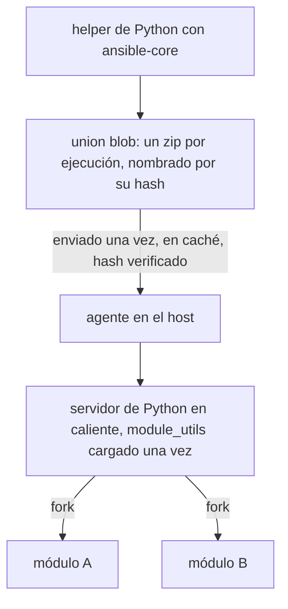

import { Aside } from '@astrojs/starlight/components';
import BarChart from '../../../../../components/BarChart.astro';

La mayoría de los módulos de Ansible son programas de Python. Volant los ejecuta sin modificarlos, pero no inicia un intérprete nuevo para cada tarea. Para los módulos más comunes, a menudo no ejecuta Python en absoluto: el agente tiene [versiones nativas](#módulos-nativos) que responden cuando los argumentos de una tarea lo permiten.

## Cómo funciona



1. El controlador pide a un proceso helper que construya el payload de ansible-core para cada módulo que necesita la ejecución, salvo que la [caché](#la-caché-de-la-union) ya contenga el resultado.
2. Volant los fusiona en un único zip, el union blob, con todos los archivos de `module_utils` que importan. El blob se nombra con el hash BLAKE3 de su contenido.
3. El blob se envía una vez a cada host y se guarda allí en caché. El agente comprueba el hash antes de usarlo, y un host que ya lo tiene no recibe nada.
4. El agente inicia un servidor de Python en cuanto el controlador ha enviado el payload, mientras todavía se ejecutan las tareas anteriores a la primera que necesita Python. Mantiene un servidor por cada intérprete, payload y la parte del `environment` de la tarea que un intérprete lee al arrancar (`PYTHON*`, `LD_*`, la configuración regional, `TZ`, `HOME` y el directorio temporal); el hijo define el resto antes de que se ejecute el módulo. Cada usuario de destino tiene un agente propio. El servidor carga el código compartido del blob una vez y después crea con fork un proceso hijo por cada tarea. El hijo ejecuta el módulo y escribe su resultado JSON de vuelta por una tubería. Mientras el hijo se ejecuta, el servidor importa ese módulo en sí mismo, de modo que el siguiente hijo del mismo módulo arranca con él ya cargado.

La union se construye antes de la primera conexión, así que tiene que contener todos los módulos a los que pueda llegar un host. Incluye los módulos que nombran los plays, los de cada archivo de tareas y de handlers de los roles del play (con las dependencias de su `meta/main.yml`) y los de cualquier archivo que un include nombre de forma literal. Un módulo nombrado solo en un archivo para otra plataforma, como `setup-RedHat.yml` junto a `setup-Debian.yml`, también está incluido, de modo que un `include_tasks: setup-{{ ansible_os_family }}.yml` encuentra su módulo sea cual sea el archivo que elija un host. Un nombre ahí al que ningún módulo responde se deja fuera, y solo falla por su nombre si un host llega a él.

El blob viaja como bytes sin procesar, comprimidos con deflate cuando así ocupan menos, y el agente comprueba el hash de los bytes descomprimidos.

Los resultados de los módulos no son fiables y nunca se renderizan como plantillas del controlador. Consulta [Valores fiables y no fiables](/es/docs/variables/templating/#los-valores-de-los-hosts-nunca-se-renderizan). Igual que ansible-core en el controlador, Volant añade `stdout_lines` y `stderr_lines` a un resultado que tiene `stdout` o `stderr` sin ellos, divididos con las reglas de `splitlines()` de Python.

## Qué necesita cada parte

El controlador necesita Python 3 con `ansible-core`. Cuando `VOLANT_PYTHON` está definida, Volant usa esa y ninguna otra. En caso contrario prueba su [runtime administrado](/es/docs/reference/runtime/), después el entorno virtual activo y después `python3` en tu `PATH`. Si ninguno tiene ansible-core, instala el runtime administrado.

El host necesita un intérprete de Python 3, pero no ansible-core: el blob lleva el módulo y todos los archivos que importa. El agente informa de los intérpretes que encuentra al iniciarse.

## Coste medido

Estas cifras proceden de un host Ubuntu 24.04 con Python 3.12, por SSH. Cada cifra es una mediana.

<BarChart
  title="Coste de ejecutar un módulo"
  subtitle="Host Ubuntu 24.04, Python 3.12, por SSH, mediana. Cuanto menos, más rápido."
  unit="ms"
  rows={[
    { label: 'Ansible, ajustes por defecto', value: 765 },
    { label: 'Ansible, pipelining', value: 469 },
    { label: 'Payload como proceso simple', value: 340 },
    { label: 'Fork, nada precargado', value: 266 },
    { label: 'Fork, module_utils cargado', value: 12.8, highlight: true, note: 'Lo que hace Volant' },
  ]}
/>

El coste por módulo sigue el trabajo que hace el módulo. `apt` tarda 755 ms, sobre todo en `dpkg`, mientras que `ping` tarda 12.8 ms: la ruta en caliente elimina sobrecarga, no trabajo.

Enviar los módulos como un único archivo ahorra el 72.7 por ciento de los bytes, porque los archivos que comparten viajan una sola vez. Para `ping`, `stat`, `file`, `lineinfile` y `apt`, son 631,050 bytes frente a 2,307,982 con un zip por módulo. Cargar el archivo cuesta 264.5 ms, una vez por servidor.

El [registro de decisión 0006](/es/docs/decisions/0006-warm-python-path/) tiene el razonamiento y una medición sobre un playbook completo.

## Módulos de colecciones

Un módulo de una colección instalada, como `ansible.posix.sysctl` o `community.general.ufw`, se ejecuta en la ruta de Python en caliente igual que uno incorporado.

### Cómo se resuelve un nombre

Antes de la primera conexión, Volant pregunta al ansible-core del controlador qué es cada nombre con puntos. ansible-core busca en las rutas de colecciones con las que está configurado, como `ANSIBLE_COLLECTIONS_PATH`, y después en el directorio `collections/` del runtime administrado, donde `volant runtime install --collections` las deja. Volant no instala nada durante una ejecución, y no se descarga nada para responder.

Un nombre fuera de `ansible.builtin` y `ansible.legacy` recibe una de cinco respuestas:

| Lo que encuentra ansible-core | Lo que hace Volant |
|---|---|
| un módulo que puede construir | lo añade a la union y lo ejecuta |
| un módulo que su colección ejecuta mediante un plugin de acción, directamente o por el enrutado de `runtime.yml` | ejecuta el plugin de acción en el helper de Python, como el propio de ansible-core |
| un plugin de acción que necesita un host Windows o una conexión de red | detiene la ejecución: el módulo necesita un plugin de acción de su colección, que esta versión no ejecuta |
| ningún módulo con ese nombre | detiene la ejecución con la frase de la referencia |
| un módulo que no puede ejecutar: eliminado, solo PowerShell, o que falla al construirse | detiene la ejecución, con el motivo |

En la union, un módulo incorporado conserva su nombre corto y un módulo de colección se identifica por su nombre completo. Dos colecciones que aportan cada una un módulo llamado `sysctl` quedan separadas, y `community.general.command` nunca se confunde con `command`.

Los argumentos de un módulo de colección escritos como cadena (`ansible.posix.sysctl: name=net.ipv4.ip_forward value=1`) se dividen en pares `key=value` como los divide `parse_kv` de ansible-core.

### Rechazos

Los rechazos llegan antes de la primera conexión, con el código de salida 4:

```text
task 'Forward': couldn't resolve module/action 'ns.coll.mod'. This often indicates a misspelling, missing collection, or incorrect module path. The collection 'ns.coll' is not installed on the controller: install it with volant runtime install --collections ns.coll
task 'Forward': module 'ns.coll.mod' cannot run: <reason>
```

La indicación de instalación aparece solo cuando falta la propia colección. Un módulo que falta en una colección instalada recibe solo la primera frase. `ansible.builtin.nosuch` también la recibe sola, porque ninguna colección puede aportar un nombre del espacio de nombres que posee ansible-core. Sin un ansible-core en el controlador, un nombre fuera de `ansible.builtin` se rechaza con la misma primera frase y el motivo por el que no se pudo consultar nada.

Un módulo de colección nombrado solo en el archivo de un rol para otra plataforma también se resuelve. Si se puede construir, se une a la union. Todo lo demás se deja fuera sin detener la ejecución, y el include que llega a él falla para ese host antes de que se ejecute ninguna tarea del archivo:

```text
task 'Forward': module 'ansible.posix.sysctl' was not resolved to a module before the run, so no payload holds it: its collection is not installed on the controller, no module path holds it, or it is named only in a file nothing read before the first connection
```

## Módulos respaldados por un plugin de acción

Algunos módulos de ansible-core solo funcionan junto con un plugin de acción que se ejecuta antes en el controlador. `package` elige el gestor de paquetes del host, `service` elige su sistema de init y `template` renderiza el archivo en el controlador antes de enviar nada. Enviar esos módulos sin su plugin haría algo distinto de lo que pidió el playbook.

Volant tiene su propia versión de ocho de estos plugins: `copy`, `dnf`, `fetch`, `package`, `reboot`, `service`, `template` y `unarchive` se ejecutan en el controlador como una breve secuencia de subtareas, cada una un módulo de Python ordinario o un comando simple enviado por la conexión que el host ya tiene. [Plugins de acción](/es/docs/internals/action-plugins/) describe cada uno. Los demás plugins, como los de `uri` y `script`, se ejecutan como el Python del propio ansible-core en el helper.

`assert`, `fail` y `pause` también tienen plugins de acción, pero ninguno llama a un módulo, así que Volant los ejecuta en el controlador. `setup` se ejecuta como un módulo ordinario, de forma nativa o en Python, de modo que la recopilación de facts funciona.

## La caché de la union

Construir la union cuesta un arranque de Python, una importación de ansible-core y una construcción de cada módulo. ansible-core lee cada archivo de `module_utils` que importa un módulo, y los módulos de una ejecución comparten la mayoría, así que el helper lee cada archivo una sola vez para toda la union: de 1.5 a 1.8 segundos con los cuatro roles de Galaxy de la [página de rendimiento](/es/docs/project/performance/), frente a 3.7 a 4.4 segundos cuando cada módulo los volvía a leer. El controlador guarda el resultado en `$XDG_CACHE_HOME/volant/unions/`, o en `~/.cache/volant/unions/`, en un directorio privado de tu cuenta.

Una entrada se busca por todo lo que leyó la construcción y que no es un archivo: la versión de Volant, el intérprete, los módulos y colecciones pedidos, el entorno `ANSIBLE_*` y `PYTHON*`, el `ansible.cfg` que leería ansible-core y el directorio de trabajo. También enumera cada archivo de origen que leyó el helper, con su tamaño y su fecha de modificación. Una ejecución reutiliza la entrada solo si cada uno de esos archivos no ha cambiado y el zip sigue teniendo su hash registrado. Por tanto, actualizar ansible-core o una colección en el sitio reconstruye la union.

Una caché que no se puede leer, está dañada o no se puede escribir nunca hace fallar una ejecución: la union se reconstruye, y un directorio en el que no se puede escribir imprime un aviso por ejecución. La caché guarda hasta 1 GiB. Por encima de eso, se eliminan primero las entradas que ninguna ejecución usa desde hace más tiempo, y una entrada que ninguna ejecución ha usado en 30 días se elimina. Para vaciarla, elimina el directorio.

## Módulos nativos

El agente incluye versiones en Rust de estos módulos:

| Módulo | Se responde de forma nativa cuando |
|---|---|
| `setup` | en Debian y Ubuntu, para los facts enumerados en [Facts](/es/docs/variables/precedence/#facts-nativos) |
| `stat` | la ruta es simple y absoluta, y el checksum es SHA-1 |
| `file` | `state` es `file`, `directory` o `absent`, o no está definido, y `link` cuando el enlace ya existe y apunta a `src` |
| `apt` | los paquetes se nombran exactamente, sin versión: una caché al día y paquetes ya instalados o ausentes solo se leen; una caché vieja se actualiza y los paquetes que faltan se instalan con los mismos comandos `apt-get` que ejecuta el módulo, bajo `policy_rc_d` cuando la tarea lo indica; un paquete marcado como instalado automáticamente se marca como manual, igual que en el módulo |
| `systemd`, `systemd_service` | `name`, `state`, `enabled` y `daemon_reload` en el ámbito del sistema |
| `lineinfile` | la expresión regular significa lo mismo en Rust que en Python, y `backrefs` está desactivado |
| `copy` | el módulo que ejecuta el plugin de acción `copy`, para un archivo preparado desde el controlador |
| `package_facts` | el gestor es apt y todos los paquetes están en un estado estable |
| `service_facts` | el host ejecuta systemd |
| `user`, `group` | en Debian y Ubuntu, para los argumentos comunes |

Todo lo que queda fuera de eso va al módulo de Python de ansible-core. Un `environment` de tarea, SELinux, los atributos extendidos, `remote_src`, una expresión regular que solo entiende Python o un paquete a medio instalar devuelven la tarea, entre otros casos. `dnf` y todos los demás módulos se ejecutan siempre en Python.

Un módulo nativo recibe los argumentos que habría recibido el módulo de Python. Primero decide, solo leyendo, si puede dar la respuesta que daría la referencia. Si no puede, devuelve la tarea antes de tocar el host, y el módulo de Python hace el trabajo real. Su resultado, `invocation` incluido, es el que devuelve el módulo de referencia, clave por clave, y una prueba los compara en cada caso que el módulo cubre. El resultado vuelve como datos no fiables, por el mismo camino que el de un módulo de Python.

En un host cuya configuración desactiva la caché de paquetes de apt, como hacen las imágenes de Debian y Ubuntu de Docker, apt la vuelve a construir a partir de las listas de paquetes en cada llamada: 1.3 segundos cada una en Ubuntu 24.04. El `apt` nativo hace entonces que sus llamadas a `apt-get`, `apt-cache` y `apt-mark` usen una caché en el directorio propio de la conexión, que se elimina cuando la conexión termina. Lo que imprimen y lo que dejan en el host no cambia.

Define `[volant] native_modules = false`, o `VOLANT_NATIVE_MODULES=0`, para enviar todas las tareas a Python. `--profile` muestra qué camino tomó cada tarea y, en una devolución, el motivo. Consulta [Línea de comandos](/es/docs/reference/cli/#ejecución-y-salida).

<Aside type="note">
La [referencia de módulos](/es/docs/reference/modules/) siempre enumera lo que ejecuta la versión actual, porque se genera a partir de las propias tablas del motor.
</Aside>
