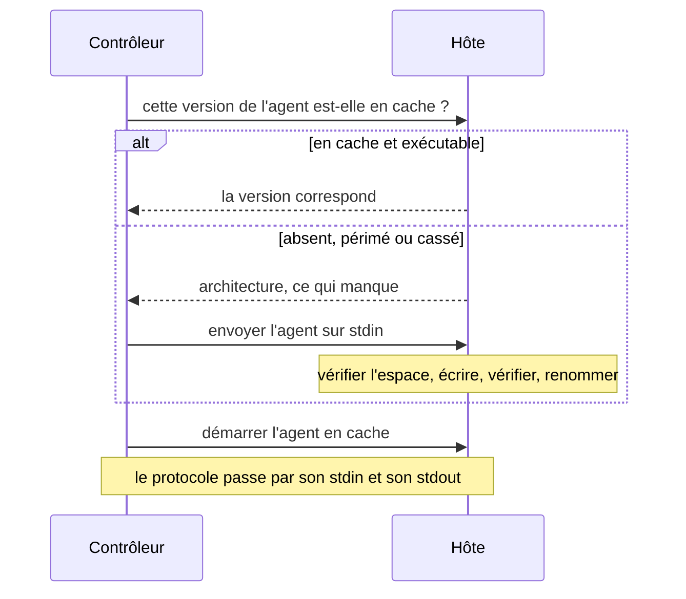

Volant dépose sur chaque hôte géré un petit programme statique, l'agent, et lui parle par `ssh` jusqu'à la fin de l'exécution. [Connexions et become](/fr/docs/hosts/connections/) explique ce que vous configurez. Cette page décrit ce qui se passe en dessous : l'envoi, les vérifications de permissions, la connexion partagée et les descripteurs de fichier qu'elle consomme.

## Atteindre un hôte



Sur un hôte qui a déjà servi, la vérification et le démarrage passent dans une seule session `ssh` : la commande vérifie le répertoire, compare l'agent en cache au build que ce contrôleur a pour le type de machine de l'hôte, et le démarre, sous `sudo -n` pour une connexion qui s'élève avec `sudo`. Si l'une de ces étapes échoue, la session se termine avant que l'agent réponde, et les étapes ci-dessus s'exécutent dans l'ordre.

## Le cache de l'agent

L'agent est un seul exécutable statique. Son archive de publication pour Linux x86_64 pèse environ 1.2 MB. Volant l'envoie une fois par hôte et le réutilise à chaque exécution suivante.

Il se trouve dans `<remote_tmp>/volant-agent-<version>-<uid>/volant-agent`. Avec la valeur par défaut de `remote_tmp`, il est donc sous `~/.ansible/tmp/` dans un répertoire personnel. La version dans le chemin est celle du contrôleur, ce qui évite à un contrôleur mis à jour d'exécuter un agent plus ancien. L'uid est l'identifiant numérique du compte qui exécute l'agent : le compte de connexion et un compte `become` qui partagent le même `remote_tmp` ont chacun leur propre répertoire.

Une tâche sans élévation exécute l'agent avec le compte sous lequel vous vous connectez et le met en cache dans le répertoire personnel de ce compte. Une tâche avec élévation l'exécute sous `become_user` et le met en cache dans le répertoire personnel de cet utilisateur, écrit par `sudo`. Un `become_user` autre que `root` l'exige, car les répertoires personnels sont souvent en mode 0700 et un agent mis en cache sous votre compte de connexion serait hors de portée. Un hôte garde un cache par compte sous lequel l'exécution agit, chacun appartenant à ce compte.

L'agent voyage par `ssh -C` : OpenSSH le compresse sur le réseau et rien n'est à décompresser sur l'hôte.


### Vérification des permissions

Volant n'exécute l'agent en cache que depuis un répertoire qu'aucun autre compte ne peut modifier. Il le vérifie lors de la sonde, après un envoi et une dernière fois juste avant le démarrage :

- Le répertoire et le programme ne sont pas des liens symboliques. Le compte qui exécute l'agent possède les deux, et aucun n'a de bit d'écriture pour le groupe ou les autres.
- `remote_tmp` appartient à ce compte, à root ou, sous `sudo` ou `su`, au compte qui s'est connecté. Les autres comptes ne peuvent pas y écrire, ou il a le sticky bit, comme `/tmp`.
- Un `remote_tmp` que le compte possède peut être ouvert à son groupe quand ce groupe est le groupe principal du compte, comme le produit un umask de 002 avec un groupe par utilisateur. Il ne le peut pas si une entrée d'ACL y apparaît (un `+` après le mode dans `ls -l`), car cette entrée peut donner l'accès en écriture à un autre compte. Volant ne lit que les bits de mode : les ACL qui n'y figurent pas (NFSv4, ZFS, macOS) ne sont pas vues.

Tout autre état arrête l'hôte avec une erreur `UNREACHABLE` qui nomme le chemin, ses permissions et son propriétaire. Un envoi crée ses fichiers avec `umask 077`. Si le répertoire est le vôtre mais trop ouvert, l'envoi le vide des fichiers de Volant et le recrée. Si un autre compte le possède, Volant n'y touche pas et le signale. Seuls sont supprimés les répertoires des autres versions que le même compte possède et qu'aucun autre compte ne peut modifier.

Un `remote_tmp` qui n'existe pas est créé par le compte qui s'est connecté, en mode 0700, comme le fait ansible-core, même quand une tâche avec élévation en a besoin la première. Un `become_user` autre que root ne peut alors pas y entrer : donnez à ce compte son propre `remote_tmp`, ou créez un répertoire partagé avec le sticky bit. Le `~/.ansible/tmp` par défaut ne demande rien, car `~` désigne le répertoire personnel de chaque compte.

Les vérifications utilisent `ls -ldn` et n'exigent donc aucune option de `stat`. Volant ne vérifie pas les répertoires au-dessus de `remote_tmp`. Un compte qui peut en remplacer un peut encore échanger le chemin dans le court laps de temps entre la dernière vérification et le démarrage de l'agent.

### Envoi et réparation

Avant chaque connexion, Volant demande sa version à l'agent en cache. Une version différente, un fichier absent ou un fichier qui ne démarre pas mènent tous à un nouvel envoi. Un cache cassé, par exemple une copie tronquée par une exécution interrompue, est réparé au lieu d'être signalé.

L'envoi vérifie d'abord l'espace libre avec `df` et veut de la place pour deux fois l'agent plus un mégaoctet. Il écrit sous un nom temporaire qui contient l'identifiant du processus du shell distant, vérifie le nombre d'octets, puis renomme. Un transfert interrompu n'atterrit jamais sous le nom définitif, et deux exécutions qui envoient en même temps vers le même hôte ne peuvent pas mélanger leurs octets.

Quand des modules Python ont été exécutés, `<remote_tmp>/volant-blobs-<version>-<uid>` se trouve à côté du répertoire de l'agent et contient les charges utiles des modules. Pour vider les deux caches, supprimez les deux répertoires. Rien d'autre ne reste :

```sh
ssh web1 'rm -rf ~/.ansible/tmp/volant-agent-* ~/.ansible/tmp/volant-blobs-*'
```

Un envoi supprime déjà les répertoires de cache des autres versions : un hôte garde donc un seul agent, pas un historique.

## Une connexion par hôte

Toutes les exécutions de `ssh` que Volant lance pour un même hôte de l'inventaire partagent une seule connexion OpenSSH : la vérification de version, l'envoi de l'agent, le lien vers l'agent et le lien avec élévation. Volant ajoute `-o ControlMaster=auto -o ControlPath=<dir>/<name> -o ControlPersist=30s` à sa ligne de commande, de sorte que seule la première exécution paie l'échange de clés et l'authentification. La connexion partagée reste ouverte 30 secondes après sa dernière session, et une exécution lancée dans cette fenêtre la réutilise.

Il ajoute aussi `ServerAliveInterval=5` et `ServerAliveCountMax=3`, de sorte qu'une connexion maître dont l'hôte ne répond plus se termine au bout d'environ 15 secondes au lieu de retenir chaque nouvelle session. Un keepalive dans vos propres arguments `ssh` (tout ce qui contient `serveralive`) les remplace.

Les sockets se trouvent dans `$XDG_RUNTIME_DIR/volant-cm`. Sans répertoire d'exécution utilisable, ils vont dans `/tmp/volant-cm-<uid>`, créé en mode 0700. Quiconque peut y créer un socket pourrait donner à votre prochain `ssh` une connexion à lui : un répertoire qui n'est pas le vôtre, ou pas en mode 0700, est donc refusé. L'exécution affiche alors `[WARNING]: ssh connections are not shared` avec la raison, et continue avec une connexion par exécution.

Le nom du socket est un hash du nom dans l'inventaire, de chaque option `ssh` avec laquelle l'hôte se connecte et de ce que `ssh -G` résout depuis vos fichiers de configuration. Une connexion ouverte pour un utilisateur, une clé, un port ou un `ProxyJump` ne sert donc jamais un hôte qui en demande un autre, et un `HostName` modifié dans `~/.ssh/config` entre deux exécutions obtient une nouvelle connexion. Deux alias d'inventaire d'une même machine obtiennent deux connexions, car une connexion partagée par cinquante alias atteindrait la limite `MaxSessions` du serveur. Une connexion ouverte avec un mot de passe n'est jamais proposée à une autre exécution.

Volant vous laisse gérer le partage quand vous le configurez déjà. Il n'ajoute rien quand :

- `ansible_ssh_common_args` ou `ansible_ssh_extra_args` mentionnent `ControlMaster`, `ControlPath` ou `ControlPersist`, ou passent `-S` ou `-M` ;
- votre configuration ssh en définit déjà un pour cet hôte, tel que `ssh -G` le rapporte ;
- les arguments de `ssh` demandent une sortie de débogage avec `-v` ;
- `[volant] ssh_control_master = false` ou `VOLANT_SSH_CONTROL_MASTER=0`, voir [Configuration](/fr/docs/reference/configuration/#volant-ssh-control-master).

Une connexion avec élévation qui ne peut pas démarrer en une seule session (voir plus haut) lance une session `ssh` supplémentaire pour la sonde `sudo`, deux quand un mot de passe est nécessaire. Quand le partage est actif, ces sessions utilisent la même connexion.

C'est OpenSSH qui fait le travail : `~/.ssh/config`, `Match`, `Include`, `ProxyJump` et votre ssh-agent s'appliquent exactement comme avec `ansible-playbook`.

## Descripteurs de fichier

Chaque connexion est un processus `ssh` distinct et coûte trois descripteurs de fichier au contrôleur. Avec l'élévation, une exécution peut tenir deux connexions par hôte : celle de l'hôte et une avec élévation.

Au démarrage, Volant relève sa propre limite souple de fichiers ouverts jusqu'à la limite stricte, plafonnée à 1,048,576. La plupart des systèmes Linux livrent une limite stricte bien supérieure à ce dont une exécution a besoin : il n'y a donc rien à faire.

:::caution
Une limite stricte de 1024 arrête encore une exécution à environ 330 connexions, ou environ 169 hôtes avec élévation. `ssh` cesse alors de démarrer, et les hôtes touchés sont signalés injoignables alors qu'ils n'ont aucun problème. Dans bash, `ulimit -n 1024` abaisse la limite stricte en même temps que la limite souple.
:::

Vérifiez les deux limites avant une exécution aussi large :

```sh
ulimit -Sn; ulimit -Hn
```
