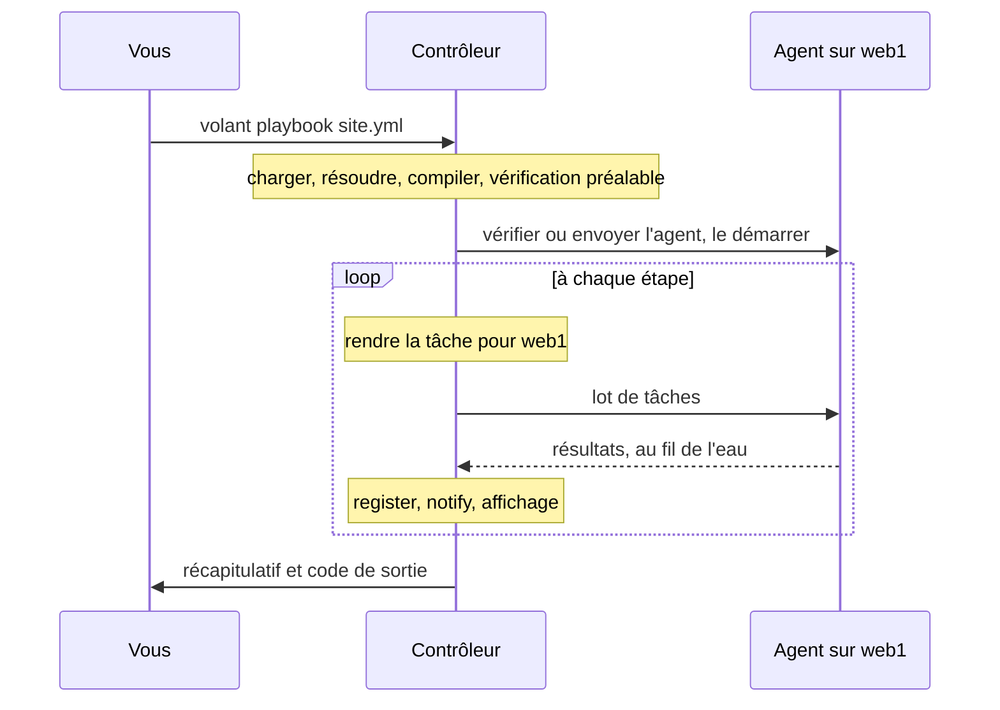

import { LinkCard } from '@astrojs/starlight/components';
import Flow from '../../../../../components/Flow.astro';

Volant se compose de deux programmes et d'un protocole. Le contrôleur tourne sur votre machine et fait tout le travail de réflexion. L'agent tourne sur chaque hôte et fait ce qu'on lui demande.

<Flow
  lanes={[
    {
      label: 'Contrôleur',
      note: 'sur votre machine, avant toute connexion',
      steps: [
        { text: 'charger les fichiers' },
        { text: 'résoudre les variables' },
        { text: 'compiler les étapes' },
        { text: 'vérification préalable' },
        { text: 'exécuteur', kind: 'key' },
      ],
    },
    {
      label: 'Hôte géré',
      note: 'un agent, joint par une seule connexion ssh',
      steps: [
        { text: 'volant-agent', kind: 'key' },
        { text: 'modules natifs ou serveur Python préchauffé' },
        { text: 'résultats, renvoyés au fil de l\'eau' },
      ],
    },
  ]}
/>

## Le contrôleur

Le contrôleur, `crates/volant`, lit `ansible.cfg`, l'inventaire, les playbooks et les rôles. Il résout les variables, rend chaque modèle et compile chaque play en une liste plate d'étapes avant de se connecter où que ce soit. La [vérification préalable](/fr/docs/internals/preflight/) s'arrête ensuite sur tout ce que cette version ne prend pas encore en charge.

L'exécuteur démarre un pilote par hôte, dans la limite de `forks`. La stratégie `linear` garde les pilotes au même rythme. Avec `free` et `host_pinned`, chaque pilote avance à son allure, et `debug` est `linear` avec un débogueur après une tâche en échec. Un pilote fait parcourir les étapes à son hôte : il rend chaque tâche avec les variables de cet hôte, l'envoie à l'agent et juge le résultat (`register`, `changed_when`, `failed_when`, handlers). Un coordinateur retient les pilotes aux points de synchronisation et gère tout ce qui arrive au terminal.

Pour les modules Python, le contrôleur demande à un processus auxiliaire qui exécute ansible-core de construire les charges utiles des modules, et garde le résultat dans un cache d'une exécution à l'autre. Ce même processus exécute les filtres, les tests et les lookups qui n'ont pas de version Rust, les plugins d'inventaire des collections et les plugins d'action que Volant relaie par le pont, dont les jobs s'exécutent en parallèle. Avant la première connexion, il lit aussi toute l'exécution pour décider si l'agent peut collecter les facts nativement. Voir [Le chemin Python préchauffé](/fr/docs/internals/python/).

Toutes les exécutions de `ssh` pour un même hôte de l'inventaire partagent une seule connexion OpenSSH, voir [Connexions et become](/fr/docs/hosts/connections/#une-connexion-par-hôte).

## L'agent

L'agent, `crates/volant-agent`, est un binaire statique, envoyé une fois par hôte et mis en cache. Son archive de publication pèse environ 1.2 MB. Il reçoit des lots de tâches, les exécute et renvoie les résultats au fur et à mesure. Il exécute lui-même `command`, `shell` et `raw`. Il embarque aussi des versions natives de `setup`, `stat`, `file`, `apt`, `systemd`, `lineinfile`, `copy`, `package_facts`, `service_facts`, `user` et `group`, qui répondent à une tâche quand ses arguments le permettent et la rendent sinon. Le serveur Python préchauffé exécute tout le reste, voir [Modules natifs](/fr/docs/internals/python/#modules-natifs). L'agent lance aussi des jobs en arrière-plan pour les tâches avec `async`, et `async_status` les relit. Avec `ansible_connection: local`, l'agent est un processus fils du contrôleur et aucun `ssh` ne s'exécute. Il ne connaît ni les playbooks, ni les variables, ni l'élévation de privilèges.

## Le protocole

`crates/volant-protocol` définit les trames et les messages que les deux programmes partagent. Le contrôleur démarre l'agent par `ssh` et parle le protocole sur l'entrée et la sortie standard de ce processus jusqu'à la fin de l'exécution. Les trames sont en JSON, sauf qu'un blob de modules ou un fichier déposé suit son annonce sous forme d'octets bruts, compressés avec deflate quand c'est plus court, depuis la version 6 du protocole. La version actuelle est la 8. Modifier un message oblige à incrémenter `PROTOCOL_VERSION`, et la version de l'agent fait partie de son chemin de cache : un contrôleur ne parle donc jamais à un agent d'une autre version.

Une trame fait au plus 64 MiB, car `slurp` envoie un fichier comme une seule chaîne dans un résultat. Un résultat est aussi borné par son contenu : au plus 500,000 valeurs, 64 niveaux d'imbrication et 500,000 lignes de `stdout` et `stderr` réunies (ou une ligne pour 32 octets de sortie quand c'est plus). Un résultat qui dépasse une borne fait échouer cette tâche pour cet hôte seul, avec un message qui donne la limite et le compte. Tout autre message fait au plus 1 MiB.

## Une exécution, de bout en bout

## Comment un play est compilé

Vous écrivez un play sous forme d'arbre : des sections, des rôles, des blocs, des tâches. Volant l'aplatit une fois, avant de se connecter à quoi que ce soit, en une seule liste numérotée d'étapes. Chaque hôte parcourt ensuite cette même liste, dans l'ordre où ansible-core l'exécute :

<Flow
  lanes={[
    {
      steps: [
        { text: 'pre_tasks' },
        { text: 'flush', kind: 'point' },
        { text: 'rôles, chacun après ses dépendances' },
        { text: 'tasks' },
        { text: 'flush', kind: 'point' },
        { text: 'post_tasks' },
        { text: 'flush', kind: 'point' },
      ],
    },
  ]}
/>

Les trois points de flush des handlers sont toujours là. On ne sait si un play a des handlers qu'une fois ses rôles lus sur le disque : le compilateur pose donc les trois. Un flush qui n'a rien à exécuter n'affiche rien.

Les mots-clés écrits sur un play, une entrée de rôle ou un bloc sont repliés dans chaque tâche en dessous pendant la compilation, et la valeur la plus interne l'emporte. Un `become: true` sur le play et un `become: false` sur une tâche donnent exactement ce que donne Ansible, et l'exécution n'a pas à transporter l'arbre.

Les blocs survivent à l'aplatissement sous forme de plages sur la liste. Une petite table de sauts sur ces plages dit à un hôte où aller quand une étape réussit, échoue ou est ignorée. [Blocs et handlers](/fr/docs/playbooks/blocks/) explique ce que cela signifie pour `rescue` et `always`.

### Où le travail s'exécute

Le templating se fait sur le contrôleur. Chaque hôte rend sa propre copie d'une tâche avec ses propres variables, et la tâche rendue part vers l'agent de cet hôte par une connexion qui reste ouverte pendant toute l'exécution. L'agent l'exécute et renvoie le résultat. Le contrôleur applique ensuite `register`, `changed_when`, `failed_when` et `notify`, puis affiche la ligne de résultat.

Certains modules ne quittent jamais le contrôleur : `debug`, `set_fact`, `assert`, `fail`, `pause`, `include_vars` et `validate_argument_spec`. Voir [Modules](/fr/docs/reference/modules/).

Une tâche écrite `action: module=ping` ne nomme aucune action. Elle échoue sur le contrôleur quand un hôte l'atteint, avec le code de sortie 2, et un `rescue` ou un `ignore_errors` rattrape l'échec.

Une boucle rend chaque élément quand elle l'atteint : un élément qui ne se rend pas échoue seul. Voir [Boucles et nouvelles tentatives](/fr/docs/playbooks/loops/#rendu-de-chaque-élément).

La ligne de résultat suit le format d'ansible-core 2.19. `failed` et `skipped` sont retirés du résultat, y compris sur les lignes `fatal:` et les éléments de boucle, puisque le préfixe de la ligne le dit déjà. Les `warnings` d'un module sont affichés sous forme de lignes `[WARNING]:` et ne figurent pas dans la valeur enregistrée. Une tâche en échec enregistre `exception: "(traceback unavailable)"`, que la ligne n'affiche jamais. Quand `when` ignore tous les éléments d'une boucle, la ligne `skipping:` de chaque élément est suivie d'une ligne `skipping: [host]` pour la tâche, et le récapitulatif compte la tâche une seule fois.

## Choix de conception

Chaque choix qui change ce que voient les utilisateurs est consigné, avec son raisonnement, dans une fiche de décision :

<LinkCard title="Fiches de décision" description="Pourquoi la GPL et quelles crates sont permissives, pourquoi ansible-core 2.19, comment fonctionnent become et le traitement par lots, pourquoi le chemin Python utilise une archive par exécution, comment s'exécutent les plugins d'action et pourquoi les modules courants s'exécutent nativement." href="/fr/docs/decisions/" />

<LinkCard title="Carte du code" description="Où se trouve chaque partie du moteur dans l'arborescence des sources, pour les contributeurs." href="https://github.com/lorica-labs/volant/blob/main/ARCHITECTURE.md" />
