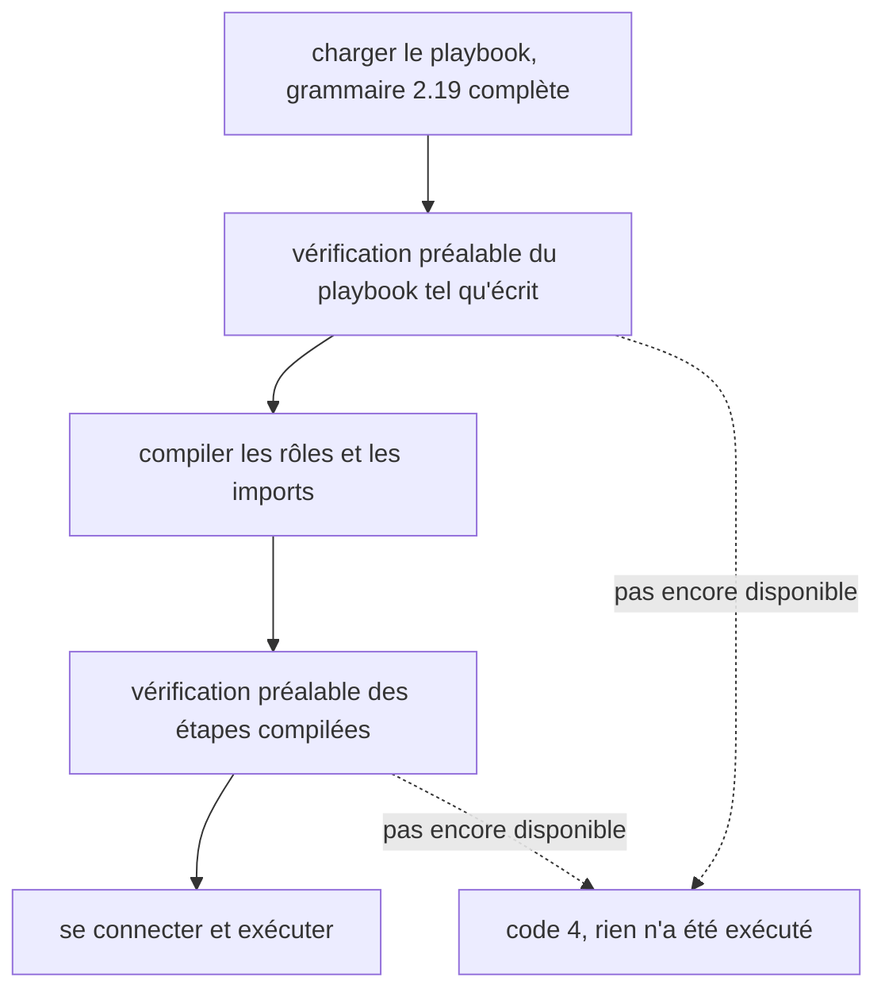

Volant lit toute la grammaire d'ansible-core 2.19 : un playbook s'analyse donc ici comme sous Ansible. Une seconde vérification, la vérification préalable, cherche ensuite tout ce que le chargeur a accepté et que cette version ne prend pas encore en charge. Si elle en trouve, elle nomme chaque élément et arrête l'exécution avant la première connexion, avant toute bannière et avant tout récapitulatif.

Sans elle, un mot-clé qui aurait échappé aux deux contrôles serait ignoré en silence, et l'exécution se terminerait avec succès après avoir sauté ce que vous demandiez.

La vérification s'exécute deux fois : une fois sur le playbook tel qu'il est écrit, une fois sur les étapes compilées. La première passe lit le play tel qu'écrit : une tâche que `--tags` aurait écartée arrête donc quand même l'exécution si elle utilise une fonction pas encore disponible. La seconde passe lit les étapes compilées, après la sélection des tags, et c'est le seul endroit où un mot-clé écrit dans un rôle ou un fichier importé est visible. Cela penche vers l'arrêt plus fréquent, jamais moins. Chaque section d'un bloc est vérifiée, `rescue` et `always` compris.

Ce qu'un include dynamique apporte est vérifié quand un hôte l'atteint. Un refus à cet endroit fait échouer l'include pour cet hôte, et un `rescue` ou un `ignore_errors` le rattrape. Voir [Imports et includes](/fr/docs/playbooks/roles/#includes-dynamiques).

## Ce qu'elle refuse aujourd'hui

[Mon playbook va-t-il s'exécuter ?](/fr/docs/start/compatibility/#ce-qui-est-refusé-aujourdhui) contient le tableau de ce que la vérification refuse, avec le message de chaque cas et son code de sortie.

## Codes de sortie

Une exécution arrêtée par la vérification préalable se termine avec le code 4, celui qu'Ansible utilise pour un playbook qu'il ne peut pas charger. Certains cas gardent le code qu'Ansible a été mesuré comme utilisant :

| Cas | Code de sortie |
|---|---|
| Tout ce que cette version ne prend pas encore en charge | 4 |
| Un rôle que `roles:` ou `import_role` ne trouve pas | 1 |
| Une méthode d'élévation que cette version ne prend pas encore en charge | 2 |

Trois cas ne relèvent plus de la vérification préalable. Ils échouent quand la tâche est atteinte, comme dans ansible-core :

- Une action `meta` inconnue affiche sa bannière, puis `invalid meta action requested: <action>` et se termine avec le code 1, quel que soit son `when`.
- Un `notify` qui ne nomme aucun handler termine l'exécution avec le code 1 quand la tâche rapporte `changed`. Voir [Handlers](/fr/docs/playbooks/blocks/#différences-avec-ansible).
- Un `include_role` d'un rôle dont le fichier de tâches ne se charge pas exécute les plays et les tâches qui le précèdent, puis se termine avec le code 4 après la bannière de l'instruction. Un `when: false` sur l'include masque l'échec.

[Codes de sortie](/fr/docs/reference/exit-codes/) liste tous les codes que Volant utilise.

Les listes et `--syntax-check` n'appellent jamais la vérification préalable : vous pouvez donc lire un playbook avant la version qui l'exécute.

## Différences avec Ansible

- `tags` et `timeout` sont vérifiés avant que leur valeur soit examinée : `tags: 3` n'obtient donc pas l'erreur de type d'Ansible.
- Un `with_<name>` qui n'est pas un plugin de lookup de l'ansible-core du contrôleur est refusé avec la phrase d'ansible-core, `'with_xyz' is not a valid attribute for a Task`. Dans un fichier qu'`include_tasks` ou `include_role` lit pendant l'exécution du play, l'include échoue pour l'hôte qui l'a atteint, et le play ne s'arrête pas au code 4.
- Pour un module que cette version ne prend pas encore en charge, les arguments ne sont pas analysés : l'erreur porte donc sur le module et non sur un `key=value` de la ligne suivante.
- `gather_facts`, `ignore_errors` et `become` écrits avec autre chose que true ou false sont rejetés au chargement du playbook, une étape plus tôt qu'Ansible, avec le message et le code de sortie d'ansible-core. Un modèle n'est pas rejeté : `ignore_errors: "{{ ... }}"` est rendu quand la tâche s'exécute, pour chaque élément de boucle, et les [mots-clés sous forme de modèle](/fr/docs/playbooks/how-a-play-runs/#mots-clés-sous-forme-de-modèle) sont rendus pour chaque hôte au même moment. `gather_facts` et `force_handlers` d'un play sont rendus au démarrage du play. Tous sont lus avec les règles d'ansible-core, et une valeur qu'ils ne peuvent pas prendre fait échouer la tâche, ou arrête le play pour les deux derniers, avec le message d'ansible-core.
