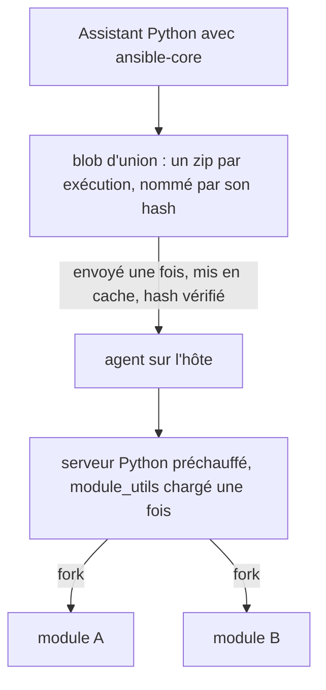

import { Aside } from '@astrojs/starlight/components';
import BarChart from '../../../../../components/BarChart.astro';

La plupart des modules Ansible sont des programmes Python. Volant les exécute tels quels, mais ne démarre pas un nouvel interpréteur pour chaque tâche. Pour les modules les plus courants, il n'exécute souvent pas Python du tout : l'agent a des [versions natives](#modules-natifs) qui répondent quand les arguments de la tâche le permettent.

## Comment ça marche



1. Le contrôleur demande à un processus auxiliaire de construire la charge utile d'ansible-core pour chaque module dont l'exécution a besoin, sauf si le [cache](#le-cache-de-lunion) contient déjà le résultat.
2. Volant les fusionne en un seul zip, le blob d'union, avec tous les fichiers `module_utils` qu'ils importent. Le blob est nommé par le hash BLAKE3 de son contenu.
3. Le blob est envoyé une fois à chaque hôte et mis en cache là-bas. L'agent vérifie le hash avant de l'utiliser, et un hôte qui l'a déjà ne reçoit rien.
4. L'agent démarre un serveur Python dès que le contrôleur a envoyé la charge utile, pendant que les tâches qui précèdent la première à avoir besoin de Python s'exécutent encore. Il garde un serveur par interpréteur, par charge utile et par partie de l'`environment` de tâche qu'un interpréteur lit au démarrage (`PYTHON*`, `LD_*`, la locale, `TZ`, `HOME` et le répertoire temporaire) ; le fils définit le reste avant que le module s'exécute. Chaque utilisateur cible a son propre agent. Le serveur charge une fois le code partagé depuis le blob, puis crée un processus fils pour chaque tâche. Le fils exécute le module et renvoie son résultat JSON par un tube. Pendant que le fils s'exécute, le serveur importe ce module dans son propre processus : le fils suivant du même module démarre donc avec lui déjà chargé.

L'union est construite avant la première connexion, elle doit donc contenir tous les modules qu'un hôte peut atteindre. Elle contient les modules que les plays nomment, ceux de chaque fichier de tâches et de handlers des rôles du play (dépendances de `meta/main.yml` comprises) et ceux de tout fichier qu'un include nomme littéralement. Un module nommé seulement dans un fichier pour une autre plateforme, comme `setup-RedHat.yml` à côté de `setup-Debian.yml`, y figure aussi : un `include_tasks: setup-{{ ansible_os_family }}.yml` trouve donc son module quel que soit le fichier choisi par un hôte. Un nom qu'aucun module ne porte en est écarté, et n'échoue, par son nom, que si un hôte l'atteint.

Le blob voyage sous forme d'octets bruts, compressés avec deflate quand c'est plus court, et l'agent vérifie le hash des octets décompressés.

Les résultats de modules sont non fiables et ne sont jamais rendus comme des modèles du contrôleur. Voir [Valeurs fiables et non fiables](/fr/docs/variables/templating/#les-valeurs-venues-des-hôtes-ne-sont-jamais-rendues-comme-modèles). Comme ansible-core le fait sur le contrôleur, Volant ajoute `stdout_lines` et `stderr_lines` à un résultat qui a `stdout` ou `stderr` sans eux, découpés selon les règles de `splitlines()` de Python.

## Ce dont chaque côté a besoin

Le contrôleur a besoin de Python 3 avec `ansible-core`. Quand `VOLANT_PYTHON` est défini, Volant l'utilise et rien d'autre. Sinon il essaie son [runtime géré](/fr/docs/reference/runtime/), puis l'environnement virtuel actif, puis `python3` dans votre `PATH`. Si aucun n'a ansible-core, il installe le runtime géré.

L'hôte a besoin d'un interpréteur Python 3, mais pas d'ansible-core : le blob contient le module et tous les fichiers qu'il importe. L'agent signale les interpréteurs qu'il trouve quand il démarre.

## Coût mesuré

Ces chiffres viennent d'un hôte Ubuntu 24.04 avec Python 3.12, par SSH. Chaque valeur est une médiane.

<BarChart
  title="Coût d'exécution d'un module"
  subtitle="Hôte Ubuntu 24.04, Python 3.12, par SSH, médiane. Plus court, c'est plus rapide."
  unit="ms"
  rows={[
    { label: 'Ansible, réglages par défaut', value: 765 },
    { label: 'Ansible, pipelining', value: 469 },
    { label: 'Charge utile en processus simple', value: 340 },
    { label: 'Fork, rien de préchargé', value: 266 },
    { label: 'Fork, module_utils chargé', value: 12.8, highlight: true, note: 'Ce que fait Volant' },
  ]}
/>

Le coût par module suit le travail que le module fait. `apt` prend 755 ms, surtout dans `dpkg`, là où `ping` prend 12.8 ms : le chemin préchauffé supprime de la charge, pas du travail.

Envoyer les modules dans une seule archive économise 72.7 % des octets, car les fichiers qu'ils partagent ne voyagent qu'une fois. Pour `ping`, `stat`, `file`, `lineinfile` et `apt`, cela fait 631,050 octets contre 2,307,982 pour un zip par module. Charger l'archive coûte 264.5 ms, une fois par serveur.

La [fiche de décision 0006](/fr/docs/decisions/0006-warm-python-path/) donne le raisonnement et une mesure sur un playbook complet.

## Modules de collections

Un module d'une collection installée, comme `ansible.posix.sysctl` ou `community.general.ufw`, s'exécute sur le chemin Python préchauffé comme un module intégré.

### Comment un nom est résolu

Avant la première connexion, Volant demande à l'ansible-core du contrôleur ce qu'est chaque nom pointé. ansible-core cherche dans les chemins de collections qui lui sont configurés, comme `ANSIBLE_COLLECTIONS_PATH`, puis dans le répertoire `collections/` du runtime géré, où `volant runtime install --collections` les place. Volant n'installe rien pendant une exécution, et rien n'est téléchargé pour répondre.

Un nom en dehors de `ansible.builtin` et `ansible.legacy` reçoit l'une de cinq réponses :

| Ce que trouve ansible-core | Ce que fait Volant |
|---|---|
| un module qu'il peut construire | l'ajoute à l'union et l'exécute |
| un module que sa collection exécute par un plugin d'action, directement ou par le routage de `runtime.yml` | exécute le plugin d'action dans l'assistant Python, comme celui d'ansible-core |
| un plugin d'action qui exige un hôte Windows ou une connexion réseau | arrête l'exécution : le module a besoin d'un plugin d'action de sa collection, que cette version n'exécute pas |
| aucun module de ce nom | arrête l'exécution avec la phrase de la référence |
| un module qu'il ne peut pas exécuter : supprimé, PowerShell uniquement, ou dont la construction échoue | arrête l'exécution, en donnant la raison |

Dans l'union, un module intégré garde son nom court et un module de collection est identifié par son nom complet. Deux collections qui fournissent chacune un module appelé `sysctl` restent distinctes, et `community.general.command` n'est jamais pris pour `command`.

Les arguments d'un module de collection écrits sous forme de chaîne (`ansible.posix.sysctl: name=net.ipv4.ip_forward value=1`) sont découpés en paires `key=value` comme le fait `parse_kv` d'ansible-core.

### Refus

Les refus surviennent avant la première connexion, avec le code de sortie 4 :

```text
task 'Forward': couldn't resolve module/action 'ns.coll.mod'. This often indicates a misspelling, missing collection, or incorrect module path. The collection 'ns.coll' is not installed on the controller: install it with volant runtime install --collections ns.coll
task 'Forward': module 'ns.coll.mod' cannot run: <reason>
```

L'indication d'installation n'apparaît que lorsque la collection elle-même manque. Un module absent d'une collection installée reçoit la première phrase seule. `ansible.builtin.nosuch` la reçoit seule aussi, car aucune collection ne peut fournir un nom dans l'espace de noms qu'ansible-core possède. Sans ansible-core sur le contrôleur, un nom en dehors de `ansible.builtin` est refusé avec la même première phrase et la raison pour laquelle rien n'a pu le chercher.

Un module de collection nommé seulement dans un fichier de rôle pour une autre plateforme est lui aussi résolu. S'il peut être construit, il rejoint l'union. Tout le reste est écarté sans arrêter l'exécution, et l'include qui l'atteint échoue pour cet hôte avant que la moindre tâche du fichier s'exécute :

```text
task 'Forward': module 'ansible.posix.sysctl' was not resolved to a module before the run, so no payload holds it: its collection is not installed on the controller, no module path holds it, or it is named only in a file nothing read before the first connection
```

## Modules adossés à un plugin d'action

Certains modules d'ansible-core ne fonctionnent qu'avec un plugin d'action qui s'exécute d'abord sur le contrôleur. `package` choisit le gestionnaire de paquets de l'hôte, `service` choisit son système d'init, et `template` rend le fichier sur le contrôleur avant que quoi que ce soit soit envoyé. Envoyer ces modules sans leur plugin ferait autre chose que ce que le playbook demandait.

Volant a sa propre version de huit de ces plugins : `copy`, `dnf`, `fetch`, `package`, `reboot`, `service`, `template` et `unarchive` s'exécutent sur le contrôleur comme une courte suite de sous-tâches, chacune un module Python ordinaire ou une commande simple envoyée sur la connexion déjà ouverte de l'hôte. [Plugins d'action](/fr/docs/internals/action-plugins/) décrit chacun d'eux. Les autres plugins, comme ceux de `uri` et `script`, s'exécutent comme le Python d'ansible-core dans l'assistant.

`assert`, `fail` et `pause` ont eux aussi des plugins d'action, mais aucun n'appelle de module : Volant les exécute donc sur le contrôleur. `setup` s'exécute comme un module ordinaire, nativement ou en Python, de sorte que la collecte des facts fonctionne.

## Le cache de l'union

Construire l'union coûte un démarrage de Python, un import d'ansible-core et la construction de chaque module. ansible-core lit chaque fichier `module_utils` qu'un module importe, et les modules d'une exécution en partagent la plupart : le helper lit donc chaque fichier une seule fois pour toute l'union. Cela prend de 1.5 à 1.8 seconde sur les quatre rôles Galaxy de la [page de performances](/fr/docs/project/performance/), contre 3.7 à 4.4 secondes quand chaque module les relisait. Le contrôleur garde le résultat sous `$XDG_CACHE_HOME/volant/unions/`, ou `~/.cache/volant/unions/`, dans un répertoire privé à votre compte.

Une entrée est retrouvée grâce à tout ce que la construction a lu et qui n'est pas un fichier : la version de Volant, l'interpréteur, les modules et collections demandés, l'environnement `ANSIBLE_*` et `PYTHON*`, l'`ansible.cfg` qu'ansible-core lirait et le répertoire de travail. Elle liste aussi chaque fichier source que l'assistant a lu, avec sa taille et sa date de modification. Une exécution ne réutilise l'entrée que si chacun de ces fichiers est inchangé et si le zip a encore le hash enregistré. Mettre à jour ansible-core ou une collection sur place reconstruit donc l'union.

Un cache illisible, corrompu ou impossible à écrire ne fait jamais échouer une exécution : l'union est reconstruite, et un répertoire non inscriptible affiche un avertissement par exécution. Le cache garde jusqu'à 1 GiB. Au-delà, les entrées qu'aucune exécution n'a utilisées depuis le plus longtemps partent en premier, et une entrée qu'aucune exécution n'a utilisée depuis 30 jours est supprimée. Pour le vider, supprimez le répertoire.

## Modules natifs

L'agent embarque des versions Rust de ces modules :

| Module | Répond nativement quand |
|---|---|
| `setup` | sur Debian et Ubuntu, pour les facts listés sous [Facts](/fr/docs/variables/precedence/#facts-natifs) |
| `stat` | le chemin est simple et absolu, et la somme de contrôle est SHA-1 |
| `file` | `state` vaut `file`, `directory` ou `absent`, ou n'est pas défini, et `link` quand le lien existe déjà et pointe vers `src` |
| `apt` | les paquets sont nommés exactement, sans version : un cache à jour et des paquets déjà installés ou absents sont seulement lus ; un cache périmé est mis à jour et les paquets manquants sont installés avec les mêmes commandes `apt-get` que le module, sous `policy_rc_d` quand la tâche le donne ; un paquet marqué comme installé automatiquement est marqué manuel, comme le fait le module |
| `systemd`, `systemd_service` | `name`, `state`, `enabled` et `daemon_reload` sur la portée système |
| `lineinfile` | l'expression régulière a le même sens en Rust qu'en Python, et `backrefs` est désactivé |
| `copy` | le module qu'exécute le plugin d'action `copy`, pour un fichier déposé depuis le contrôleur |
| `package_facts` | le gestionnaire est apt et chaque paquet est dans un état stable |
| `service_facts` | l'hôte exécute systemd |
| `user`, `group` | sur Debian et Ubuntu, pour les arguments courants |

Tout ce qui sort de là va au module Python d'ansible-core. Un `environment` de tâche, SELinux, les attributs étendus, `remote_src`, une expression régulière que seul Python comprend ou un paquet à moitié installé rendent tous la main, entre autres cas. `dnf` et tous les autres modules s'exécutent toujours en Python.

Un module natif reçoit les arguments que le module Python aurait reçus. Il décide d'abord, en lisant seulement, s'il peut donner la réponse que donnerait la référence. S'il ne le peut pas, il rend la tâche avant de toucher à l'hôte, et le module Python fait le vrai travail. Son résultat, `invocation` compris, est celui que renvoie le module de référence, clé pour clé, et un test les compare pour chaque cas que le module couvre. Le résultat revient comme donnée non fiable, par le même chemin que celui d'un module Python.

Sur un hôte dont la configuration désactive le cache de paquets d'apt, comme les images Debian et Ubuntu de Docker, apt le reconstruit à partir des listes de paquets à chaque appel : 1.3 seconde par appel sous Ubuntu 24.04. Le `apt` natif fait alors utiliser à ses appels de `apt-get`, `apt-cache` et `apt-mark` un cache placé dans le répertoire propre à la connexion, supprimé à la fin de celle-ci. Ce qu'ils affichent et ce qu'ils laissent sur l'hôte ne change pas.

Définissez `[volant] native_modules = false`, ou `VOLANT_NATIVE_MODULES=0`, pour envoyer chaque tâche à Python. `--profile` montre quel chemin chaque tâche a pris et, pour un retour de main, la raison. Voir [Ligne de commande](/fr/docs/reference/cli/#exécution-et-sortie).

<Aside type="note">
La [référence des modules](/fr/docs/reference/modules/) liste toujours ce que la version actuelle exécute, puisqu'elle est générée à partir des tables du moteur lui-même.
</Aside>
