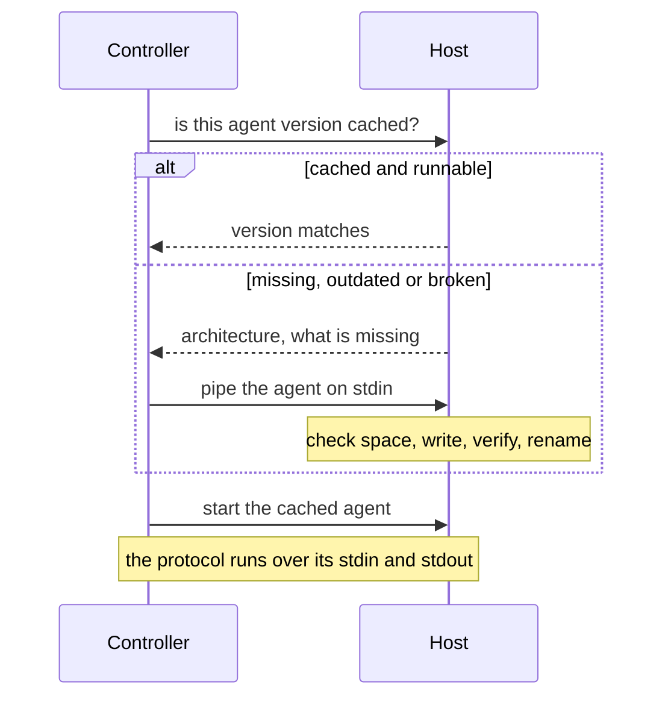

Volant reaches a managed host, puts a small static agent there, and talks to it over the same connection for the rest of the run.

## Connection types

`ansible_connection` picks the transport. It defaults to `ssh`, as in Ansible.

| Value | What it does |
|---|---|
| `ssh` | Runs the OpenSSH client from your `PATH`. Volant builds the command line itself, without a wrapper and without a Rust SSH library, so your `~/.ssh/config` applies. |
| `local` | Runs the agent as a child process on the controller, with no network. |

Every other connection is refused. That covers `paramiko_ssh`, `winrm`, `psrp`, the container and cloud plugins such as `docker`, `podman`, `kubectl` and `aws_ssm`, and the fully qualified spellings of the two supported ones: `ansible.builtin.ssh`, `ansible.builtin.local` and `ansible.legacy.*`. Any value with a dot in it is refused, so a collection's plugin such as `community.docker.docker` is too. The host is reported unreachable with `connection '<name>' is not supported`, and the rest of the run continues.

A bare name that no plugin carries fails the task with `the connection plugin '<name>' was not found`, as Ansible does. The same happens for `docker` and the other names a collection took over from ansible-core, because the collection is not there. That applies whether the value is the host's own connection, a `delegate_to` target's, or that of the host running a `run_once` task.

A password comes from `-k`, from `--connection-password-file` or from the `ansible_password` variable. Volant hands it to `ssh` through `SSH_ASKPASS` and a private temporary file that is removed at the end of the run, which needs OpenSSH 8.4 or later. `ssh` then runs with `BatchMode=no` and `NumberOfPasswordPrompts=1`, so one wrong answer ends the attempt. The password is never on a command line, in the environment of a program or in the output, `-vvvv` included. A vaulted `ansible_password` works like any vaulted variable. Without a password, `ssh` runs with `BatchMode=yes` and never prompts, so a host that would ask for a password or a passphrase is reported unreachable instead of hanging the run.

## Host variables

Volant reads these per host, from the inventory or from any other variable source. A test checks this list against the names the connection code reads, so it stays in sync with the engine.

| Variable | Effect |
| --- | --- |
| `ansible_connection` | `ssh` (default) or `local` |
| `ansible_host`, `ansible_ssh_host` | Address to connect to. Defaults to the inventory name. A value that starts with `-` or holds whitespace or a control character is refused before `ssh` runs. |
| `ansible_port`, `ansible_ssh_port` | `ssh -p`. A quoted number works as well as a bare one. |
| `ansible_user`, `ansible_ssh_user` | `ssh -l` |
| `ansible_password`, `ansible_ssh_pass`, `ansible_ssh_password` | The connection password, offered to `ssh` as described above. |
| `ansible_private_key_file`, `ansible_ssh_private_key_file` | `ssh -i` |
| `ansible_timeout`, `ansible_ssh_timeout` | Seconds `ssh` waits for the connection, `ssh -o ConnectTimeout`. |
| `ansible_ssh_executable` | The `ssh` program to run. Defaults to `ssh` from your `PATH`. |
| `ansible_ssh_common_args` | Extra `ssh` arguments, split the way a shell would split them |
| `ansible_ssh_extra_args` | The same, added after the common ones |
| `ansible_ssh_use_tty` | Run `raw` and `script` commands on a terminal, as `ssh -tt` does. On unless set to false. The default comes from [`usetty`](/reference/configuration/#ssh-connection-usetty). |
| `ansible_remote_tmp` | Directory that holds the agent cache on that host |
| `ansible_become` | Escalate or not, overriding the `become` keyword |
| `ansible_become_user`, `ansible_sudo_user`, `ansible_su_user` | Target user for escalation |
| `ansible_become_method` | `sudo` or `su` |
| `ansible_become_password`, `ansible_become_pass`, `ansible_sudo_pass`, `ansible_su_pass` | Escalation password |
| `ansible_become_exe`, `ansible_sudo_exe`, `ansible_su_exe` | The escalation program |
| `ansible_become_flags`, `ansible_sudo_flags`, `ansible_su_flags` | Its flags |
| `ansible_su_prompt_l10n` | A list of prompts that `su` may print. It replaces the built-in ones. |

When a host sets a variable and an alias of it, the one Ansible lets win applies. The table lists them from strongest to weakest, with the keyword that sets the same thing:

| Setting | Variables | Keyword |
|---|---|---|
| Address | `ansible_ssh_host`, `ansible_host` | |
| Port | `ansible_ssh_port`, `ansible_port` | `port` |
| User | `ansible_ssh_user`, `ansible_user` | `remote_user` |
| Key file | `ansible_ssh_private_key_file`, `ansible_private_key_file` | |
| Timeout | `ansible_ssh_timeout`, `ansible_timeout` | |
| Password | `ansible_ssh_password`, `ansible_ssh_pass`, `ansible_password` | |
| Connection | `ansible_connection` | `connection` |
| Escalation user, program and flags | `ansible_sudo_*` or `ansible_su_*` (the method's own), then `ansible_become_*` | `become_user`, `become_exe`, `become_flags` |
| Escalation password | `ansible_sudo_pass` or `ansible_su_pass`, then `ansible_become_pass`, then `ansible_become_password` | |

A password variable beats `-k` and `--connection-password-file`, and a variable set to an empty string offers no password at all. A connection variable works at every level that sets variables: inventory, `group_vars`, a play's `vars`, a block, a task's `vars` and `-e`.

The keywords work on a play, a block and a task, and `-c` sets the connection for hosts that name none. The order is the one Ansible uses: a host variable such as `ansible_user` wins, then the task, the block and the play, then the command line and `ansible.cfg`. Facts a host reports about itself never choose its user, port or connection. A keyword written as a template is rendered once per task. These values fail the task: a user name that starts with `-` or holds a space, a quote or a control character, a port outside 1-65535, and a connection name with anything but letters, digits, `_` and `.`. A delegated task uses the task's `remote_user` and `port` unless the delegate sets its own `ansible_user` or `ansible_port`.

An unbalanced quote in `ansible_ssh_common_args` or `ansible_ssh_extra_args` fails the host instead of being dropped. That matters behind a bastion: silently discarding a `ProxyCommand` would connect straight to an address that may belong to a different machine.

The `ansible.cfg` settings that affect connections, such as `timeout`, `remote_user`, `host_key_checking` and `forks`, are listed in [Configuration](/reference/configuration/).

## Reaching a host



## The agent cache

The agent is a single static executable. Its release archive for x86_64 Linux is about 1.2 MB. Volant uploads it once per host and reuses it on every later run.

It lives at `<remote_tmp>/volant-agent-<version>-<uid>/volant-agent`, so with the default `remote_tmp` it sits under `~/.ansible/tmp/` in a home directory. The version in the path is the controller's own, which is how an upgraded controller avoids running an older agent. The uid is the numeric id of the account that runs the agent, so the login account and a `become` account that share one `remote_tmp` each get their own directory.

A task that does not escalate runs the agent as the account you log in as and caches it in that account's home. A task that escalates runs it as the `become_user` and caches it in that user's home, written through `sudo`. A `become_user` other than `root` needs this, because home directories are often mode 0700 and an agent cached under your login account would be out of reach. A host holds one cache per account the run acts as, each owned by that account.

The agent travels through `ssh -C`, so OpenSSH compresses it on the wire and nothing has to be unpacked on the host.

### Permission checks

Volant runs the cached agent only from a directory that no other account can change. It checks this on the probe, after an upload and again just before the start:

- The directory and the program are not symbolic links. The account that runs the agent owns both, and neither has a group or other write bit.
- `remote_tmp` belongs to that account, to root or, under `sudo`, to the account that ran `sudo`. Other accounts cannot write to it, or it has the sticky bit, as `/tmp` has.
- A `remote_tmp` that the account owns may be open to its group when that group is the account's own primary group, as a umask of 002 with a group per user makes it. It may not when an ACL entry shows on it (a `+` after the mode in `ls -l`), because that entry can grant write access to another account. Volant reads only the mode bits, so ACLs that are not in them (NFSv4, ZFS, macOS) are not seen.

Any other state stops the host with an `UNREACHABLE` error that names the path, its permissions and its owner. An upload is created with `umask 077`. If the directory is yours but too open, the upload empties it of Volant's files and makes it again. If another account owns it, Volant leaves it alone and reports it. Only the directories of other versions that the same account owns and that no other account can write are removed.

A `remote_tmp` that does not exist is created by the first account that needs it, with mode 0700, and then belongs to that account. Create it first when several accounts share it. The default `~/.ansible/tmp` needs nothing.

The checks use `ls -ldn`, so they need no `stat` option. Volant does not check the directories above `remote_tmp`. An account that can replace one of them can still swap the path in the short time between the last check and the start of the agent.

### Upload and repair

Before every connection, Volant asks the cached agent for its version. A version mismatch, a missing file or a file that will not start all lead to a fresh upload. A broken cache, such as a copy truncated by an interrupted run, gets repaired instead of reported.

The upload checks free space with `df` first, and wants room for twice the agent plus a megabyte. It writes to a temporary name that includes the remote shell's process ID, checks the byte count, then renames into place. A transfer cut short never lands under the final name, and two runs uploading to the same host at once cannot mix their bytes.

To clear the cache, remove the directory. Nothing else is left behind:

```sh
ssh web1 'rm -rf ~/.ansible/tmp/volant-agent-*'
```

An upload already removes the cache directories of other versions, so a host holds one agent rather than a history of them.

## Persistent connections

A host keeps its connection to the agent for the whole run, across plays. Tasks travel over that one connection instead of opening a new one each time. If the connection dies between two plays, Volant reconnects once, and a second failure reports the host unreachable.

Some tasks add a connection:

- Escalation. A host that uses `become` holds a second connection, to an agent running as the target user. It is kept until the end of the play, so a play of escalated tasks starts one escalated agent, not one per task. A host holds at most one escalated connection at a time: escalating to a different user replaces it.
- Delegation. A delegated task runs over the delegate's own connection, with the delegate's settings. A host whose play delegates to three other hosts holds those three connections alongside its own.

## One connection per host

All the `ssh` runs Volant makes for one inventory host share a single OpenSSH connection: the version check, the agent upload, the link to the agent and the escalated link. Volant adds `-o ControlMaster=auto -o ControlPath=<dir>/<name> -o ControlPersist=30s` to its command line, so only the first run pays for the key exchange and the authentication. The shared connection stays open for 30 seconds after its last session, and a run started in that window reuses it.

It also adds `ServerAliveInterval=5` and `ServerAliveCountMax=3`, so a master whose host stopped answering exits after about 15 seconds instead of holding every new session. A keepalive in your own `ssh` arguments (anything containing `serveralive`) replaces them.

The sockets live in `$XDG_RUNTIME_DIR/volant-cm`. Without a usable runtime directory they go to `/tmp/volant-cm-<uid>`, created at mode 0700. Whoever can create a socket there could hand your next `ssh` a connection of their own, so a directory that is not yours, or not at mode 0700, is refused. The run then prints `[WARNING]: ssh connections are not shared` with the reason and carries on with one connection per run.

The socket name is a hash of the inventory name, every `ssh` option the host connects with and what `ssh -G` resolves from your configuration files. So a connection opened for one user, key, port or `ProxyJump` never serves a host that asks for another, and a `HostName` changed in `~/.ssh/config` between two runs gets a new connection. Two inventory aliases of one machine get two connections, because one connection shared by fifty aliases would run into the server's `MaxSessions` limit. A connection that a password opened is never offered to another run.

Volant leaves sharing to you when you already configure it. It adds nothing when:

- `ansible_ssh_common_args` or `ansible_ssh_extra_args` mention `ControlMaster`, `ControlPath` or `ControlPersist`, or pass `-S` or `-M`;
- your ssh configuration already sets one of them for that host, as `ssh -G` reports it;
- the `ssh` arguments ask for debug output with `-v`;
- `[volant] ssh_control_master = false` or `VOLANT_SSH_CONTROL_MASTER=0`, see [Configuration](/reference/configuration/#volant-ssh-control-master).

An escalated connection runs one extra `ssh` session for the `sudo` probe, two when a password is needed. With sharing on, those sessions use the same connection.

OpenSSH does the work, so `~/.ssh/config`, `Match`, `Include`, `ProxyJump` and your ssh-agent apply exactly as they do for `ansible-playbook`.

## File descriptors

Each connection is a separate `ssh` process and costs the controller three file descriptors. With escalation, a run can hold two connections per host: the host's own and one escalated.

At startup Volant raises its own soft limit on open files up to the hard limit, capped at 1,048,576. Most Linux systems ship a hard limit far above what a run needs, so nothing has to be done.

:::caution
A hard limit of 1024 still stops a run at about 330 connections, or about 169 escalating hosts. `ssh` then stops starting, and the hosts it happens to hit are reported unreachable although nothing is wrong with them. In bash, `ulimit -n 1024` lowers the hard limit along with the soft one.
:::

Check both limits before a run that wide:

```sh
ulimit -Sn; ulimit -Hn
```

## Not there yet

- Windows hosts and network devices.
- The connection plugins named under Connection types.

[Keywords](/reference/keywords/) is the full list, generated from the tables the engine reads.
