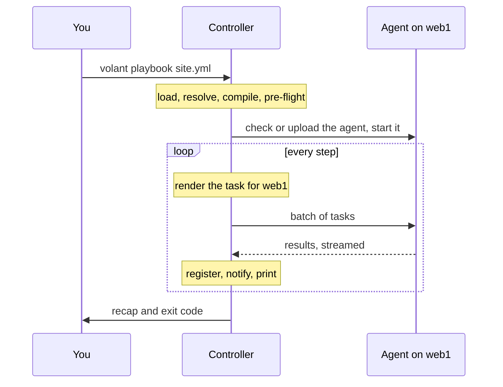

import { LinkCard } from '@astrojs/starlight/components';
import Flow from '../../../components/Flow.astro';

Volant is two programs and a protocol. The controller runs on your machine and does all the thinking. The agent runs on each host and does what it is told.

<Flow
  lanes={[
    {
      label: 'Controller',
      note: 'on your machine, before anything connects',
      steps: [
        { text: 'load files' },
        { text: 'resolve variables' },
        { text: 'compile steps' },
        { text: 'pre-flight' },
        { text: 'executor', kind: 'key' },
      ],
    },
    {
      label: 'Managed host',
      note: 'one agent, reached over a single ssh connection',
      steps: [
        { text: 'volant-agent', kind: 'key' },
        { text: 'native modules or the warm Python server' },
        { text: 'results, streamed back' },
      ],
    },
  ]}
/>

## The controller

The controller, `crates/volant`, reads `ansible.cfg`, the inventory, the playbooks and the roles. It resolves variables, renders every template, and compiles each play into a flat list of steps before it connects anywhere. The [pre-flight](/internals/preflight/) then stops on anything this release does not support yet.

The executor starts one driver per host, bounded by `forks`. The `linear` strategy keeps the drivers in step. Under `free` and `host_pinned` each driver runs at its own pace, and `debug` is `linear` with a debugger after a failed task. A driver walks its host through the steps, renders each task with that host's variables, sends it to the agent and judges the result: `register`, `changed_when`, `failed_when`, handlers. A coordinator holds the drivers at synchronization points and owns everything that reaches the terminal.

For Python modules, the controller asks a helper process running ansible-core to build the module payloads, and keeps the result in a cache between runs. The same helper runs the filters, tests and lookups that have no Rust version, the inventory plugins of collections, and the action plugins that Volant bridges, which run their jobs in parallel. Before the first connection it also reads the whole run to decide whether the agent may gather facts natively. See [The warm Python path](/internals/python/).

All the `ssh` runs for one inventory host share one OpenSSH connection, see [Connections and the agent](/hosts/connections/#one-connection-per-host).

## The agent

The agent, `crates/volant-agent`, is a static binary, uploaded once per host and cached. Its release archive is about 1.2 MB. It receives batches of tasks, runs them, and streams results back as they finish. It runs `command`, `shell` and `raw` itself. It also carries native versions of `setup`, `stat`, `file`, `apt`, `systemd`, `lineinfile`, `copy`, `package_facts`, `service_facts`, `user` and `group`, which answer a task when its arguments allow and hand it back otherwise. The warm Python server runs everything else, see [Native modules](/internals/python/#native-modules). It also starts background jobs for tasks with `async`, and `async_status` reads them back. With `ansible_connection: local` the agent is a child process of the controller and no `ssh` runs. It knows nothing about playbooks, variables or escalation.

## The protocol

`crates/volant-protocol` defines the frames and messages both programs share. The controller starts the agent over `ssh` and speaks the protocol over that process's standard input and output for the rest of the run. Frames are JSON, except that a blob of modules or a staged file follows its announcement as raw bytes, deflated when that is shorter, since protocol version 6. The current version is 8. Changing a message means bumping `PROTOCOL_VERSION`, and the agent's version is part of its cache path, so a controller never talks to an agent from another release.

A frame is at most 64 MiB, because `slurp` and `fetch` send a file as one string inside a result. A result is bounded by what it holds as well: at most 500,000 values, 64 levels of nesting, and 500,000 lines of `stdout` and `stderr` together (or one line for every 32 bytes of output when that is more). A result over a bound fails that task for that host alone, with a message that gives the limit and the count. Any other message is at most 1 MiB.

## A run, end to end

## How a play is compiled

You write a play as a tree: sections, roles, blocks, tasks. Volant flattens it once, before it connects to anything, into a single numbered list of steps. Every host then walks that same list, in the order ansible-core runs it:

<Flow
  lanes={[
    {
      steps: [
        { text: 'pre_tasks' },
        { text: 'flush', kind: 'point' },
        { text: 'roles, each after its dependencies' },
        { text: 'tasks' },
        { text: 'flush', kind: 'point' },
        { text: 'post_tasks' },
        { text: 'flush', kind: 'point' },
      ],
    },
  ]}
/>

The three handler flush points are always there. Whether a play has handlers at all is only known once its roles are read from disk, so the compiler lays out all three. A flush with nothing to run prints nothing.

Keywords written on a play, a role entry or a block are folded into each task underneath while the play compiles, and the innermost value wins. A `become: true` on the play and a `become: false` on one task give exactly what Ansible gives, and the run does not have to carry the tree around.

Blocks survive the flattening as spans over the list. A small jump table over those spans tells a host where to go after a step succeeds, fails, or is skipped. [Blocks and handlers](/playbooks/blocks/) covers what that means for `rescue` and `always`.

### Where the work happens

Templating happens on the controller. Each host renders its own copy of a task with its own variables, and the rendered task goes to that host's agent over a connection that stays open for the whole run. The agent runs it and streams the result back. The controller then applies `register`, `changed_when`, `failed_when` and `notify`, and prints the result line.

Some modules never leave the controller: `debug`, `set_fact`, `assert`, `fail`, `pause`, `include_vars` and `validate_argument_spec`. See [Modules](/reference/modules/).

A task written as `action: module=ping` names no action. It fails on the controller when a host reaches it, with exit 2, and a `rescue` or `ignore_errors` takes the failure.

A loop renders each item when it reaches the item, so an item that fails to render fails alone. See [Loops and retries](/playbooks/loops/#rendering-each-item).

The result line follows ansible-core 2.19's format. `failed` and `skipped` are left off the result, on `fatal:` lines and loop items too, since the line's prefix already says it. A module's `warnings` are printed as `[WARNING]:` lines and kept out of the registered value. A failed task registers `exception: "(traceback unavailable)"`, which the line never shows. When `when` skips every item of a loop, each item's `skipping:` line is followed by one `skipping: [host]` line for the task, and the recap counts the task once.

## Design choices

Each choice that changes what users see is recorded, with its reasoning, as a decision record:

<LinkCard title="Decision records" description="Why GPL and which crates are permissive, why ansible-core 2.19, how become and batching work, why the Python path uses one archive per run, how action plugins run, and why common modules run natively." href="/decisions/" />

<LinkCard title="Code map" description="Where each part of the engine lives in the source tree, for contributors." href="https://github.com/lorica-labs/volant/blob/main/ARCHITECTURE.md" />
