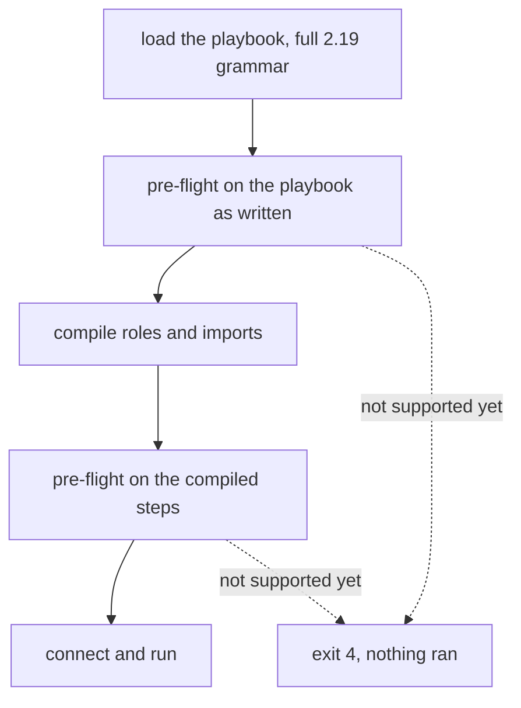

Volant reads the whole ansible-core 2.19 grammar, so a playbook parses here as it parses under Ansible. A second check, the pre-flight, then looks for everything the loader accepted and this release does not support yet. If it finds any, it names each one and stops the run before the first connection, before any banner and before any recap.

Without it, a keyword that slipped past both checks would be ignored in silence, and the run would report success after skipping what you asked for.

The check runs twice: once on the playbook as written, and once on the compiled steps. The first pass reads the play as written, so a task that `--tags` would have dropped still stops the run when it uses something not supported yet. The second pass reads the compiled steps, after tag selection, and is the only place where a keyword written inside a role or an imported file is visible. This errs toward stopping more often, never less. Every section of a block is checked, `rescue` and `always` included.

What a dynamic include brings in is checked when a host reaches it. A refusal there fails the include for that host, and a `rescue` or `ignore_errors` takes it. See [Includes and imports](/playbooks/roles/#dynamic-includes).

## What it refuses today

[Will my playbook run?](/start/compatibility/#what-it-refuses-today) has the table of what the check refuses, with the message of each and its exit code.

## Exit codes

A run the pre-flight stops exits with code 4, which is what Ansible uses for a playbook it cannot load. Some cases keep the code Ansible was measured to use:

| Case | Exit code |
|---|---|
| Anything this release does not support yet | 4 |
| A role that `roles:` or `import_role` cannot find | 1 |
| An escalation method this release does not support yet | 2 |

Three cases are no longer pre-flight cases. They fail when the task is reached, as in ansible-core:

- An unknown `meta` action prints its banner, then `invalid meta action requested: <action>` and exits 1, whatever its `when` says.
- A `notify` that names no handler ends the run with exit 1 when the task reports `changed`. See [Handlers](/playbooks/blocks/#differences-from-ansible).
- An `include_role` of a role whose task file does not load runs the plays and tasks before it, then ends with exit 4 after the statement's banner. A `when: false` on the include hides the failure.

[Exit codes](/reference/exit-codes/) lists every code Volant uses.

Listings and `--syntax-check` never call the pre-flight, so you can read a playbook before the release that runs it ships.

## Differences from Ansible

- `tags` and `timeout` are checked before their value is looked at, so `tags: 3` does not get Ansible's type error.
- A `with_<name>` that is no lookup plugin of the controller's ansible-core is refused with ansible-core's sentence, `'with_xyz' is not a valid attribute for a Task`. In a file that `include_tasks` or `include_role` reads while the play runs, the include fails for the host that reached it, and the play does not stop at exit 4.
- For a module this release does not support yet, the arguments are not parsed, so the error is about the module and not about a `key=value` on the next line.
- `gather_facts`, `ignore_errors` and `become` written as something other than true or false are rejected when the playbook loads, one step earlier than Ansible rejects them, with ansible-core's message and exit code. A template is not rejected: `ignore_errors: "{{ ... }}"` renders when the task runs, for each loop item, and the [templated keywords](/playbooks/how-a-play-runs/#templated-keywords) render for each host at the same moment. `gather_facts` and `force_handlers` of a play render when the play starts. All of them are read with ansible-core's rules, and a value they cannot take fails the task, or stops the play for the last two, with ansible-core's message.
