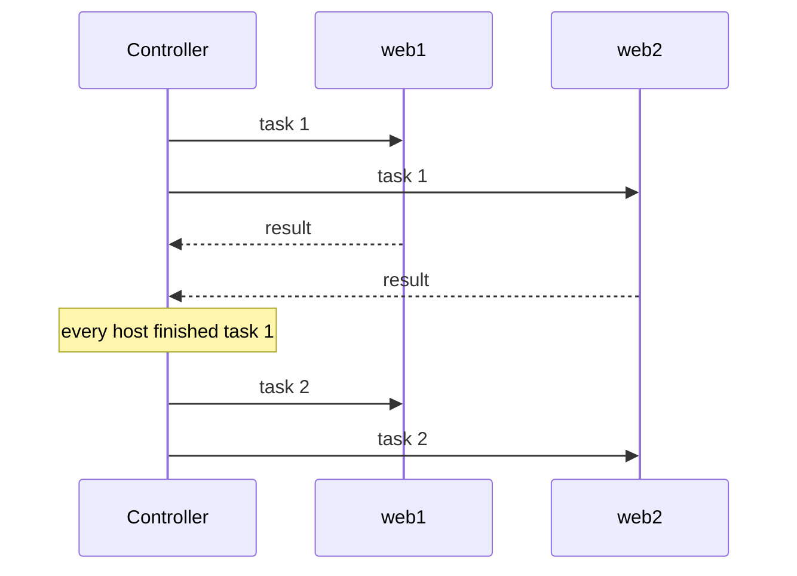

import { Aside } from '@astrojs/starlight/components';
import Flow from '../../../components/Flow.astro';

The pages in this section explain what each keyword does once Volant runs it. [Keywords](/reference/keywords/) says which keywords this release accepts. Each page ends with the places where Volant deliberately behaves differently from ansible-core 2.19.12, and why.

## From a tree to a list

You write a play as a tree: sections, roles, blocks, tasks. Volant flattens it once, before it connects to anything, into a single numbered list of steps. Every host then walks that same list, in the order ansible-core runs it:

<Flow
  lanes={[
    {
      steps: [
        { text: 'pre_tasks' },
        { text: 'flush', kind: 'point' },
        { text: 'roles, each after its dependencies' },
        { text: 'tasks' },
        { text: 'flush', kind: 'point' },
        { text: 'post_tasks' },
        { text: 'flush', kind: 'point' },
      ],
    },
  ]}
/>

The three handler flush points are always there. Whether a play has handlers at all is only known once its roles are read from disk, so the compiler lays out all three. A flush with nothing to run prints nothing.

Keywords written on a play, a role entry or a block are folded into each task underneath while the play compiles, and the innermost value wins. A `become: true` on the play and a `become: false` on one task give exactly what Ansible gives, and the run does not have to carry the tree around.

Blocks survive the flattening as spans over the list. A small jump table over those spans tells a host where to go after a step succeeds, fails, or is skipped. [Blocks](/playbooks/blocks/) covers what that means for `rescue` and `always`.

## Hosts move together

By default Volant follows Ansible's `linear` strategy: the hosts of a play meet in front of every task. No host starts task two until every host has finished task one, and the output arrives in task order because the run happens in task order.

[Cross-host batching](/hosts/batching/) is an opt-in setting that lets each host run ahead through tasks that do not depend on the others.

### Other strategies

`strategy: free` lets every host walk the play at its own pace. A banner is printed whenever the task changes from the one the last line belonged to, so the output follows the hosts, not the task list. Hosts still meet where a step is shared by its keywords (`run_once`, `pause`, `any_errors_fatal`) and at handlers and dynamic includes.

`strategy: host_pinned` is `free` with a host held by one fork from its first task to its last, so `-f 1` runs the hosts one after the other. With fewer forks than hosts the hosts run in waves: the results match ansible-core, and timing and line order can differ. Under both strategies, as in ansible-core, `max_fail_percentage`, `any_errors_fatal` and `run_once` are ignored with a warning, and a `pause` or `add_host` task stops the run with an error.

`strategy: debug` is `linear` with the debugger prompt after a failed task. So is the `debugger` keyword, on a play, a block or a task: `always`, `never`, `on_failed`, `on_unreachable` or `on_skipped`. Setting `enable_task_debugger` in `ansible.cfg` (or `ANSIBLE_ENABLE_TASK_DEBUGGER`) opens it after any failed or unreachable task. The prompt takes `p` and `pprint` to print a value, `u` to update the task's arguments, `h` for help, `r` to run the task again, `c` to continue and `q` to quit. `p` and a line that is not a command evaluate a subset of Python: names, literals, indexing, attributes, assignments and the calls the prompt needs. A change to `task_vars` reaches a redo only through `u`. A `debugger` value that is not valid fails the task when it runs. The prompt reads standard input, from a terminal or a pipe. At the end of input, or after `q`, it prints `User interrupted execution` and the run ends with exit code 99, as in ansible-core.

`order` sets the order a play's hosts run in: `inventory`, `reverse_inventory`, `sorted`, `reverse_sorted` or `shuffle`. `throttle` limits a task to that many hosts at a time. It is templated for each task and read as a number. A play's `timeout` is the default `timeout` of its tasks.

### Async tasks

`async: <seconds>` starts the task as a job on the host and `poll: <seconds>` waits for it; `poll: 0` returns at once with an `ansible_job_id` that `async_status` reads later. The job keeps running if the connection drops, writes its status file atomically in the async directory, and is killed with its process group when `async` runs out. `async_status` with `mode: cleanup` removes that job's file only. An action that ansible-core runs under `async` runs here too. Any other action fails at run time on each host with `This action (<name>) does not support async.` The async directory is `ansible_async_dir`, else `ANSIBLE_ASYNC_DIR`, else `async_dir` in `ansible.cfg`, else `~/.ansible_async`.

### vars_prompt and module_defaults

`vars_prompt` asks for each variable when the play starts, unless `-e` already gave it. When standard input is not a terminal it takes the `default` and warns once, and never waits. `module_defaults` fills a module's missing arguments from the play, block or task, for the module's own name and for its group, such as `group/aws`, with `collections` resolving short names the way ansible-core does.

## Where the work happens

Templating happens on the controller. Each host renders its own copy of a task with its own variables, and the rendered task goes to that host's agent over a connection that stays open for the whole run. The agent runs it and streams the result back. The controller then applies `register`, `changed_when`, `failed_when` and `notify`, and prints the result line.

Some modules never leave the controller: `debug`, `set_fact`, `assert`, `fail`, `pause`, `include_vars` and `validate_argument_spec`. See [Modules](/reference/modules/).

The result line follows ansible-core 2.19's format. `failed` and `skipped` are left off the result, on `fatal:` lines and loop items too, since the line's prefix already says it. A module's `warnings` are printed as `[WARNING]:` lines and kept out of the registered value. A failed task registers `exception: "(traceback unavailable)"`, which the line never shows. When `when` skips every item of a loop, each item's `skipping:` line is followed by one `skipping: [host]` line for the task, and the recap counts the task once.

<Aside type="tip">
The [architecture page](/internals/architecture/) follows the same run from the point of view of the source code.
</Aside>
