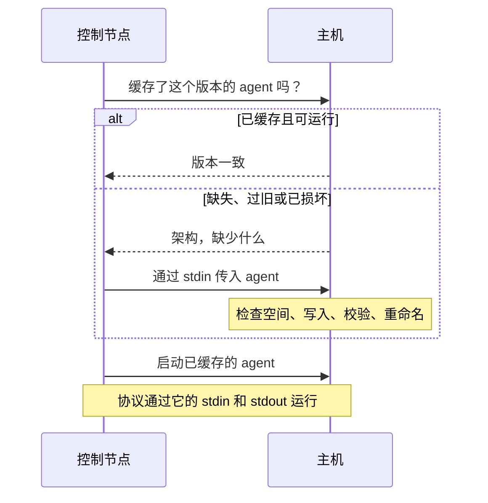

Volant 在每台受管主机上放置一个小型静态程序，即 agent，并在运行的其余时间里通过 `ssh` 与它通信。需要配置什么，见[连接与 become](/zh-cn/docs/hosts/connections/)。本页讲的是底层发生的事：上传、权限检查、共享连接，以及它占用的文件描述符。

## 连接到主机



对已经运行过的主机，检查和启动在同一个 `ssh` 会话里完成：命令检查目录，把缓存的 agent 与本控制端为该主机机器类型准备的构建比较，然后启动它；用 `sudo` 提权的连接用 `sudo -n`。其中任何一步失败，会话会在 agent 应答之前结束，然后按上面的步骤依次进行。

## agent 缓存

agent 是单个静态可执行文件。它面向 x86_64 Linux 的发布压缩包约为 1.2 MB。Volant 为每台主机上传一次，之后的每次运行都复用它。

它位于 `<remote_tmp>/volant-agent-<version>-<uid>/volant-agent`，所以在默认的 `remote_tmp` 下，它位于主目录里的 `~/.ansible/tmp/` 下。路径中的版本是控制节点自己的版本，升级后的控制节点就是靠它避免运行更旧的 agent。uid 是运行 agent 的账户的数字 id，所以共用一个 `remote_tmp` 的登录账户和 `become` 账户各有各的目录。

不提权的 task 以你登录的账户运行 agent，并把它缓存在该账户的主目录里。提权的 task 以 `become_user` 运行 agent，并通过 `sudo` 把它缓存在该用户的主目录里。`become_user` 不是 `root` 时需要这样做，因为主目录的权限常常是 0700，缓存在你登录账户下的 agent 它够不到。一台主机上，运行所用的每个账户各有一份缓存，归该账户所有。

agent 通过 `ssh -C` 传输，所以 OpenSSH 会在链路上压缩它，主机上无需解包任何东西。


### 权限检查

Volant 只会从其他账户都无法修改的目录运行已缓存的 agent。它在探测时、上传之后以及启动之前再各检查一次：

- 目录和程序都不是符号链接。运行 agent 的账户同时拥有两者，且两者都没有组或其他用户的写权限位。
- `remote_tmp` 属于该账户、root，或在 `sudo` 或 `su` 下属于登录的账户。其他账户不能写入，或者它带有粘滞位，就像 `/tmp` 那样。
- 该账户拥有的 `remote_tmp` 可以对其所在的组开放，前提是这个组是该账户自己的主组，比如 umask 为 002 且每个用户一个组的情形。如果上面出现了 ACL 条目（`ls -l` 中权限后面的 `+`），则不可以，因为该条目可能授予其他账户写权限。Volant 只读取权限位，所以不在权限位里的 ACL（NFSv4、ZFS、macOS）它看不到。

任何其他状态都会让该主机停止，并报出 `UNREACHABLE` 错误，指明路径、它的权限和所有者。上传以 `umask 077` 创建文件。如果目录是你的但开放得太宽，上传会清空其中属于 Volant 的文件并重新创建。如果目录属于另一个账户，Volant 不会动它，只是报告。只有同一账户拥有、且没有其他账户能写入的其他版本目录才会被删除。

不存在的 `remote_tmp` 由登录的账户以 0700 权限创建，与 ansible-core 一致，即使提权的 task 先用到它也是如此。这时 root 以外的 `become_user` 进不去：请给这样的账户单独的 `remote_tmp`，或创建一个带粘滞位的共享目录。默认的 `~/.ansible/tmp` 什么都不需要做，因为 `~` 指向每个账户自己的主目录。

这些检查使用 `ls -ldn`，所以不需要 `stat` 的任何选项。Volant 不检查 `remote_tmp` 之上的目录。能替换其中某个目录的账户，仍可以在最后一次检查和 agent 启动之间的短暂时间里替换掉这条路径。

### 上传与修复

每次连接之前，Volant 都会向已缓存的 agent 询问它的版本。版本不匹配、文件缺失或文件无法启动，都会导致重新上传。损坏的缓存，例如被中断的运行截断的副本，会被修复，而不是被报告为错误。

上传时先用 `df` 检查可用空间，要求有两倍 agent 大小再加 1 MB 的空间。它写入一个临时名称，其中包含远程 shell 的进程 ID，核对字节数，然后重命名到位。中途断掉的传输永远不会落到最终名称下，两个同时向同一台主机上传的运行也不会混用对方的字节。

运行过 Python 模块之后，`<remote_tmp>/volant-blobs-<version>-<uid>` 会与 agent 目录并排存在，里面是模块 payload。要清除两份缓存，删除这两个目录即可。不会留下任何其他东西：

```sh
ssh web1 'rm -rf ~/.ansible/tmp/volant-agent-* ~/.ansible/tmp/volant-blobs-*'
```

上传时已经会删除其他版本的缓存目录，所以一台主机上只有一个 agent，而不是一长串历史版本。

## 每台主机一个连接

Volant 为同一台 inventory 主机发起的所有 `ssh` 运行共享同一个 OpenSSH 连接：版本检查、agent 上传、到 agent 的链路和提权链路。Volant 在它的命令行里加上 `-o ControlMaster=auto -o ControlPath=<dir>/<name> -o ControlPersist=30s`，所以只有第一次运行需要付出密钥交换和认证的代价。共享连接会在最后一个会话结束后保持打开 30 秒，在这段时间内开始的运行会复用它。

它还会加上 `ServerAliveInterval=5` 和 `ServerAliveCountMax=3`，这样，主机不再应答的 master 会在约 15 秒后退出，而不是拖住每个新会话。你自己的 `ssh` 参数里的保活设置（任何包含 `serveralive` 的参数）会取代它们。

socket 位于 `$XDG_RUNTIME_DIR/volant-cm`。没有可用的运行时目录时，它们放在 `/tmp/volant-cm-<uid>`，以 0700 权限创建。能在那里创建 socket 的人，可以给你的下一个 `ssh` 塞进一个他们自己的连接，所以不属于你、或权限不是 0700 的目录会被拒绝。这时运行会输出 `[WARNING]: ssh connections are not shared` 和原因，并继续运行，每次运行使用一个连接。

socket 名称是 inventory 名称、主机连接时使用的每个 `ssh` 选项，以及 `ssh -G` 从你的配置文件解析出的内容的哈希。所以为某个用户、密钥、端口或 `ProxyJump` 打开的连接，永远不会服务于要求另一个的主机；两次运行之间在 `~/.ssh/config` 中改过的 `HostName` 会得到一个新连接。同一台机器的两个 inventory 别名会得到两个连接，因为让五十个别名共享一个连接，会撞上服务器的 `MaxSessions` 限制。由密码打开的连接永远不会提供给另一次运行。

当你已经自行配置了共享时，Volant 会把共享交给你。在以下情况它什么都不加：

- `ansible_ssh_common_args` 或 `ansible_ssh_extra_args` 提到了 `ControlMaster`、`ControlPath` 或 `ControlPersist`，或者传了 `-S` 或 `-M`；
- 你的 ssh 配置已经为该主机设置了其中之一，以 `ssh -G` 报告的为准；
- `ssh` 参数用 `-v` 要求了调试输出；
- `[volant] ssh_control_master = false` 或 `VOLANT_SSH_CONTROL_MASTER=0`，见[配置](/zh-cn/docs/reference/configuration/#volant-ssh-control-master)。

不能在一个会话里启动（见上文）的提权连接，为 `sudo` 探测多运行一个 `ssh` 会话，需要密码时是两个。开启共享时，这些会话使用同一个连接。

工作由 OpenSSH 完成，所以 `~/.ssh/config`、`Match`、`Include`、`ProxyJump` 和你的 ssh-agent 的生效方式，与它们在 `ansible-playbook` 下完全相同。

## 文件描述符

每个连接是一个独立的 `ssh` 进程，占用控制节点三个文件描述符。有提权时，一次运行可以为每台主机持有两个连接：主机自己的一个，加上一个提权连接。

启动时，Volant 会把自己的打开文件软限制提高到硬限制，上限为 1,048,576。大多数 Linux 系统出厂的硬限制远高于一次运行所需，所以无需做任何事。

:::caution
1024 的硬限制仍会让运行在约 330 个连接、或约 169 台提权主机处停止。这时 `ssh` 不再启动，碰上这种情况的主机会被报告为不可达，尽管它们本身没有任何问题。在 bash 中，`ulimit -n 1024` 会把硬限制和软限制一起调低。
:::

在这样大规模的运行之前，请检查两个限制：

```sh
ulimit -Sn; ulimit -Hn
```
