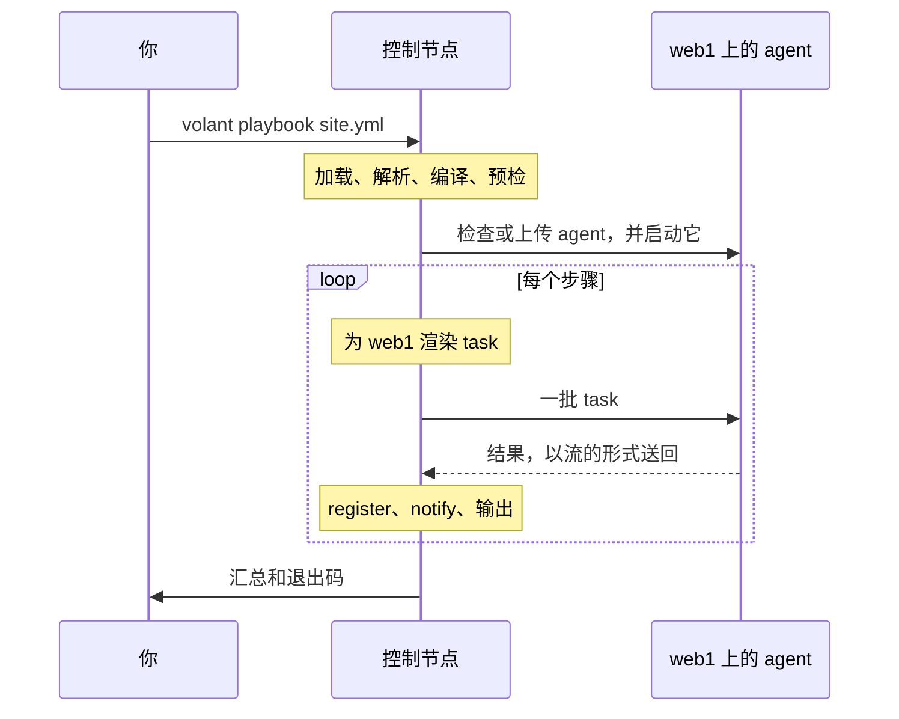

import { LinkCard } from '@astrojs/starlight/components';
import Flow from '../../../../../components/Flow.astro';

Volant 由两个程序和一个协议组成。控制节点运行在你的机器上，负责所有的思考。agent 运行在每台主机上，只做被吩咐的事。

<Flow
  lanes={[
    {
      label: '控制节点',
      note: '在你的机器上，先于任何连接',
      steps: [
        { text: '加载文件' },
        { text: '解析变量' },
        { text: '编译步骤' },
        { text: '预检' },
        { text: '执行器', kind: 'key' },
      ],
    },
    {
      label: '受管主机',
      note: '一个 agent，通过单个 ssh 连接访问',
      steps: [
        { text: 'volant-agent', kind: 'key' },
        { text: '原生模块或预热的 Python 服务' },
        { text: '结果，以流的形式送回' },
      ],
    },
  ]}
/>

## 控制节点

控制节点即 `crates/volant`，读取 `ansible.cfg`、inventory、playbook 和 role。它解析变量，渲染每个模板，并在连接任何主机之前把每个 play 编译成一个扁平的步骤列表。随后[预检](/zh-cn/docs/internals/preflight/)会拦下这个版本尚不支持的一切内容。

执行器为每台主机启动一个驱动，数量受 `forks` 限制。`linear` 策略让各个驱动步调一致。在 `free` 和 `host_pinned` 下，每个驱动按自己的节奏运行；`debug` 是 task 失败后带调试器的 `linear`。驱动带着它的主机走完这些步骤：用该主机的变量渲染每个 task，发给 agent，再判定结果：`register`、`changed_when`、`failed_when`、handler。协调器在同步点把各个驱动拦住，并负责所有输出到终端的内容。

对于 Python 模块，控制节点让一个运行 ansible-core 的辅助进程来构建模块 payload，并把结果缓存起来供以后的运行使用。同一个辅助进程还会运行没有 Rust 版本的过滤器、测试器和 lookup、collection 的 inventory 插件，以及 Volant 桥接的 action plugin，这些 plugin 的作业并行运行。在第一次连接之前，它还会通读整个运行，以决定 agent 是否可以用原生方式收集 facts。见[预热的 Python 路径](/zh-cn/docs/internals/python/)。

同一台 inventory 主机的所有 `ssh` 运行共用一个 OpenSSH 连接，见[连接与 become](/zh-cn/docs/hosts/connections/#每台主机一个连接)。

## Agent

agent 即 `crates/volant-agent`，是一个静态二进制文件，每台主机上传一次并缓存。它的发布压缩包约为 1.2 MB。它接收成批的 task，运行它们，并在每个 task 完成时把结果以流的形式送回。它自己运行 `command`、`shell` 和 `raw`。它还自带 `setup`、`stat`、`file`、`apt`、`systemd`、`lineinfile`、`copy`、`package_facts`、`service_facts`、`user` 和 `group` 的原生版本：参数允许时由它们回答 task，否则交还。其余一切由预热的 Python 服务运行，见[原生模块](/zh-cn/docs/internals/python/#原生模块)。它还会为带 `async` 的 task 启动后台作业，由 `async_status` 读回。在 `ansible_connection: local` 下，agent 是控制节点的子进程，不会运行 `ssh`。它对 playbook、变量和提权一无所知。

## 协议

`crates/volant-protocol` 定义了两个程序共用的帧和消息。控制节点通过 `ssh` 启动 agent，并在运行的其余时间里通过该进程的标准输入和输出使用这个协议通信。帧是 JSON，唯一的例外是：自协议版本 6 起，模块 blob 或暂存文件跟在它的通告之后，以原始字节发送，在压缩后更短时使用 deflate 压缩。当前版本是 8。修改消息意味着要提高 `PROTOCOL_VERSION`，而 agent 的版本是它缓存路径的一部分，所以控制节点永远不会和另一个发布版本的 agent 通信。

一个帧最大为 64 MiB，因为 `slurp` 会把文件作为结果里的一个字符串发送。结果本身也有上限：最多 500,000 个值，嵌套 64 层，`stdout` 和 `stderr` 合计最多 500,000 行（输出每 32 字节折合一行，折合出的行数更大时以它为准）。超出上限的结果只会让该主机的该 task 失败，错误信息会给出上限和实际计数。其他任何消息最大为 1 MiB。

## 一次运行的端到端过程

## play 是如何编译的

你把 play 写成一棵树：各个部分、role、块、task。Volant 在连接任何主机之前，把它一次性压平成一个带编号的步骤列表。然后每台主机都按 ansible-core 运行它的顺序，走这同一个列表：

<Flow
  lanes={[
    {
      steps: [
        { text: 'pre_tasks' },
        { text: '刷新', kind: 'point' },
        { text: 'role，各自排在其依赖之后' },
        { text: 'tasks' },
        { text: '刷新', kind: 'point' },
        { text: 'post_tasks' },
        { text: '刷新', kind: 'point' },
      ],
    },
  ]}
/>

三个 handler 刷新点始终存在。一个 play 到底有没有 handler，要等它的 role 从磁盘读出来才知道，所以编译器把三个都排上。没有可运行内容的刷新不会输出任何东西。

写在 play、role 条目或块上的关键字，会在 play 编译时折叠进它下面的每个 task，最内层的值生效。play 上的 `become: true` 加上某个 task 上的 `become: false`，得到的结果与 Ansible 完全一致，而运行时不必再带着这棵树。

块在压平之后以列表上的区间形式保留下来。一张针对这些区间的小跳转表告诉主机：一个步骤成功、失败或被跳过之后该去哪里。`rescue` 和 `always` 因此如何表现，见[块与 handler](/zh-cn/docs/playbooks/blocks/)。

### 工作发生在哪里

模板渲染发生在控制节点上。每台主机用自己的变量渲染自己的那份 task，渲染后的 task 通过整个运行期间保持打开的连接发给该主机的 agent。agent 运行它，并把结果以流的形式送回。随后控制节点应用 `register`、`changed_when`、`failed_when` 和 `notify`，并输出结果行。

有些模块从不离开控制节点：`debug`、`set_fact`、`assert`、`fail`、`pause`、`include_vars` 和 `validate_argument_spec`。见[模块](/zh-cn/docs/reference/modules/)。

写成 `action: module=ping` 的 task 没有指定任何 action。主机运行到它时，它会在控制节点上失败，退出码为 2，`rescue` 或 `ignore_errors` 可以接住这次失败。

循环在轮到某一项时才渲染该项，所以渲染失败的项只会单独失败。见[循环与重试](/zh-cn/docs/playbooks/loops/#逐项渲染)。

结果行遵循 ansible-core 2.19 的格式。`failed` 和 `skipped` 不会出现在结果里，`fatal:` 行和循环项也一样，因为行首的前缀已经说明了。模块的 `warnings` 会作为 `[WARNING]:` 行输出，而不会进入被 register 的值。失败的 task 会 register `exception: "(traceback unavailable)"`，这一项永远不会出现在结果行里。当 `when` 跳过一个循环的所有项时，每一项的 `skipping:` 行之后会再跟一行该 task 的 `skipping: [host]`，汇总只把这个 task 计一次。

## 设计选择

每个改变用户所见内容的选择，都连同理由一起记录为一份决策记录：

<LinkCard title="决策记录" description="为什么用 GPL、哪些 crate 采用宽松许可证，为什么选择 ansible-core 2.19，become 和批处理如何工作，为什么 Python 路径每次运行用一个压缩包，action plugin 如何运行，以及为什么常用模块以原生方式运行。" href="/zh-cn/docs/decisions/" />

<LinkCard title="代码地图" description="引擎的每个部分在源码树中的位置，面向贡献者。" href="https://github.com/lorica-labs/volant/blob/main/ARCHITECTURE.md" />
