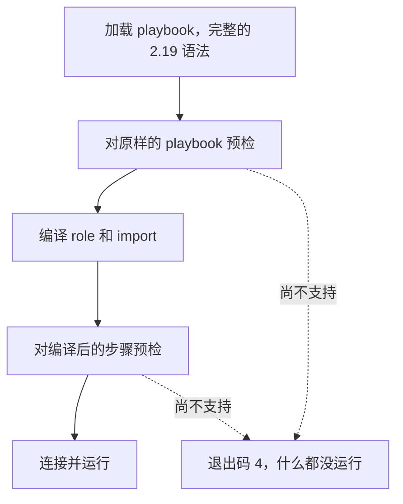

Volant 会读取 ansible-core 2.19 的完整语法，所以一个 playbook 在这里的解析方式与在 Ansible 下一样。随后第二道检查，即预检，会找出加载器接受了、但这个版本尚不支持的一切内容。只要找到，它就逐条指出，并在第一次连接之前、在任何横幅和任何汇总之前停止运行。

没有它，一个同时躲过了前两道检查的关键字会被悄悄忽略，运行会在跳过你要求的内容之后报告成功。

检查运行两次：一次针对原样的 playbook，一次针对编译后的步骤。第一遍读取的是原样的 play，所以，即使某个 task 会被 `--tags` 丢弃，只要它用了尚不支持的内容，仍会让运行停止。第二遍读取的是 tag 选择之后编译出的步骤，也是唯一能看到写在 role 或被 import 的文件里的关键字的地方。这样宁可多停，也不少停。块的每一部分都会被检查，包括 `rescue` 和 `always`。

动态 include 带进来的内容，在主机运行到它时才检查。那里被拒绝，会让该主机的这个 include 失败，`rescue` 或 `ignore_errors` 可以接住。见 [role、include 与 import](/zh-cn/docs/playbooks/roles/#动态-include)。

## 目前会拒绝什么

[我的 playbook 能运行吗？](/zh-cn/docs/start/compatibility/#目前会拒绝什么)列出了检查所拒绝内容的表格，包括每一项的信息和退出码。

## 退出码

被预检停下的运行以退出码 4 退出，Ansible 对无法加载的 playbook 也用这个码。有些情况沿用实测得到的 Ansible 所用的退出码：

| 情况 | 退出码 |
|---|---|
| 这个版本尚不支持的任何内容 | 4 |
| `roles:` 或 `import_role` 找不到的 role | 1 |
| 这个版本尚不支持的提权方式 | 2 |

有三种情况不再属于预检。它们和在 ansible-core 里一样，在 task 运行到时才失败：

- 未知的 `meta` action 会先输出它的横幅，然后输出 `invalid meta action requested: <action>` 并以 1 退出，无论它的 `when` 怎么写。
- 指向不存在的 handler 的 `notify`，会在 task 报告 `changed` 时让运行以退出码 1 结束。见 [Handler](/zh-cn/docs/playbooks/blocks/#与-ansible-的差异)。
- 对一个 task 文件无法加载的 role 做 `include_role`，会先运行它之前的 play 和 task，然后在该语句的横幅之后以退出码 4 结束。include 上的 `when: false` 会把这次失败藏起来。

[退出码](/zh-cn/docs/reference/exit-codes/)列出了 Volant 使用的每个退出码。

列表输出和 `--syntax-check` 从不调用预检，所以你可以在能运行某个 playbook 的版本发布之前，先读一读它。

## 与 Ansible 的差异

- `tags` 和 `timeout` 在检查它们的值之前就被检查，所以 `tags: 3` 得不到 Ansible 的类型错误。
- 不是控制节点的 ansible-core 中任何 lookup plugin 的 `with_<name>`，会以 ansible-core 的原话被拒绝：`'with_xyz' is not a valid attribute for a Task`。在 play 运行期间由 `include_tasks` 或 `include_role` 读取的文件里，是运行到它的主机的 include 失败，play 不会以退出码 4 停止。
- 对于这个版本尚不支持的模块，参数不会被解析，所以错误是关于模块的，而不是关于下一行的某个 `key=value`。
- `gather_facts`、`ignore_errors` 和 `become` 写成 true 或 false 以外的值时，会在 playbook 加载时被拒绝，比 Ansible 拒绝它们早一步，信息和退出码与 ansible-core 一致。模板不会被拒绝：`ignore_errors: "{{ ... }}"` 在 task 运行时渲染，对每个循环项分别渲染，而[可使用模板的关键字](/zh-cn/docs/playbooks/how-a-play-runs/#可使用模板的关键字)会在同一时刻为每台主机渲染。play 的 `gather_facts` 和 `force_handlers` 在 play 开始时渲染。它们全都按 ansible-core 的规则读取，取不了的值会让 task 失败，对后两者则是让 play 停止，信息与 ansible-core 一致。
