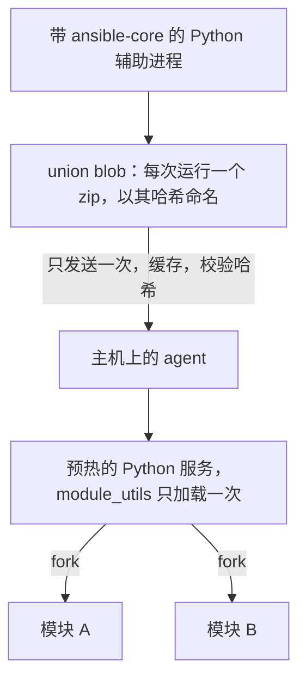

import { Aside } from '@astrojs/starlight/components';
import BarChart from '../../../../../components/BarChart.astro';

大多数 Ansible 模块都是 Python 程序。Volant 原样运行它们，但不会为每个 task 启动新的解释器。对于最常用的模块，它往往根本不运行 Python：agent 自带[原生版本](#原生模块)，在 task 的参数允许时直接回答。

## 工作原理



1. 控制节点让一个辅助进程为本次运行需要的每个模块构建 ansible-core 的 payload，除非[缓存](#union-缓存)里已经有结果。
2. Volant 把它们合并成一个 zip，即 union blob，其中包含它们导入的每个 `module_utils` 文件。blob 以其内容的 BLAKE3 哈希命名。
3. blob 只向每台主机发送一次，并缓存在那里。agent 在使用之前会校验哈希，已经有它的主机什么都不会收到。
4. 控制端发送 payload 之后，agent 立即启动一个 Python 服务，此时第一个需要 Python 的 task 之前的那些 task 仍在运行。每个解释器、payload 和 task `environment` 中解释器启动时读取的部分（`PYTHON*`、`LD_*`、区域设置、`TZ`、`HOME` 和临时目录）的组合保持一个服务；其余变量由子进程在模块运行前设置。每个目标用户有自己的 agent。服务从 blob 中加载一次共享代码，然后为每个 task fork 一个子进程。子进程运行模块，并通过管道把它的 JSON 结果写回。子进程运行期间，服务会把该模块导入自己，所以同一个模块的下一个子进程启动时它已经加载好了。

union 在第一次连接之前构建，所以它必须包含主机可能用到的每个模块。它带有 play 指名的模块、参与 play 的 role 的每个 task 和 handler 文件里的模块（包括其 `meta/main.yml` 依赖），以及 include 按字面指名的任何文件里的模块。只在另一个平台的文件里出现的模块，例如 `setup-Debian.yml` 旁边的 `setup-RedHat.yml`，也在其中，所以 `include_tasks: setup-{{ ansible_os_family }}.yml` 无论主机选了哪个文件，都能找到它的模块。那里没有任何模块对应的名称会被省略，只有在某台主机真的运行到它时，才会按名称失败。

blob 以原始字节传输，在压缩后更短时使用 deflate 压缩，agent 校验的是解压后字节的哈希。

模块结果是不可信的，永远不会被当作控制节点的模板渲染。见[可信值与不可信值](/zh-cn/docs/variables/templating/#来自主机的值绝不会被当作模板)。与 ansible-core 在控制节点上所做的一样，对于带有 `stdout` 或 `stderr` 但没有 `stdout_lines` 和 `stderr_lines` 的结果，Volant 会补上这两项，按 Python 的 `splitlines()` 规则拆分。

## 每一方需要什么

控制节点需要带 `ansible-core` 的 Python 3。设置了 `VOLANT_PYTHON` 时，Volant 只使用它。否则，它依次尝试它的[托管运行时](/zh-cn/docs/reference/runtime/)、当前激活的虚拟环境，然后是 `PATH` 上的 `python3`。如果其中没有一个有 ansible-core，它就安装托管运行时。

主机需要 Python 3 解释器，但不需要 ansible-core：blob 带着模块和它导入的每个文件。agent 启动时会报告它找到的解释器。

## 实测开销

这些数字来自一台 Python 3.12 的 Ubuntu 24.04 主机，通过 SSH 测得。每个数字都是中位数。

<BarChart
  title="运行一个模块的开销"
  subtitle="Ubuntu 24.04 主机，Python 3.12，通过 SSH，中位数。越短越快。"
  unit="毫秒"
  rows={[
    { label: 'Ansible，默认设置', value: 765 },
    { label: 'Ansible，pipelining', value: 469 },
    { label: 'payload 作为普通进程', value: 340 },
    { label: 'Fork，什么都不预加载', value: 266 },
    { label: 'Fork，已加载 module_utils', value: 12.8, highlight: true, note: 'Volant 的做法' },
  ]}
/>

每个模块的开销随模块所做的工作而变。`apt` 需要 755 毫秒，大部分花在 `dpkg` 上，而 `ping` 只需 12.8 毫秒：预热路径去掉的是开销，而不是工作本身。

把模块作为一个压缩包发送，可以节省 72.7% 的字节，因为它们共用的文件只传输一次。对于 `ping`、`stat`、`file`、`lineinfile` 和 `apt`，这是 631,050 字节，而每个模块一个 zip 是 2,307,982 字节。加载这个压缩包需要 264.5 毫秒，每个服务一次。

[决策记录 0006](/zh-cn/docs/decisions/0006-warm-python-path/)有推理过程和一次完整 playbook 上的测量。

## 来自 collection 的模块

来自已安装 collection 的模块，例如 `ansible.posix.sysctl` 或 `community.general.ufw`，和内置模块一样在预热的 Python 路径上运行。

### 名称如何被解析

在第一次连接之前，Volant 会询问控制节点的 ansible-core，每个带点的名称是什么。ansible-core 在它所配置的 collection 路径中查找，例如 `ANSIBLE_COLLECTIONS_PATH`，然后是托管运行时的 `collections/` 目录，`volant runtime install --collections` 会把 collection 放在那里。Volant 在运行期间不安装任何东西，也不会为了回答而去获取任何东西。

`ansible.builtin` 和 `ansible.legacy` 之外的名称会得到五种回答之一：

| ansible-core 找到什么 | Volant 怎么做 |
|---|---|
| 一个它能构建的模块 | 把它加入 union 并运行 |
| 一个它所在 collection 通过 action plugin 运行的模块，无论是直接的还是通过 `runtime.yml` 路由的 | 在 Python 辅助进程中运行该 action plugin，作为 ansible-core 自己的 plugin |
| 一个需要 Windows 主机或网络连接的 action plugin | 停止运行：该模块需要它所在 collection 的 action plugin，这个版本不运行 |
| 没有这个名称的模块 | 停止运行，并给出参照版本的原句 |
| 一个它无法运行的模块：已被移除、仅限 PowerShell，或构建失败 | 停止运行，并给出原因 |

在 union 里，内置模块保留它的短名称，collection 模块以完整名称为键。各自带有名为 `sysctl` 的模块的两个 collection 不会混在一起，`community.general.command` 也永远不会被误认为 `command`。

collection 模块写成字符串的参数（`ansible.posix.sysctl: name=net.ipv4.ip_forward value=1`），会按 ansible-core 的 `parse_kv` 拆分方式拆成 `key=value` 对。

### 拒绝

拒绝发生在第一次连接之前，退出码为 4：

```text
task 'Forward': couldn't resolve module/action 'ns.coll.mod'. This often indicates a misspelling, missing collection, or incorrect module path. The collection 'ns.coll' is not installed on the controller: install it with volant runtime install --collections ns.coll
task 'Forward': module 'ns.coll.mod' cannot run: <reason>
```

只有 collection 本身缺失时才会出现安装提示。已安装的 collection 中缺少某个模块时，只会得到第一句。`ansible.builtin.nosuch` 也只会得到第一句，因为没有任何 collection 能提供 ansible-core 所拥有的命名空间里的名称。控制节点上没有 ansible-core 时，`ansible.builtin` 之外的名称会被拒绝，同样是第一句，外加无法查找的原因。

只在 role 的另一个平台文件里指名的 collection 模块也会被解析。能构建的就加入 union。其他任何情况都会被省略而不让运行停止，运行到它的 include 会在文件的任何 task 运行之前，让该主机的这个 include 失败：

```text
task 'Forward': module 'ansible.posix.sysctl' was not resolved to a module before the run, so no payload holds it: its collection is not installed on the controller, no module path holds it, or it is named only in a file nothing read before the first connection
```

## 由 action plugin 支持的模块

有些 ansible-core 模块只有与先在控制节点上运行的 action plugin 配合才能工作。`package` 选择主机的包管理器，`service` 选择它的初始化系统，`template` 在发送任何东西之前先在控制节点上渲染文件。不带 plugin 就发送这些模块，做出来的事会和 playbook 的要求不同。

Volant 有其中八个 plugin 的自有版本：`copy`、`dnf`、`fetch`、`package`、`reboot`、`service`、`template` 和 `unarchive` 在控制节点上作为一小串子 task 运行，每个子 task 是一个普通的 Python 模块，或经主机现有连接发送的一条裸命令。每一个的细节见 [Action plugin](/zh-cn/docs/internals/action-plugins/)。其他 plugin，例如 `uri` 和 `script` 的，在辅助进程中作为 ansible-core 自己的 Python 运行。

`assert`、`fail` 和 `pause` 也有 action plugin，但它们都不调用模块，所以 Volant 在控制节点上运行它们。`setup` 作为普通模块运行，原生的或 Python 的，所以 facts 收集可以工作。

## union 缓存

构建 union 需要一次 Python 启动、一次 ansible-core 导入，以及每个模块的一次构建。ansible-core 会读取模块导入的每个 `module_utils` 文件，而同一次运行的模块大多共用这些文件，所以 helper 在整个 union 中每个文件只读一次：在[性能页面](/zh-cn/docs/project/performance/)的四个 Galaxy role 上需要 1.5 到 1.8 秒，而每个模块各自重读时需要 3.7 到 4.4 秒。控制节点把结果保存在 `$XDG_CACHE_HOME/volant/unions/` 或 `~/.cache/volant/unions/` 下，该目录只属于你的账户。

查找条目所依据的是构建读取的、不是文件的一切内容：Volant 版本、解释器、被要求的模块和 collection、`ANSIBLE_*` 和 `PYTHON*` 环境、ansible-core 会读取的 `ansible.cfg`，以及工作目录。它还列出辅助进程读取的每个源文件，连同大小和修改时间。只有这些文件都没变、且 zip 仍与记录的哈希一致时，一次运行才会复用该条目。所以就地升级 ansible-core 或某个 collection 会重新构建 union。

无法读取、已损坏或无法写入的缓存永远不会让运行失败：union 会重新构建，无法写入的目录每次运行输出一条警告。缓存最多保存 1 GiB。超出时，最久没有被任何运行使用的条目最先删除；30 天内没有被任何运行使用的条目也会被删除。要清除它，删除该目录即可。

## 原生模块

agent 自带这些模块的 Rust 版本：

| 模块 | 在以下情况原生回答 |
|---|---|
| `setup` | 在 Debian 和 Ubuntu 上，针对[原生 facts](/zh-cn/docs/variables/precedence/#原生-facts)下列出的 facts |
| `stat` | 路径是普通的绝对路径，且校验和是 SHA-1 |
| `file` | `state` 是 `file`、`directory` 或 `absent`，或者未设置；路径上还没有任何东西，或链接已存在且指向 `src` 时，也包括 `link` |
| `apt` | 包按精确名称给出、不带版本：缓存是新的、包都已安装或都已不存在时只读取；缓存过期时执行更新，缺少的包用与模块相同的 `apt-get` 命令安装，任务设置了 `policy_rc_d` 时在其下安装；标记为自动安装的包会像模块那样被标记为手动安装 |
| `systemd`、`systemd_service` | 系统范围内的 `name`、`state`、`enabled` 和 `daemon_reload` |
| `lineinfile` | 正则表达式在 Rust 中与在 Python 中含义相同，且 `backrefs` 关闭 |
| `copy` | `copy` action plugin 运行的那个模块，针对从控制节点暂存的文件 |
| `package_facts` | 包管理器是 apt，且每个包都处于稳定状态 |
| `service_facts` | 主机运行 systemd |
| `user`、`group` | 在 Debian 和 Ubuntu 上，针对常用参数 |

此外的一切都交给 ansible-core 的 Python 模块。task 的 `environment`、SELinux、扩展属性、`remote_src`、只有 Python 才懂的正则表达式，或装了一半的包，以及其他情况，都会交还。`dnf` 和其他所有模块总是在 Python 中运行。

原生模块接收的参数，就是 Python 模块本来会接收的参数。它先通过只读来判断，自己能否给出参照模块会给出的答案。如果不能，它会在接触主机之前就把 task 交还，由 Python 模块来做真正的工作。它的结果，包括 `invocation`，就是参照模块返回的那一个，逐键一致，并且有测试对它覆盖的每种情形做比较。结果作为不可信数据回来，走的路径与 Python 模块的相同。

如果主机的配置关闭了 apt 的软件包缓存（Docker 的 Debian 和 Ubuntu 镜像就是这样），apt 每次调用都会从软件包列表重新构建缓存：在 Ubuntu 24.04 上每次 1.3 秒。这时原生 `apt` 会让它对 `apt-get`、`apt-cache` 和 `apt-mark` 的调用使用连接自己目录中的缓存，连接结束时删除。它们的输出以及留在主机上的内容都不变。

设置 `[volant] native_modules = false` 或 `VOLANT_NATIVE_MODULES=0`，可以把每个 task 都发给 Python。`--profile` 会显示每个 task 走了哪条路径，对于交还的情形还会给出原因。见[命令行](/zh-cn/docs/reference/cli/#运行与输出)。

<Aside type="note">
[模块参考](/zh-cn/docs/reference/modules/)始终列出当前版本所运行的内容，因为它是由引擎自己的表生成的。
</Aside>
